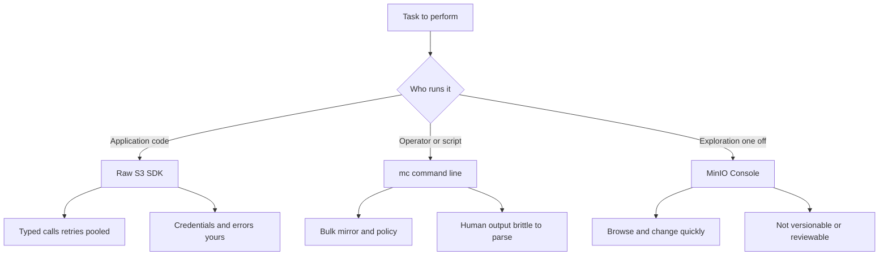

# Choosing a Client: Raw S3 SDK, mc, or the Console, and When Each Is Right

## English

There are three main ways to talk to MinIO, and they serve different jobs. The raw S3 SDK (AWS SDK for Python, Go, Java, JavaScript, and so on) is the choice for application code. It gives you typed calls, retries, connection pooling, and the ability to control every request detail — multipart thresholds, checksum headers, presigned URL generation. If your program needs to store or fetch objects as part of its logic, the SDK is the right tool, because it lives inside your process and can be tested with the same unit-test harness as the rest of your code. The cost is that you must handle credentials, endpoint configuration, and error mapping yourself.

The mc command-line client is the choice for operators and scripts. It is designed for human-readable output and bulk operations: mirroring a directory tree to a bucket, listing buckets with sizes, setting policies, configuring replication, running admin diagnostics. Commands like mc mirror and mc cp handle recursion and parallelism in ways that are tedious to reimplement with an SDK. The trade-off is that mc is a separate binary and its output format is meant for humans, so parsing it in automation is brittle; for machine-driven workflows, prefer the SDK or the admin API over scraping mc output.

The MinIO Console — the browser UI — is the choice for exploration and one-off tasks. It is excellent for browsing buckets, inspecting object metadata, checking cluster health, and performing a quick policy change while you are looking at the problem. It is a poor choice for anything repeatable, because clicking is not versionable and not reviewable. A useful rule: if you would want a colleague to review the change, it belongs in code or a script, not in the Console. The Console is a window, not a workflow.

A practical pattern is to use all three in layers. During development, use the SDK in your application and the Console to eyeball what your code produced. In CI, use the SDK or a small script with mc for fixtures and cleanup, so tests are reproducible. In operations, use mc and the admin API for scheduled jobs and monitoring, and reserve the Console for incident response and exploration. The layers reinforce each other: the SDK proves the behaviour, mc automates it, and the Console lets you see it when something looks wrong.

One more consideration is credentials and least privilege. Each client should run with the narrowest identity it needs: an application with a service account restricted to its own bucket, an operator with admin rights only on the machines that run admin commands, and the Console logged in with a personal account rather than a shared root credential. Mixing these up — for example, embedding an admin key in an application config — turns a convenience into a security incident waiting to happen. The client you choose is also a decision about blast radius.

## 中文

與 MinIO 溝通主要有三種方式，各自服務不同的工作。原始的 S3 SDK（AWS SDK for Python、Go、Java、JavaScript 等）是應用程式碼的選擇。它給你型別化的呼叫、重試、連線池，以及控制每個請求細節的能力 — 分段上傳門檻、校驗和標頭、預簽章 URL 產生。如果你的程式需要把儲存或取得對象當作邏輯的一部分，SDK 就是正確工具，因為它活在你的行程內，能用與程式其餘部分相同的單元測試框架來測試。代價是你必須自己處理憑證、端點組態與錯誤對應。

mc 命令列客戶端是操作人員與腳本的選擇。它為人類可讀的輸出與批次操作而設計：把目錄樹鏡像到 bucket、列出 bucket 與大小、設定策略、設定複製、執行管理診斷。像 mc mirror 和 mc cp 這類命令以繁瑣的方式處理遞迴與平行化，用 SDK 重新實作很乏味。取捨在於 mc 是獨立二進位檔，其輸出格式是給人看的，所以在自動化中解析它很脆弱；對於機器驅動的工作流程，寧可選擇 SDK 或管理 API，而不是刮取 mc 的輸出。

MinIO Console — 瀏覽器 UI — 是探索與一次性任務的選擇。它非常適合瀏覽 bucket、檢視對象中繼資料、檢查叢集健康，以及在你正看著問題時做個快速策略變更。它不適合任何可重複的事，因為點擊既不可版本化也不可審查。一條有用的規則：如果你會希望同事審查這項變更，它就該放在程式碼或腳本裡，而不是 Console。Console 是一扇窗，不是一套工作流程。

一個實用的模式是分層使用三者。開發時，在應用程式中用 SDK，並用 Console 瞄一眼你的程式產出了什麼。在 CI 中，用 SDK 或搭配 mc 的小腳本做測試資料與清理，讓測試可重現。營運時，用 mc 與管理 API 做排程工作與監控，並把 Console 留給事故應變與探索。這些層次互相強化：SDK 證明行為，mc 將其自動化，而 Console 讓你在事情看起來不對時看見它。

還有一個考量是憑證與最小權限。每個客戶端都應以其所需的最窄身分執行：應用程式用僅限自己 bucket 的服務帳戶，操作人員只在執行管理命令的機器上擁有管理權限，而 Console 以個人帳戶登入而非共享的根憑證。把這些混在一起 — 例如把管理金鑰嵌進應用程式組態 — 會把便利變成隨時可能發生的安全事故。你選擇的客戶端，同時也是關於爆炸半徑的決定。

## Key Takeaway

Use the SDK for application logic, mc for automation, and the Console for exploration — and give each the narrowest credentials it needs.

## Related Concepts
- Least-privilege service accounts
- mc mirror for bulk operations

## Diagram

