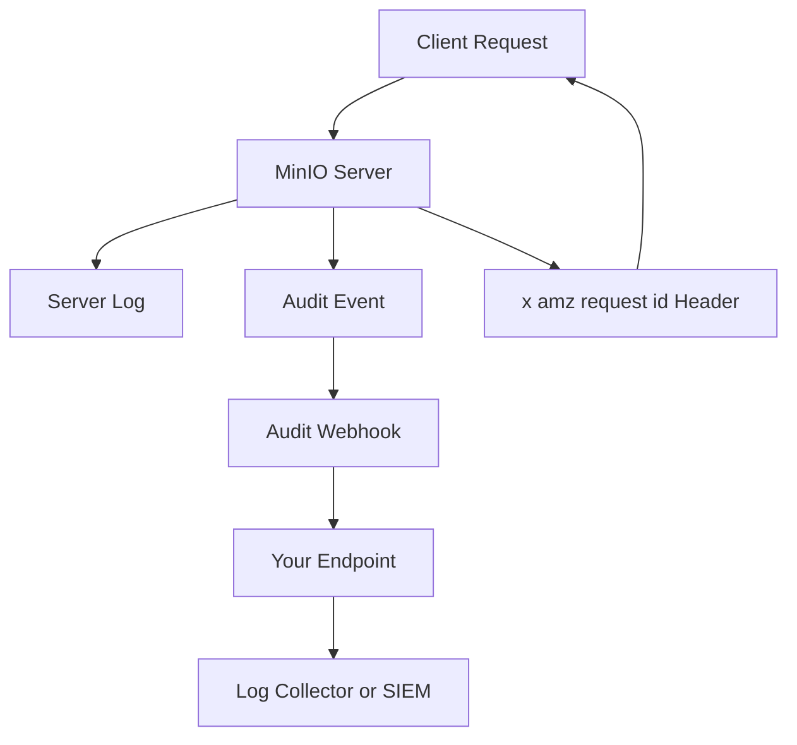

# MinIO's Audit Trail: Who Did What, and How to Read It Back

## English

Every request that reaches a MinIO server can be logged twice, in two very different ways, and knowing which is which saves hours of debugging. The first is the server log (stderr, or a file if you redirect it), which records what the process itself is doing: startup, drive errors, healing progress, and internal warnings. The second is the audit log, which records what a client asked for: the API call, the bucket and object, the identity that made it, the response status, and timing. Audit logging is configured through the `audit_webhook` target in the server configuration, so the output is a stream of JSON events pushed to an HTTP endpoint you control — a log collector, a SIEM, or a simple listener that appends to a file. Because it is a webhook rather than a file, MinIO does not keep the audit trail itself; if your endpoint is down, those events are lost.

A single audit event is dense but readable once you know the fields. You will see entries like `api` (the S3 operation, for example `PutObject` or `ListObjectsV2`), `bucket`, `object`, `requestID`, `remotehost`, `userAgent`, and a `responseStatus` such as `200 OK` or `403 Forbidden`. The `requestID` is the important one: it also appears in the response header `x-amz-request-id`, so a client that reports a failure can hand you that ID and you can grep the audit stream for the exact request. Without it, a busy cluster produces thousands of near-identical lines and you cannot tell which one was yours.

The audit stream is not the same as the metrics endpoint. Metrics tell you aggregate health — request rate, error counts, bytes in and out — while audit tells you individual intent. If someone asks 'did this object ever get deleted, and by whom', metrics cannot answer; only the audit trail can, and only if you were capturing it at the time. This is why audit logging belongs in the design phase, not the incident phase. A common pattern is to point the `audit_webhook` at a small sidecar or a log shipper that batches events into durable storage, because the volume on a busy cluster can be substantial — every `GET`, `HEAD`, and `LIST` is an event.

There are practical limits worth knowing. Audit events are emitted asynchronously, so a burst of traffic can queue them; if the webhook endpoint is slow, MinIO may drop events rather than block the data path, which is the correct trade-off for a storage system but means your audit trail is best-effort, not transactional. Also, audit logging records the identity as MinIO sees it after authentication — an access key, or a derived name for a service account — so correlating an event back to a human depends on how you issued credentials in the first place. If everyone shares one root credential, the audit trail tells you nothing about who did it.

A sensible operating habit is to treat the audit stream as a security control with its own retention policy. Keep events long enough to cover your investigation window, protect the collector with the same care as the storage cluster, and alert on patterns rather than single lines: a spike in `403` responses from one remote host suggests credential probing, and a burst of `DeleteObject` calls outside a known job window is worth a page. The audit trail is not glamorous, but it is the difference between knowing what happened and guessing.

## 中文

每一個到達 MinIO 伺服器的請求，都可以用兩種截然不同的方式被記錄下來，分清楚兩者可以省下大量排錯時間。第一種是伺服器日誌（stderr，或你重新導向的檔案），記錄的是行程本身在做什麼：啟動、硬碟錯誤、修復進度、內部警告。第二種是稽核日誌（audit log），記錄的是客戶端要求了什麼：API 呼叫、bucket 與 object、發出請求的身分、回應狀態與耗時。稽核日誌是透過伺服器設定中的 `audit_webhook` target 來配置，所以輸出是一連串 JSON 事件，推送到你控制的 HTTP 端點——可以是日誌收集器、SIEM，或是一個簡單的監聽程式把事件附加到檔案。正因為它是 webhook 而非檔案，MinIO 本身不儲存稽核軌跡；如果你的端點掛了，那些事件就永遠消失了。

單一稽核事件資訊密集但可讀，只要你知道各欄位的意義。你會看到 `api`（S3 操作，例如 `PutObject` 或 `ListObjectsV2`）、`bucket`、`object`、`requestID`、`remotehost`、`userAgent`，以及 `responseStatus` 例如 `200 OK` 或 `403 Forbidden`。其中最重要的是 `requestID`：它同時出現在回應標頭 `x-amz-request-id` 中，所以當客戶端回報失敗時，可以把那個 ID 交給你，你就能在稽核串流中精準搜出那一筆請求。沒有它，忙碌的叢集會產生成千上萬行幾乎相同的紀錄，你根本分不出哪一筆是你的。

稽核串流不等同於 metrics 端點。Metrics 告訴你整體健康狀況——請求速率、錯誤計數、進出位元組——而稽核告訴你個別意圖。如果有人問「這個 object 到底有沒有被刪除、是誰刪的」，metrics 答不出來；只有稽核軌跡能回答，而且前提是你當時有在收集。這就是為什麼稽核日誌屬於設計階段，而不是事故發生後才補。常見做法是把 `audit_webhook` 指向一個小型的 sidecar 或日誌轉發器，把事件批次寫進耐久儲存，因為忙碌叢集的量可能相當可觀——每一個 `GET`、`HEAD`、`LIST` 都是一筆事件。

有幾個實務限制值得知道。稽核事件是非同步發出的，所以流量暴增時會排隊；如果 webhook 端點太慢，MinIO 寧可丟棄事件也不會阻塞資料路徑，這對儲存系統而言是正確的取捨，但也意味著你的稽核軌跡是盡力而為（best-effort），而非交易性保證。此外，稽核日誌記錄的是 MinIO 驗證後所見的身分——一個 access key，或服務帳戶衍生的名稱——所以要把事件對應回真人，取決於你當初怎麼發放憑證。如果所有人共用同一組 root 憑證，稽核軌跡對「是誰做的」一點幫助也沒有。

一個合理的營運習慣，是把稽核串流當成一項有自己保留策略的安全控制。事件要保留得夠久以涵蓋你的調查視窗，收集器要用與儲存叢集同等的心思去保護，並且針對模式而非單行告警：某個遠端主機的 `403` 回應突然暴增，暗示有人在試探憑證；在已知工作時段之外突然大量 `DeleteObject`，值得叫人起床。稽核軌跡不華麗，但它是「知道發生了什麼」與「只能猜」之間的差別。

## Key Takeaway

MinIO does not store its own audit trail — it streams JSON events to a webhook you must run, so audit logging is a design decision, not an incident-time rescue.

## Related Concepts
- Metrics, Audit Logs, and Health Endpoints
- Identity and Access Management

## Diagram

