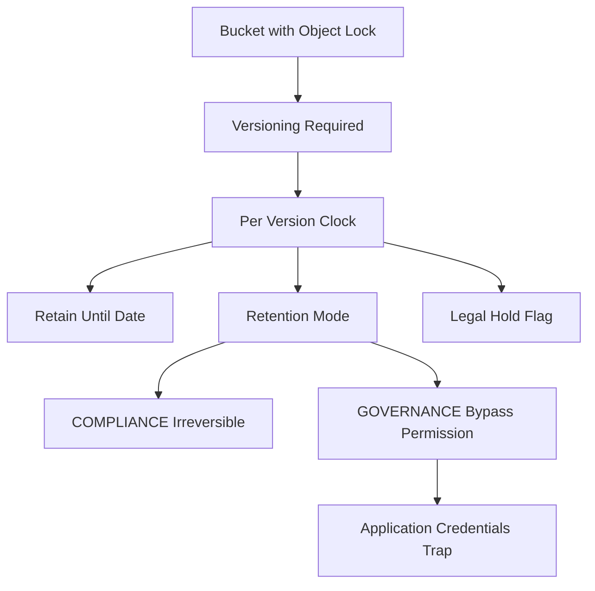

# The Object Lock Clock: Retention Modes, Legal Holds, and the Governance Trap

## English

Object Lock is often described as 'WORM storage', but the mechanism is a clock attached to each object version, and the details of that clock decide whether it protects you or merely inconveniences you. When you create a bucket with object locking enabled, MinIO requires versioning to be on — locking is a property of a specific version, not of a name. Each version can carry a retain-until date and a mode. In COMPLIANCE mode, nobody can delete or overwrite that version before the date passes, not even the root user; the only way out is to wait. In GOVERNANCE mode, the same protection applies to ordinary users, but an identity holding the `s3:BypassGovernanceRetention` permission can shorten or remove the retention. That single permission is the whole difference between a vault and a suggestion.

The practical consequence is that GOVERNANCE mode is a policy problem disguised as a storage setting. If your application's credentials include the bypass permission — which is easy to do accidentally when you attach a broad administrative policy — then your ransomware protection is nominal, because the same credential that writes objects can also strip their protection. A defensible design keeps the bypass permission on a separate, rarely used identity that requires a second person to activate, and gives the application only the ability to set retention, never to bypass it. COMPLIANCE mode needs no such discipline, but it is genuinely irreversible: if you set a ten-year retention on the wrong prefix, you have created ten years of undeletable data, and no support ticket will remove it.

Legal holds are the second mechanism and behave differently from retention. A legal hold is a simple on/off flag on an object version with no expiry date; it blocks deletion until someone explicitly clears it. It exists for the case where you do not know how long you need to keep something — litigation, an investigation, a regulatory request — and you want a human decision, not a timer, to release it. You can have both a retention date and a legal hold on the same version, and the object stays locked until both are satisfied. Mixing them up is a common operational error: people set a legal hold expecting it to expire, or set retention expecting to be able to clear it in a hurry.

There is an important interaction with lifecycle rules. Lifecycle expiration cannot delete an object version that is still under retention or legal hold; the rule simply has no effect on that version until the lock clears. This is usually what you want, but it produces a surprising symptom: a bucket whose lifecycle policy says 'expire after 30 days' keeps growing because objects were written with a one-year retention. The storage does not leak; the policy is being correctly overruled. Diagnosing this requires looking at the object's retention metadata, not at the lifecycle configuration, and it is exactly the kind of thing that confuses people who assume lifecycle always wins.

Finally, remember that object locking is a bucket-creation-time property. You cannot turn it on for an existing bucket later, and you cannot turn it off once enabled. That asymmetry means the decision to enable it should be made deliberately, before the first object lands, and documented — because six months later someone will ask why a bucket cannot be deleted, and the answer will be buried in a creation flag nobody remembers setting.

## 中文

Object Lock 常被描述為「WORM 儲存」，但它的機制其實是綁在每個 object 版本上的一個時鐘，而這個時鐘的細節，決定了它究竟保護你，還是只是讓你麻煩。當你建立一個啟用 object locking 的 bucket 時，MinIO 要求 versioning 必須開啟——鎖定是某個特定版本的屬性，而不是名稱的屬性。每個版本可以帶有一個保留到期日與一個模式。在 COMPLIANCE 模式下，到期日之前任何人都不能刪除或覆寫該版本，連 root 使用者也不行；唯一的出路就是等。在 GOVERNANCE 模式下，同樣的保護適用於一般使用者，但持有 `s3:BypassGovernanceRetention` 權限的身分可以縮短或移除保留期。這一個權限，就是「金庫」與「建議」之間的全部差別。

實務上的後果是：GOVERNANCE 模式其實是一個被包裝成儲存設定的政策問題。如果你的應用程式憑證含有 bypass 權限——當你綁定一個寬鬆的管理策略時，這很容易不小心發生——那麼你的防勒索保護只是名義上的，因為寫入 object 的同一組憑證也能剝奪它的保護。站得住腳的設計，會把 bypass 權限放在另一個獨立、極少使用的身分上，需要第二個人才能啟用，而應用程式只被賦予設定保留期的能力，永遠不能 bypass。COMPLIANCE 模式不需要這種紀律，但它是真正不可逆的：如果你在錯誤的 prefix 上設了十年保留期，你就創造了十年無法刪除的資料，沒有任何支援工單能移除它。

法律保留（legal hold）是第二種機制，行為與保留期不同。法律保留是 object 版本上一個簡單的開／關旗標，沒有到期日；它會阻擋刪除，直到有人明確清除它。它存在的理由，是你不知道需要保留多久的情況——訴訟、調查、監管要求——而你希望由人來決定釋放，而不是由計時器。同一個版本可以同時有保留日期與法律保留，object 會一直鎖住直到兩者都滿足。把兩者搞混是常見的操作錯誤：有人設了法律保留卻以為它會到期，或設了保留期卻以為可以臨時清除。

與生命週期規則有一個重要的互動。生命週期到期無法刪除仍處於保留期或法律保留下的 object 版本；該規則對那個版本根本沒有效果，直到鎖解除為止。這通常正是你要的，但會產生一個令人困惑的症狀：一個生命週期政策寫著「30 天後到期」的 bucket 卻持續長大，因為物件是以一年保留期寫入的。儲存並沒有漏，是政策被正確地否決了。要診斷這件事，得看 object 的保留中繼資料，而不是生命週期設定，而這正是那些假設生命週期永遠最大的人會困惑的地方。

最後，請記住 object locking 是建立 bucket 當下的屬性。你不能對既有的 bucket 事後開啟，一旦啟用也不能關閉。這種不對稱意味著，啟用與否應在第一個 object 落地之前就審慎決定並記錄下來——因為六個月後會有人問為什麼某個 bucket 刪不掉，而答案會埋在一個沒人記得設過的建立旗標裡。

## Key Takeaway

Object Lock is a per-version clock, and GOVERNANCE mode is only as strong as your discipline in keeping the bypass permission away from the credentials that write the data.

## Related Concepts
- Object Lock and Immutability
- Lifecycle Rules and Storage Classes

## Diagram

