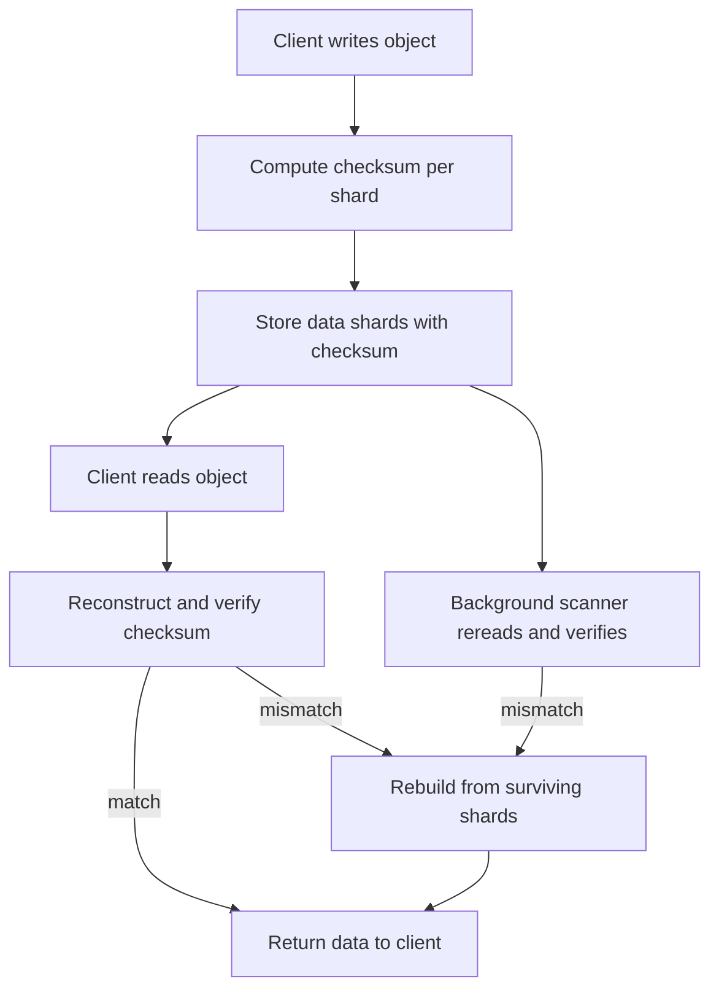

# Bitrot, Checksums, and the Healing Scanner: Proving Data You Never Look At

## English

Object storage is built on an uncomfortable premise: the bytes you wrote are probably still there, but nobody is watching them. Disks develop bad sectors silently, controllers return corrupt data without an error, and memory flips bits. MinIO's answer has two halves — detecting corruption at read time, and scanning for it in the background — and understanding both explains why 'durability' is not the same as 'integrity'.

The first line of defence is the checksum. When MinIO writes an object in erasure-coded form, it computes a hash over the data and stores it alongside the shards; on every read, the reconstructed object is verified against that hash before it is returned to the client. If the hash does not match, MinIO knows the read is bad and can reconstruct from other shards rather than handing you corrupted bytes. This is the crucial difference from a plain filesystem: a filesystem will happily return whatever the disk gave it, because it has no independent notion of what the data should be. The checksum is that independent notion.

The second half is the background scanner, sometimes called the healing scanner. It walks the drives on a schedule, re-reads object data, recomputes checksums, and compares. When it finds a mismatch — a shard that has rotted — it treats that shard as lost and reconstructs it from the surviving shards, writing a fresh copy. This is why MinIO can heal without anyone reading the object: the scanner is the reader. The schedule is configurable, and the trade-off is obvious: scan more often and you detect rot sooner but consume more I/O; scan less often and you may not notice a bad shard until a second failure makes reconstruction impossible.

The subtle point is that checksums protect you only while you have enough surviving shards. If erasure coding is set to tolerate two drive failures and two shards have rotted, the data is still readable and the scanner will repair it. But if three shards are bad, the object is gone — the checksum tells you it is gone, which is better than silently returning garbage, but it cannot bring it back. This is why 'bitrot protection' and 'drive failure tolerance' are the same budget: every rotted shard spends the same redundancy you were saving for a dead disk. A cluster that has been running for years without a drive failure may have quietly spent its margin on rot.

Operationally, the practical lesson is to watch healing activity, not just drive health. Metrics and `mc admin` output can show you whether the scanner is finding and repairing objects; a steady trickle of healed objects is normal and healthy, while a sudden spike suggests something is wrong — a failing controller, bad memory, or a firmware bug. The worst state is a scanner that has been silently disabled or has not completed a pass in months, because then you have no evidence either way. Integrity is not a property you buy once; it is a claim you keep re-proving, and the scanner is how MinIO keeps proving it.

## 中文

物件儲存建立在一個讓人有點不安的前提上：你寫入的位元組大概還在，但沒有人在看著它們。硬碟會默默產生壞軌，控制器會在不報錯的情況下回傳損壞的資料，記憶體會翻轉位元。MinIO 的答案分兩半——讀取時偵測損壞，以及在背景掃描找出損壞——理解這兩半，就能明白為什麼「耐用性」不等於「完整性」。

第一道防線是校驗和（checksum）。當 MinIO 以糾刪碼形式寫入 object 時，會對資料計算雜湊並與 shard 一起儲存；每次讀取時，重建出來的 object 會先與該雜湊比對，通過後才回傳給客戶端。如果雜湊不符，MinIO 就知道這次讀取是壞的，可以從其他 shard 重建，而不是把損壞的位元組交給你。這正是與普通檔案系統的關鍵差別：檔案系統會樂於回傳硬碟給它的任何東西，因為它對「資料應該是什麼」沒有獨立的概念。校驗和就是那個獨立的概念。

第二半是背景掃描器，有時稱為修復掃描器（healing scanner）。它按排程走訪硬碟，重新讀取 object 資料、重算校驗和並比對。當它發現不符——某個 shard 已經腐壞——就把該 shard 視為遺失，從存活的 shard 重建，寫入一份全新的副本。這就是為什麼 MinIO 可以在沒有人讀取該 object 的情況下修復它：掃描器就是那個讀者。排程是可配置的，取捨也很明顯：掃得越勤，越早發現腐壞，但消耗更多 I/O；掃得越少，可能直到第二次故障讓重建變得不可能時，才發現某個 shard 壞了。

微妙之處在於，校驗和只在你還有足夠存活 shard 時才保護得了你。如果糾刪碼設定為可容忍兩顆硬碟故障，而已經有兩個 shard 腐壞，資料仍可讀，掃描器也會修好它。但如果三個 shard 都壞了，object 就沒了——校驗和會告訴你它沒了，這比默默回傳垃圾好，但它救不回來。這就是為什麼「防位元腐壞」與「硬碟故障容忍」其實是同一份預算：每一個腐壞的 shard，花掉的都是你原本為死碟預留的同一份冗餘。一個多年沒遇過硬碟故障的叢集，可能已經悄悄把餘裕花在腐壞上了。

在營運上，實用的教訓是盯修復活動，而不只是硬碟健康。Metrics 與 `mc admin` 的輸出可以顯示掃描器是否在發現並修復 object；穩定而涓涓細流的修復是正常且健康的，突然暴增則暗示有問題——故障的控制器、壞掉的記憶體，或韌體 bug。最糟的狀態是掃描器被默默停用、或已經好幾個月沒跑完一輪，因為那樣你兩邊都沒有證據。完整性不是買一次就有的屬性，而是一個你必須不斷重新證明的宣稱，而掃描器就是 MinIO 不斷證明它的方式。

## Key Takeaway

Checksums detect corruption and the background scanner repairs it, but both spend the same redundancy budget as drive-failure tolerance — rot and dead disks draw from one account.

## Related Concepts
- Erasure Coding
- Bitrot Detection and Healing

## Diagram

