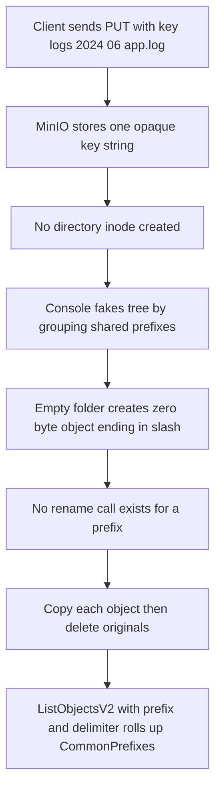

# The Metadata Limit: Why Object Keys Are Not Paths and What That Breaks

## English

In a POSIX file system, a directory is a real thing: it has an inode, its own permissions, and it can be renamed atomically. In MinIO, and in S3 generally, there are no directories at all. A key like `logs/2024/06/app.log` is a single opaque string that happens to contain slashes. The slashes are a convention that clients layer on top, and the `mc ls` command and the Console both fake a tree view by grouping keys that share a prefix. This is why creating an "empty folder" in the Console actually creates a zero-byte object whose key ends in a slash — there is nothing else to create. It is also why renaming a "directory" is not an operation: to move `logs/2024/` to `archive/2024/` you must copy every object individually (or use server-side copy) and then delete the originals, because no single call renames a prefix.

The practical consequence is that prefix operations are the only efficient way to work with groups of keys. A `ListObjectsV2` call with a `prefix` parameter and a `delimiter` of `/` returns two things: the objects whose keys continue past the delimiter (rolled up into `CommonPrefixes`), and the objects that terminate before it. This is how a client draws one level of a folder tree without listing millions of keys. The `delimiter` is not a path separator the server understands — it is just a character the server uses to decide where to truncate keys for grouping. You can pass `delimiter=-` and get "folders" split on hyphens if you want.

Because listing is a scan over a sorted key space, the sort order matters enormously. Keys are returned in lexicographic byte order, not in creation order. If you name objects `1.jpg`, `2.jpg`, ..., `10.jpg`, they will list as `1, 10, 2`, which is almost never what you want. The standard fix is zero-padding or date-based prefixes (`2024/06/01/...`), which also makes time-range queries cheap: a lifecycle rule or a listing scoped to a date prefix touches only the keys in that range. This is the same reasoning behind time-series naming conventions in object stores.

There is a hard limit worth knowing: an object key can be up to 1024 bytes of UTF-8. That sounds generous until you start embedding long user IDs, timestamps, and content hashes. A key that exceeds the limit is rejected at the API layer, and clients that build keys by concatenating arbitrary user input need to validate or hash that input first. Separately, a single `ListObjectsV2` page returns at most 1000 keys, so any code that assumes "list returns everything" will silently lose data once a prefix grows past a thousand objects — you must follow `ContinuationToken` until `IsTruncated` is false.

The mental model to keep: MinIO is a flat sorted map from key string to object, and everything that looks like hierarchy is a client-side or query-side illusion built on prefix matching. Once you internalize that, decisions like "should I put the tenant ID first or the date first in the key" stop being cosmetic and become indexing decisions. The key layout is your only index; there are no secondary indexes and no way to query by metadata or tag without scanning.

## 中文

在 POSIX 檔案系統裡，目錄是一個真實存在的東西：它有 inode、有自己的許可權，而且可以被原子性地重新命名。在 MinIO（以及廣義上的 S3）裡，根本沒有目錄這回事。像 `logs/2024/06/app.log` 這樣的 key，只是一條恰好含有斜線的不透明字串。斜線是客戶端自行加上去的慣例，`mc ls` 和 Console 都是靠把共享同一字首的 key 分組，來假造出樹狀檢視。這就是為什麼在 Console 裡「建立空資料夾」實際上會建立一個 key 以斜線結尾的零位元組物件——因為根本沒有別的東西可以建立。這也是為什麼重新命名一個「目錄」不是一個操作：要把 `logs/2024/` 搬到 `archive/2024/`，你必須逐個複製每個物件（或使用伺服器端複製）再刪除原物件，因為沒有任何一個呼叫可以重新命名一個字首。

實際後果是：字首操作是處理成群 key 的唯一有效率方式。一個帶有 `prefix` 引數和 `/` 分隔符（`delimiter`）的 `ListObjectsV2` 呼叫會回傳兩樣東西：key 在分隔符之後還有內容的物件（被彙整進 `CommonPrefixes`），以及在分隔符之前就結束的物件。客戶端就是靠這個方式，在不列出幾百萬個 key 的情況下畫出目錄樹的一層。`delimiter` 不是伺服器理解的路徑分隔符——它只是一個字元，伺服器用它來決定在哪裡截斷 key 以便分組。你甚至可以傳 `delimiter=-`，用連字號來切出「資料夾」。

因為列出本質上是對已排序 key 空間的一次掃描，排序順序就至關重要。key 是以字典序的位元組順序回傳，而不是建立順序。如果你把物件命名為 `1.jpg`、`2.jpg`……`10.jpg`，它們會列成 `1, 10, 2`，這幾乎永遠不是你想要的。標準解法是補零或以日期為字首（`2024/06/01/...`），這也讓時間範圍查詢變得便宜：一條生命週期規則或一次限定在日期字首的列出，只會碰到該範圍內的 key。物件儲存裡時間序列命名慣例背後的道理，正是這個。

有一個值得知道的硬限制：物件 key 最多可以是 1024 位元組的 UTF-8。聽起來很寬裕，直到你開始把長使用者 ID、時間戳和內容雜湊塞進去。超過限制的 key 會在 API 層被拒絕，而把任意使用者輸入串接成 key 的客戶端，必須先驗證或雜湊這些輸入。另外，單一 `ListObjectsV2` 分頁最多回傳 1000 個 key，所以任何假設「列出會回傳全部」的程式碼，一旦某個字首長到超過一千個物件，就會無聲無息地漏掉資料——你必須沿著 `ContinuationToken` 一路跟到 `IsTruncated` 為 false 為止。

要記住的心智模型是：MinIO 就是一個從 key 字串對應到物件的扁平有序對映，所有看起來像階層的東西，都是建立在字首比對之上的客戶端或查詢端錯覺。一旦你內化了這一點，像「租戶 ID 該放前面還是日期該放前面」這種決策，就不再是外觀問題，而是索引決策。key 的佈局就是你唯一的索引；沒有二級索引，也沒有辦法不靠掃描就依中繼資料或標籤查詢。

## Key Takeaway

MinIO has no directories: keys are flat sorted strings, slashes are a client-side convention, and your key layout is the only index you will ever get.

## Related Concepts
- Prefix-based listing and delimiters
- Lexicographic key ordering

## Diagram

