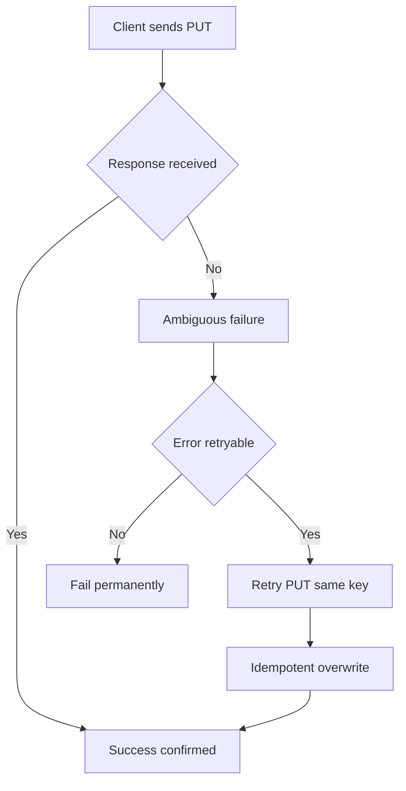

# The Life of a Failed PUT: Retries, Idempotency, and the Ambiguity of Network Errors

## English

A PUT that fails is rarely as simple as "the write did not happen." The most dangerous case is the one where the server succeeded but the response never made it back to the client: the TCP connection dropped after MinIO committed the object, or a load balancer timed out and returned a 504 while the backend was still writing. From the client's point of view this is indistinguishable from a failure, and the naive response — retry the PUT — is only safe because PUT is defined to be idempotent on the same key. A second PUT to `photos/cat.jpg` with the same body simply overwrites the first, producing the same final state. This is why S3 clients default to retrying PUTs but are much more careful with POST-based multipart completion, which is not idempotent in the same way.

Retries are governed by a few knobs that are easy to ignore until they bite. The AWS SDKs (which MinIO's compatibility is designed around) use exponential backoff with jitter, and they only retry on a specific set of conditions: 5xx responses, connection errors, throttling codes like `SlowDown`, and a few transient 4xx codes. A `403 Forbidden` or `400 Bad Request` is never retried, because retrying will not change the answer — a bad signature stays a bad signature. If you are seeing a flood of retries in your logs, the first question is whether the errors are retryable at all, and the second is whether the total retry budget is long enough to outlast a brief MinIO node restart.

Multipart uploads complicate this picture substantially. A large upload is split into parts, each uploaded with its own `UploadPart` call and its own ETag, and the upload only becomes visible when `CompleteMultipartUpload` is called with the list of part numbers and ETags. If a part upload fails, only that part needs to be retried — the others are already durable. But if `CompleteMultipartUpload` itself times out ambiguously, the client may not know whether the object exists. The safe recovery is to retry the completion with the same part list; if the first completion actually succeeded, the second will either succeed again (idempotent) or return `NoSuchUpload`, which tells you the upload was already finalized. Either way you can then `HeadObject` to confirm.

Abandoned multipart uploads are a real operational hazard. If a client crashes mid-upload and never calls `CompleteMultipartUpload` or `AbortMultipartUpload`, the parts sit on disk consuming space and counting against capacity, invisible to a normal `ls`. MinIO exposes them via `mc admin` tooling and the S3 `ListMultipartUploads` API, and the standard defense is a lifecycle rule that aborts incomplete multipart uploads after a fixed number of days. Without that rule, a flaky CI job or a crashed batch processor can quietly accumulate terabytes of orphaned parts over months.

The lesson is that "the write failed" is a statement about the client's knowledge, not about the server's state. Robust code treats every write as potentially-ambiguous, verifies with a `HeadObject` or a checksum comparison when the outcome matters, and relies on idempotency to make retries safe. This is also why content-addressed keys (where the key is a hash of the body) are so attractive: a retry that lands twice produces exactly the same object, and a retry that lands on a different body is immediately detectable.

## 中文

一次失敗的 PUT，很少像「寫入沒有發生」那麼簡單。最危險的情況是伺服器成功了，但回應沒能回到客戶端：TCP 連線在 MinIO 提交物件之後斷掉，或者負載平衡器逾時回傳 504，而後端其實還在寫。從客戶端的角度來看，這和真正的失敗無法區分，而天真的反應——重試這個 PUT——之所以安全，只是因為 PUT 被定義為對同一個 key 具有冪等性。對 `photos/cat.jpg` 用相同內容再 PUT 一次，只會覆寫第一次，產生相同的最終狀態。這就是為什麼 S3 客戶端預設會重試 PUT，但對基於 POST 的 multipart 完成卻謹慎得多，因為後者並不是同樣意義上的冪等。

重試由幾個很容易被忽略、直到出事才後悔的旋鈕控制。AWS SDK（MinIO 的相容性就是圍繞它設計的）使用帶抖動的指數退避，而且只在特定條件下重試：5xx 回應、連線錯誤、像 `SlowDown` 這類限流碼，以及少數暫時性的 4xx 碼。`403 Forbidden` 或 `400 Bad Request` 永遠不會被重試，因為重試不會改變答案——壞掉的簽章還是壞掉的簽章。如果你在日誌裡看到大量重試，第一個問題是這些錯誤到底可不可以重試，第二個問題是總重試預算是否長到足以撐過一次短暫的 MinIO 節點重啟。

Multipart 上傳會大幅複雜化這幅影象。一個大型上傳會被切成多個 part，每個 part 用自己的 `UploadPart` 呼叫上傳、有自己的 ETag，而上傳只有在以 part 編號和 ETag 清單呼叫 `CompleteMultipartUpload` 之後才會變得可見。如果某個 part 上傳失敗，只有那個 part 需要重試——其他的已經持久化了。但如果 `CompleteMultipartUpload` 本身曖昧地逾時，客戶端可能不知道物件到底存不存在。安全的復原方式是用相同的 part 清單重試完成；如果第一次完成其實成功了，第二次要嘛再成功一次（冪等），要嘛回傳 `NoSuchUpload`，告訴你這個上傳已經被定案了。無論哪種，你都可以接著用 `HeadObject` 確認。

被遺棄的 multipart 上傳是實實在在的營運風險。如果客戶端在上傳中途崩潰，從未呼叫 `CompleteMultipartUpload` 或 `AbortMultipartUpload`，那些 part 就會躺在磁碟上佔用空間、計入容量，而且對一般的 `ls` 隱形。MinIO 透過 `mc admin` 工具和 S3 的 `ListMultipartUploads` API 把它們暴露出來，標準防禦是一條在固定天數後中止未完成 multipart 上傳的生命週期規則。沒有那條規則，一個不穩定的 CI 工作或一個崩潰的批次處理器，可以在幾個月內悄悄累積出幾 TB 的孤兒 part。

教訓是：「寫入失敗了」這句話講的是客戶端的知識狀態，而不是伺服器的狀態。強健的程式碼把每一次寫入都視為可能曖昧，在結果要緊時用 `HeadObject` 或校驗和比對來確認，並依賴冪等性讓重試變得安全。這也是為什麼以內容定址的 key（key 就是內容的雜湊）如此吸引人：重試落地兩次會產生完全相同的物件，而重試落地到不同內容則會立刻被偵測到。

## Key Takeaway

A failed PUT is a statement about what the client knows, not what the server did; idempotency and verification are what make retries safe.

## Related Concepts
- Multipart upload completion
- Exponential backoff with jitter

## Diagram

