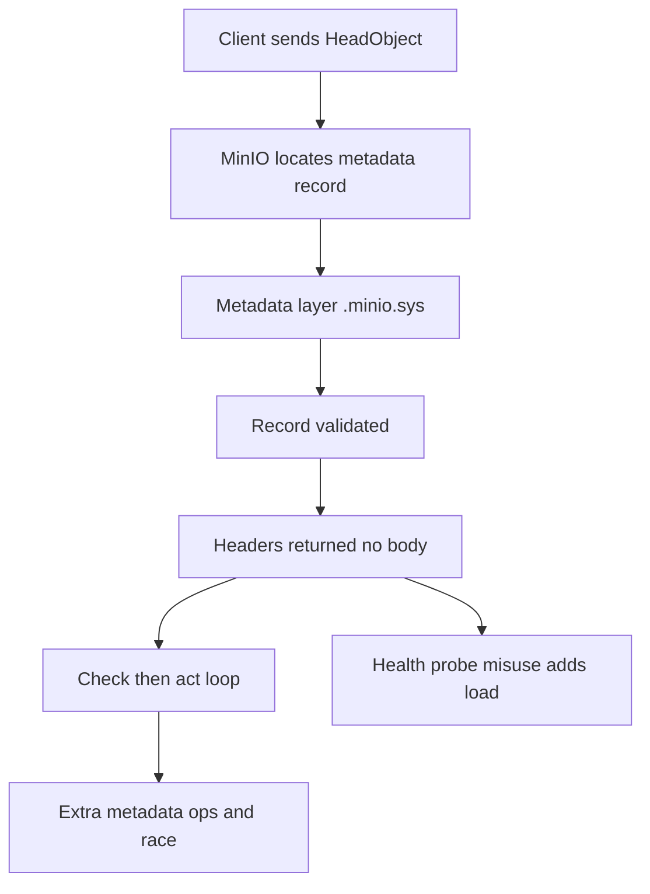

# The Cost of a HEAD: Why Cheap-Looking Metadata Calls Drive Real Load

## English

A `HeadObject` call looks free. It returns no body, just a handful of headers: content length, ETag, last-modified time, content type, and any user metadata. Compared to a GET that streams gigabytes, it seems like a rounding error. But HEAD is not a cache lookup — in MinIO it is a real read of the object's metadata record, which lives in the `.minio.sys` metadata layer, and that record must be located and validated before the response goes out. On a healthy single-node deployment this is microseconds; on a busy distributed cluster with millions of objects, a burst of HEADs from a crawler or a health-check loop can become a meaningful fraction of the cluster's read capacity. The mistake is treating HEAD as if it were free.

The pattern that causes trouble is the "check-then-act" loop. Code that does `HeadObject` to see if an object exists, then GETs it if so, doubles the number of metadata operations and creates a race: the object can vanish between the HEAD and the GET. The same applies to `HeadBucket` used as a liveness probe — a monitoring system that HEADs every bucket every ten seconds is doing real work against the metadata layer, and if the bucket count grows, so does the load. The correct probes for liveness are the dedicated health endpoints, which are designed to be cheap and to reflect cluster state rather than hammering individual buckets.

There is a subtler cost: HEAD responses are not always what you expect. The `Content-Length` header on a HEAD for a multipart-uploaded object is the total object size, but the ETag is not a simple MD5 of the content — it is a digest that encodes the number of parts, conventionally written with a `-N` suffix. Code that compares a HEAD ETag to a locally computed MD5 will mismatch on every multipart object, which is a classic source of "corruption" false alarms. If you need integrity verification, use the checksum headers (`x-amz-checksum-*`) that MinIO returns when the object was uploaded with one, or compare against the ETag you recorded at upload time rather than recomputing it.

Another trap is using HEAD to poll for completion of an asynchronous process. A pipeline that uploads an object and then HEADs it in a tight loop until it appears will generate thousands of requests per second against a single key, all of which hit the same metadata record and contend with each other. The better pattern is to have the producer signal completion through a queue or a notification event, or to poll with exponential backoff and a cap. If you must poll, poll a listing with a prefix rather than a specific key, and do it at a low frequency — the listing is a scan but it is amortized across many keys.

Finally, remember that HEAD is subject to the same authorization as GET. A HEAD that returns `403` is not a sign the object is missing; it is a sign the caller's policy does not allow `s3:GetObject` on that key. Distinguishing `403` from `404` in your logs is one of the fastest ways to debug "the object is not there" reports, because a surprising number of them turn out to be permission problems wearing a disguise. Treat HEAD as a real API call with real cost, use it deliberately, and prefer event-driven or listing-based patterns when you find yourself calling it in a loop.

## 中文

一個 `HeadObject` 呼叫看起來是免費的。它不回傳 body，只回傳少數幾個標頭：內容長度、ETag、最後修改時間、內容類型，以及任何使用者中繼資料。和一個串流數 GB 的 GET 相比，它看起來像捨入誤差。但 HEAD 不是快取查詢——在 MinIO 裡，它是對物件中繼資料記錄的一次真實讀取，那條記錄住在 `.minio.sys` 中繼資料層，而且在回應送出之前必須被定位和驗證。在健康的單節點部署上，這是微秒級的事；但在一個有幾百萬個物件的繁忙分散式叢集上，來自爬蟲或健康檢查迴圈的一陣 HEAD 爆發，可以佔到叢集讀取容量相當可觀的比例。錯誤就在於把 HEAD 當成免費的。

會造成麻煩的模式是「先檢查再動作」的迴圈。先用 `HeadObject` 看物件在不在、在的話再 GET，會讓中繼資料操作數量加倍，並製造一個競態：物件可能在 HEAD 和 GET 之間消失。同樣的道理適用於把 `HeadBucket` 當成存活探針——一個每十秒對每個 bucket 做一次 HEAD 的監控系統，是在對中繼資料層做真實的工作，而如果 bucket 數量成長，負載也跟著成長。存活探針的正確做法是專用的健康端點，它們被設計成便宜、且反映叢集狀態，而不是猛敲個別 bucket。

還有一個更細微的成本：HEAD 回應不總是如你所料。對一個以 multipart 上傳的物件做 HEAD，`Content-Length` 標頭是物件的總大小，但 ETag 不是內容的簡單 MD5——它是一個編碼了 part 數量的摘要，慣例上寫成帶 `-N` 後綴的形式。把 HEAD 的 ETag 拿來和本地計算的 MD5 相比的程式碼，會在每一個 multipart 物件上不匹配，這是「資料損毀」假警報的經典來源。如果你需要完整性驗證，請使用 MinIO 在物件以校驗和上傳時回傳的校驗和標頭（`x-amz-checksum-*`），或者和你上傳時記錄下來的 ETag 相比，而不是重新計算它。

另一個陷阱是用 HEAD 輪詢非同步程序的完成。一條先上傳物件、然後在緊密迴圈裡 HEAD 它直到它出現的管線，會對單一 key 每秒產生幾千個請求，全部打到同一條中繼資料記錄上並互相競爭。更好的模式是讓生產者透過佇列或通知事件發出完成訊號，或者用帶上限的指數退避來輪詢。如果你非得輪詢，請輪詢一個帶前綴的列出，而不是某個特定 key，並且用低頻率——列出是一次掃描，但它的成本分攤在許多 key 上。

最後，記住 HEAD 和 GET 受同樣的授權管轄。一個回傳 `403` 的 HEAD 不是物件不見了的徵兆，而是呼叫者的策略不允許對那個 key 做 `s3:GetObject` 的徵兆。在日誌裡區分 `403` 和 `404`，是除錯「物件不在那裡」這類回報最快的方法之一，因為其中出乎意料地多，其實是偽裝成遺失的權限問題。把 HEAD 當成一個有真實成本的真實 API 呼叫，刻意地使用它，而當你發現自己在迴圈裡呼叫它時，優先改用事件驅動或以列出為基礎的模式。

## Key Takeaway

HEAD is a real metadata read, not a free existence check; use it deliberately, avoid polling loops, and never assume its ETag is a plain MD5.

## Related Concepts
- The .minio.sys metadata layer
- ETag semantics for multipart objects

## Diagram

