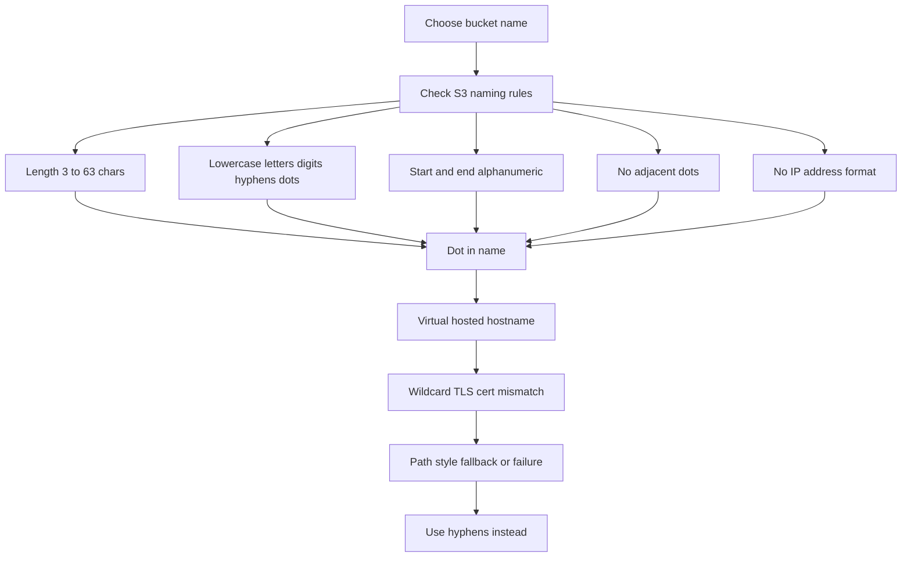

# The Bucket Name Is a Global Address: Naming Rules and the DNS Trap

## English

Before MinIO can store a single byte, you have to name the bucket, and bucket names are not free-form labels. The S3 naming rules that MinIO enforces are strict: 3 to 63 characters, lowercase letters, digits, hyphens and dots only, must start and end with a letter or digit, no two adjacent dots, and no format that looks like an IP address (for example 192.168.1.1 is rejected). The reason for the IP-address rule is subtle and worth understanding: many S3 clients, including the AWS SDKs, will address a bucket in virtual-hosted style, meaning the bucket name becomes a subdomain of the endpoint, like mybucket.s3.example.com. If a bucket were named like an IP address, that URL would be ambiguous, so the rule exists to keep URL construction sane.

The dot is the real trap. Dots are legal in bucket names, but a bucket with a dot cannot be served over HTTPS in virtual-hosted style without breaking TLS. TLS certificates are issued for a specific hostname, and a wildcard certificate for *.example.com does not match a.b.example.com, because wildcards match exactly one label. So a bucket named logs.prod gets a hostname logs.prod.s3.example.com, which a *.s3.example.com certificate will not cover, and the client falls back to path-style addressing (https://s3.example.com/logs.prod/) or fails outright. MinIO supports both addressing styles, but the client's choice is not always yours to control.

This is why the practical convention is to avoid dots entirely and use hyphens. A name like app-logs-prod is unambiguous, safe in any addressing style, and safe in DNS. The lowercase-only rule exists because DNS names are case-insensitive; if MinIO allowed MyBucket and mybucket as distinct buckets, two buckets could resolve to the same hostname, so the rule removes the ambiguity before it can happen. Digits and hyphens keep names readable without introducing case.

There is a second layer: the namespace is per-cluster, not global. On AWS S3, bucket names are globally unique across all AWS accounts, which is why you sometimes cannot get the name you want. On a self-hosted MinIO cluster, uniqueness is only within that deployment. Two different MinIO clusters can both have a bucket called backups. That is convenient, but it means any tooling that assumes globally unique names, or any migration script that copies bucket names between clusters, can collide. It also means you cannot rely on a bucket name alone to identify data across environments; you need the endpoint plus the name.

Finally, remember that the bucket name is baked into every request path and every presigned URL. Renaming a bucket is not an operation MinIO offers; you create a new bucket and copy objects. So the naming decision is effectively permanent. Pick lowercase, hyphenated, environment-prefixed names like prod-app-logs from day one, and you avoid a class of problems that are annoying to fix later.

## 中文

在 MinIO 能儲存任何一個位元組之前，你得先為 bucket 命名，而 bucket 名稱並不是自由填寫的標籤。MinIO 強制執行的 S3 命名規則相當嚴格：長度 3 到 63 個字元，只允許小寫字母、數字、連字號與點號，必須以字母或數字開頭與結尾，不能有連續兩個點，也不能長得像 IP 位址（例如 192.168.1.1 會被拒絕）。IP 位址這條規則背後的理由很微妙，值得理解：許多 S3 客戶端（包括 AWS 的 SDK）會以虛擬主機風格（virtual-hosted style）定址 bucket，也就是 bucket 名稱會變成端點的子網域，例如 mybucket.s3.example.com。如果 bucket 名稱長得像 IP 位址，這個 URL 就會有歧義，所以這條規則的存在是為了讓 URL 建構保持合理。

點號才是真正的陷阱。點號在 bucket 名稱中是合法的，但帶點號的 bucket 無法在虛擬主機風格下以 HTTPS 提供服務而不破壞 TLS。TLS 憑證是為特定主機名簽發的，而 *.example.com 的萬用字元憑證並不匹配 a.b.example.com，因為萬用字元只匹配一個標籤。所以一個名為 logs.prod 的 bucket 會得到 logs.prod.s3.example.com 這個主機名，而 *.s3.example.com 的憑證覆蓋不到它，客戶端就會退回路徑風格定址（https://s3.example.com/logs.prod/）或直接失敗。MinIO 兩種定址風格都支援，但客戶端選哪一種並不總是由你控制。

這就是為什麼實務上的慣例是完全避開點號、改用連字號。像 app-logs-prod 這樣的名稱沒有歧義、在任何定址風格下都安全、在 DNS 中也安全。只允許小寫這條規則的存在，是因為 DNS 名稱不區分大小寫；如果 MinIO 允許 MyBucket 與 mybucket 是兩個不同的 bucket，兩個 bucket 就會解析到同一個主機名，所以這條規則在歧義發生之前就把它消除了。數字與連字號讓名稱保持可讀，又不會引入大小寫問題。

還有第二層：命名空間是每個叢集各自的，不是全域的。在 AWS S3 上，bucket 名稱在所有 AWS 帳號之間全域唯一，這就是為什麼你有時搶不到想要的名稱。在自架的 MinIO 叢集上，唯一性只限於該部署之內。兩個不同的 MinIO 叢集可以都有一個叫 backups 的 bucket。這很方便，但也意味著任何假設名稱全域唯一的工具，或任何在叢集之間複製 bucket 名稱的遷移腳本，都可能發生碰撞。它也意味著你不能只靠 bucket 名稱來辨識跨環境的資料；你需要端點加上名稱。

最後，記住 bucket 名稱被寫進每一個請求路徑與每一個預簽署 URL 之中。MinIO 並不提供重新命名 bucket 的操作；你只能建立新 bucket 再複製物件。所以命名決策實際上是永久的。從第一天就選用小寫、以連字號連接、帶環境前綴的名稱，例如 prod-app-logs，你就能避開一整類日後修起來很麻煩的問題。

## Key Takeaway

Bucket names are permanent, DNS-sensitive identifiers: stay lowercase and hyphenated, avoid dots, and remember the namespace is per-cluster, not global.

## Related Concepts
- DNS and TLS certificate matching
- S3 virtual-hosted vs path-style addressing

## Diagram

