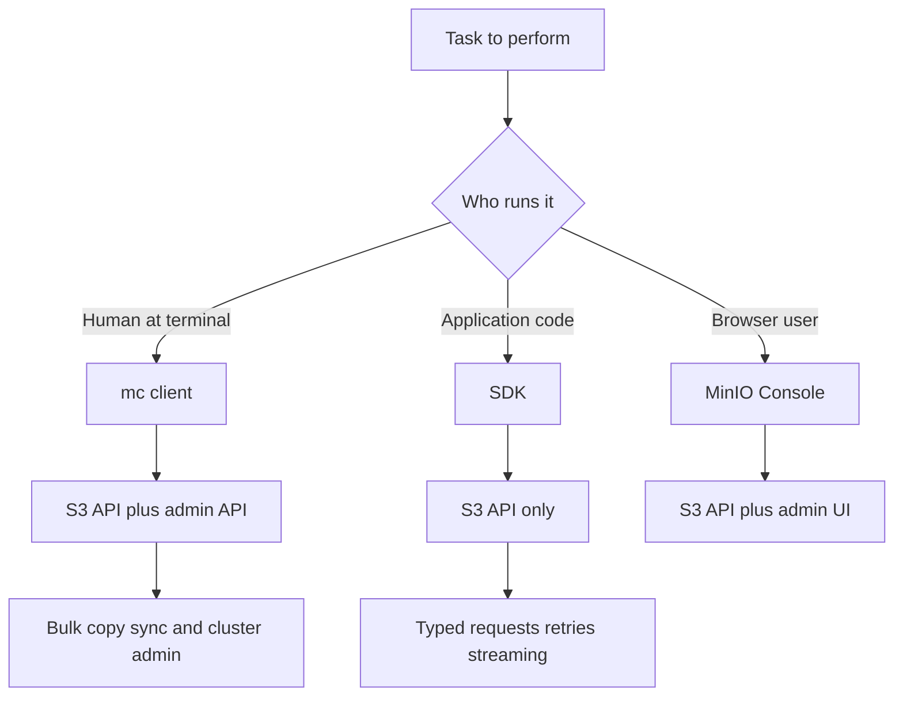

# Choosing the Right Tool for the Job: When to Use mc, an SDK, or the Console

## English

MinIO exposes the same underlying S3 API through at least three very different front doors, and picking the wrong one for a task is a common source of wasted effort. The three are the mc command-line client, a language SDK (the AWS SDK for Go, Python, Java, and so on, pointed at the MinIO endpoint), and the browser-based MinIO Console. They are not interchangeable; each has a shape that fits certain jobs and fights against others.

mc is a shell tool, and its strength is that it behaves like a file utility. Commands like mc cp, mc ls, mc mirror, and mc rm map onto familiar mental models, and mc mirror in particular is the go-to for bulk copying a directory tree into a bucket or syncing two buckets. mc also carries admin subcommands (mc admin info, mc admin heal, mc admin trace) that talk to MinIO's admin API rather than the S3 API, so it can do things no S3 SDK can. The catch is that mc is built for humans at a terminal: scripting it means parsing text output, handling exit codes, and coping with the fact that it was not designed as an embedded library. For anything that runs inside an application, an SDK is usually cleaner.

An SDK is the right choice when MinIO is a dependency of your code rather than a place you poke at by hand. The AWS SDKs work against MinIO because MinIO implements the S3 protocol, but you must configure the endpoint URL explicitly (the SDKs default to AWS regions and endpoints) and usually enable path-style addressing, because MinIO may not have DNS entries for virtual-hosted-style bucket subdomains. Once configured, the SDK gives you typed requests, retries, pagination helpers, and streaming bodies, which is exactly what application code needs. The trade-off is that the SDK only speaks the S3 API; it cannot heal a drive or read cluster health.

The Console is a browser UI, and its value is visibility, not automation. It is excellent for a human to browse buckets, inspect object metadata, edit a bucket policy, or watch a quick metric while debugging. It is a poor fit for repeatable operations because clicking is not scriptable, and it is a poor fit for large transfers because the browser is not a bulk-copy engine. Treat the Console as a window into the cluster, not as a deployment tool.

A useful rule of thumb: use the Console to look, mc to operate the cluster and move bulk data, and an SDK to build features. The boundary is not absolute. A CI pipeline might use mc for fixtures and an SDK for integration tests. But when a task feels awkward, ask whether you are using the wrong door. Copying ten thousand objects with a hand-rolled SDK loop, or trying to script a browser, are both signs that the tool does not match the job.

## 中文

MinIO 透過至少三個截然不同的大門，暴露出同一套底層 S3 API，而為任務挑錯門是浪費精力的常見來源。這三個門是 mc 命令列客戶端、語言 SDK（把 AWS SDK for Go、Python、Java 等指向 MinIO 端點），以及瀏覽器版的 MinIO Console。它們不能互換；每一個都有適合某些工作的形狀，也會與另一些工作相抗。

mc 是 shell 工具，它的強項是行為像檔案工具。mc cp、mc ls、mc mirror、mc rm 這些指令對應到熟悉的心智模型，而 mc mirror 尤其是把整個目錄樹大量複製進 bucket、或在兩個 bucket 之間同步的首選。mc 也帶有管理子指令（mc admin info、mc admin heal、mc admin trace），它們與 MinIO 的管理 API 而非 S3 API 溝通，所以能做到任何 S3 SDK 都做不到的事。陷阱在於 mc 是為終端機前的人類而設計：要把它寫進腳本，就得解析文字輸出、處理結束碼，並應付它並非設計成嵌入式函式庫這件事。對於在應用程式內部執行的任何東西，SDK 通常比較乾淨。

當 MinIO 是你程式碼的依賴、而不是你用手去戳的地方時，SDK 就是正確選擇。AWS 的 SDK 能對 MinIO 運作，是因為 MinIO 實作了 S3 協定，但你必須明確設定端點 URL（SDK 預設指向 AWS 的區域與端點），而且通常要啟用路徑風格定址，因為 MinIO 可能沒有為虛擬主機風格的 bucket 子網域建立 DNS 記錄。設定好之後，SDK 給你型別化的請求、重試、分頁輔助與串流主體，這正是應用程式碼需要的。取捨是 SDK 只會說 S3 API；它無法修復磁碟，也無法讀取叢集健康狀態。

Console 是瀏覽器 UI，它的價值是可見性，不是自動化。對人類來說，它非常適合瀏覽 bucket、檢視物件中介資料、編輯 bucket 策略，或在除錯時快速看一眼指標。它不適合可重複的操作，因為點擊無法腳本化；它也不適合大量傳輸，因為瀏覽器不是大量複製引擎。把 Console 當成窺視叢集的窗戶，而不是部署工具。

一個有用的經驗法則：用 Console 來看，用 mc 來操作叢集與搬運大量資料，用 SDK 來建構功能。界線並非絕對。CI 管線可能用 mc 準備測試資料、用 SDK 跑整合測試。但當某個任務感覺彆扭時，問問自己是不是用錯了門。用親手寫的 SDK 迴圈複製一萬個物件，或試圖腳本化一個瀏覽器，都是工具與工作不匹配的徵兆。

## Key Takeaway

Use the Console to look, mc to operate and bulk-move, and an SDK to build: match the tool's shape to the job instead of forcing one door to do everything.

## Related Concepts
- S3 API vs MinIO admin API
- AWS SDK endpoint and path-style configuration

## Diagram

