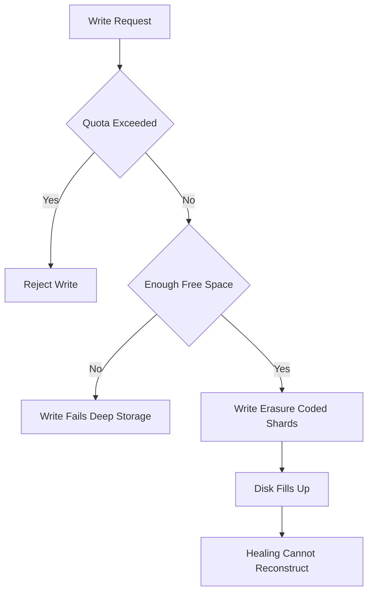

# Quotas and Full Disks: What Actually Happens When Storage Runs Out

## English

Object storage feels infinite until it is not, and the failure mode when a MinIO deployment runs out of space is worth understanding before it happens to you. There are two distinct limits that can bite: a bucket quota, which is a policy you set deliberately, and actual disk exhaustion, which is physics catching up with you. They behave differently, and confusing them leads to bad incident responses.

A bucket quota is a soft ceiling enforced by MinIO at the API layer. When you set a quota on a bucket (via mc quota set or the admin API), MinIO tracks the total size of objects in that bucket and rejects new writes that would exceed it, typically with an error indicating the quota is exceeded. The important subtlety is that a quota is not a reservation: setting a 100 GB quota on a bucket does not set aside 100 GB of disk, and it does not stop other buckets from consuming the same physical space. Quotas are about fairness and predictability between tenants or applications sharing one cluster, not about protecting the disk from total exhaustion. A quota also does not shrink existing data; if you lower a quota below current usage, the bucket stays over quota and new writes fail until you delete objects.

Disk exhaustion is a different beast. MinIO writes objects as erasure-coded shards across drives, so a write needs enough free space on enough drives to place its shards and satisfy the write quorum. As drives fill, writes begin to fail, and the errors can be confusing: a PUT may fail with an internal error or a timeout rather than a clean 'no space' message, because the failure happens deep in the storage layer. Worse, healing and rebalancing also need free space. If you are near full and a drive fails, MinIO may be unable to reconstruct the missing shards because there is nowhere to write them, which turns a single drive failure into data loss. This is why capacity planning should keep headroom, not run at 95 percent.

Operationally, the defenses are layered. Set quotas on buckets that serve noisy tenants so one application cannot starve the others. Monitor free space per drive, not just total capacity, because erasure coding distributes shards and a single full drive can cause failures even when the cluster looks half empty. Alert well before full, and treat a healing backlog as a capacity warning, since healing consumes space. And remember that deleting objects frees space only after MinIO actually removes the shards; versioning and object lock can keep deleted objects around, so a bucket that looks empty may still be holding gigabytes of retained versions.

The mental model: quotas are a contract between users of the cluster, while free disk is a physical resource that every bucket shares. Protect both, but do not mistake one for the other. A cluster with generous quotas and no free space is still down; a cluster with plenty of free space and no quotas is still one runaway job away from an outage.

## 中文

物件儲存感覺無窮無盡，直到它不是為止，而 MinIO 部署空間耗盡時的失敗模式，值得在你遇到之前就先理解。有兩種截然不同的限制會咬你一口：bucket 配額，那是你刻意設定的策略；以及實際的磁碟耗盡，那是物理追上你的結果。兩者行為不同，把它們混為一談會導致糟糕的事故應變。

bucket 配額是 MinIO 在 API 層強制的軟天花板。當你在 bucket 上設定配額（透過 mc quota set 或管理 API），MinIO 會追蹤該 bucket 中物件的總大小，並拒絕會超過上限的新寫入，通常回傳一個表示配額超出的錯誤。重要的微妙之處在於，配額不是預留：在 bucket 上設 100 GB 配額，並不會保留 100 GB 磁碟，也不會阻止其他 bucket 消耗同一塊實體空間。配額是關於共用同一個叢集的租戶或應用之間的公平性與可預測性，不是關於保護磁碟免於徹底耗盡。配額也不會縮小既有資料；如果你把配額降到低於目前用量，bucket 就會一直處於超額狀態，新寫入會失敗，直到你刪除物件為止。

磁碟耗盡是另一種野獸。MinIO 把物件以糾刪碼分片寫到各磁碟上，所以一次寫入需要在足夠多的磁碟上有足夠的可用空間，來放置它的分片並滿足寫入法定人數。當磁碟逐漸填滿，寫入開始失敗，而錯誤可能令人困惑：一個 PUT 可能以內部錯誤或逾時失敗，而不是乾淨的「空間不足」訊息，因為失敗發生在儲存層深處。更糟的是，修復與再平衡也需要可用空間。如果你接近滿載而一顆磁碟故障，MinIO 可能因為無處可寫而無法重建缺失的分片，這就把單一磁碟故障變成資料遺失。這就是為什麼容量規劃應該保留餘裕，而不是跑到 95%。

在營運上，防禦是分層的。對服務吵鬧租戶的 bucket 設定配額，讓一個應用無法餓死其他應用。監控每顆磁碟的可用空間，而不只是總容量，因為糾刪碼會分散分片，即使叢集看起來只用了半滿，單一磁碟滿了也可能造成故障。在滿載之前就發出告警，並把修復積壓視為容量警訊，因為修復會消耗空間。還要記得，刪除物件只有在 MinIO 真正移除分片之後才會釋放空間；版本控制與物件鎖定會讓已刪除的物件繼續存在，所以一個看起來空的 bucket 可能仍持有數 GB 的保留版本。

心智模型是：配額是叢集使用者之間的契約，而可用磁碟是每個 bucket 共享的實體資源。兩者都要保護，但別把一個誤當成另一個。一個配額寬鬆卻沒有可用空間的叢集仍然是掛掉的；一個可用空間充足卻沒有配額的叢集，仍然只差一個失控的工作就停擺。

## Key Takeaway

Quotas are a fairness contract enforced at the API layer, while free disk is a shared physical resource: monitor per-drive headroom and never let a cluster fill up, because healing needs space too.

## Related Concepts
- Erasure coding write quorum
- Bucket versioning and object lock retention

## Diagram

