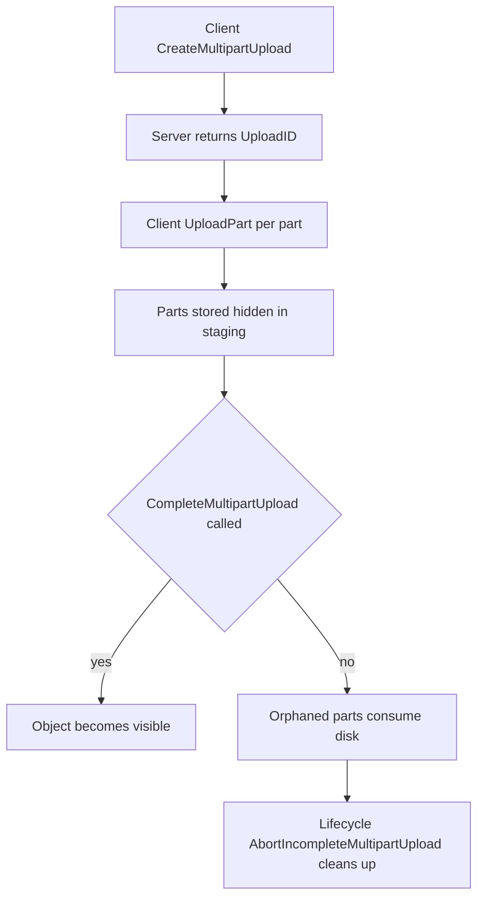

# The Lifecycle of a Multipart Upload That Never Finishes

## English

When a client uploads a large object, the S3 protocol lets it split the object into parts, upload each part independently with UploadPart, and then stitch them together with a final CompleteMultipartUpload call that lists the part numbers and their ETags. Until that final call succeeds, none of the uploaded parts are visible as an object. They sit in a hidden staging area under the bucket, consuming real disk space, but a simple ListObjects will not show them. This is by design: multipart uploads exist so that a flaky network does not force you to restart a 50 GB upload from byte zero. You can retry individual parts, upload them in parallel, and only pay the cost of reassembly at the end.

The operational trap is that clients crash, processes get killed, and CI jobs time out. If a client uploads 40 parts and then dies before calling CompleteMultipartUpload, those 40 parts stay on disk indefinitely. MinIO (like AWS S3) does not automatically clean them up unless you configure a lifecycle rule. Over months, a busy bucket can accumulate terabytes of orphaned parts that never appear in any listing and never get billed to any obvious owner. The fix is a lifecycle rule with AbortIncompleteMultipartUpload, typically set to expire after a few days. That rule tells the server: if an upload has not been completed within N days of being initiated, delete all its parts.

You can inspect in-progress uploads with the mc command line: `mc ls --incomplete myminio/mybucket` lists unfinished uploads, and `mc rm --incomplete` or the equivalent admin command lets you abort them manually. Under the hood, each multipart upload is tracked by an upload ID, which the server returns from CreateMultipartUpload. Every UploadPart call references that ID and a part number. Part numbers must be between 1 and 10000, and each part except the last must be at least 5 MiB. Those constraints are not arbitrary: they bound the server's bookkeeping and ensure that a single part is large enough that the overhead of per-part metadata does not dominate.

A subtle consequence is that the ETag of a multipart object is not a simple MD5 of the object contents. Historically it was computed as an MD5 of the concatenated MD5s of the parts, followed by a dash and the part count, which is why multipart ETags look like `abc123...-7`. That means you cannot compare a multipart ETag to a locally computed MD5 to verify integrity. Instead you should rely on the checksum headers that newer S3 clients send (like x-amz-checksum-sha256), or compute your own hash before uploading and store it as object metadata. MinIO supports these checksum headers and will validate them on the server side.

Finally, remember that multipart uploads interact with every other feature: encryption is applied per part, replication copies the assembled object, and object lock applies once the object exists. If you enable versioning and then complete a multipart upload, you get a new version. If you abort an upload, no version is created. Understanding this lifecycle saves you from the classic surprise of a bucket that reports 500 GB used but only 100 GB of visible objects.

## 中文

當客戶端要上傳一個大對象時，S3 協議允許它把對象切成多個 part，用 UploadPart 逐個獨立上傳，最後用一個 CompleteMultipartUpload 呼叫把 part 編號同 ETag 清單交上去，將它們縫合起來。在最後那個呼叫成功之前，任何已上傳的 part 都不會以對象形式出現。它們藏喺 bucket 下面一個隱藏的暫存區，實實在在佔用磁碟空間，但簡單一個 ListObjects 係睇唔到嘅。呢個係刻意設計：multipart upload 存在嘅目的，就係令到網絡唔穩定時你唔需要由第零個 byte 重新上傳成 50 GB。你可以重試個別 part、並行上傳，到最後才付出重組嘅代價。

運維上嘅陷阱係：客戶端會 crash、process 會被 kill、CI job 會 timeout。如果客戶端上傳咗 40 個 part 之後，喺呼叫 CompleteMultipartUpload 之前死咗，嗰 40 個 part 就會無限期留喺磁碟。MinIO（同 AWS S3 一樣）唔會自動清理，除非你配置 lifecycle rule。幾個月下來，一個繁忙嘅 bucket 可以累積幾 TB 嘅孤兒 part，佢哋唔會喺任何 listing 出現，亦唔會帳面上算到邊個頭上。解決方法係加一條 AbortIncompleteMultipartUpload 嘅 lifecycle rule，通常設做幾日後過期。呢條規則話俾伺服器知：如果一個 upload 喺發起之後 N 日內都未完成，就刪除佢所有 part。

你可以用 mc 命令列檢查進行中嘅 upload：`mc ls --incomplete myminio/mybucket` 會列出未完成嘅 upload，而 `mc rm --incomplete` 或者對應嘅 admin 命令可以讓你手動中止佢哋。底層運作上，每個 multipart upload 都由一個 upload ID 追蹤，伺服器喺 CreateMultipartUpload 時返回呢個 ID。每次 UploadPart 呼叫都會引用呢個 ID 同一個 part 編號。Part 編號必須介乎 1 到 10000 之間，而除咗最後一個 part 之外，每個 part 至少要 5 MiB。呢啲限制唔係隨意定嘅：佢哋限制咗伺服器嘅簿記負擔，亦確保單個 part 夠大，唔會俾逐 part 嘅元數據開銷蓋過。

一個微妙嘅後果係：multipart 對象嘅 ETag 唔係對象內容嘅簡單 MD5。歷史上佢係咁計嘅：將每個 part 嘅 MD5 串連起來再計 MD5，後面加一個連字號同 part 數量，所以 multipart ETag 會睇落似 `abc123...-7`。咁樣即係話，你唔可以將 multipart ETag 同本地計嘅 MD5 比較來驗證完整性。你應該依賴較新 S3 客戶端送出嘅 checksum header（例如 x-amz-checksum-sha256），或者上傳前自己計一個 hash 再存做對象元數據。MinIO 支援呢啲 checksum header，並會喺伺服器端驗證。

最後要記住，multipart upload 同其他每個功能都有互動：加密係逐 part 套用、複製係複製組裝好嘅對象、object lock 喺對象存在之後才生效。如果你開咗 versioning 然後完成一個 multipart upload，你會得到一個新版本。如果你中止 upload，就唔會創建任何版本。明白呢個生命週期，就可以避免經典嘅驚嚇場面：bucket 報稱用咗 500 GB，但可見對象只有 100 GB。

## Key Takeaway

Multipart uploads leave invisible orphaned parts on disk until a lifecycle rule aborts them, and their ETags are not plain MD5s.

## Related Concepts
- Multipart upload lifecycle
- S3 ETag semantics

## Diagram

