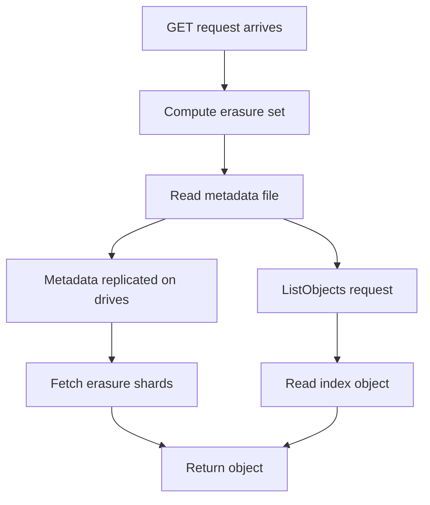

# Why MinIO Does Not Need a Database (and What It Uses Instead)

## English

A newcomer often asks: where does MinIO keep its metadata? The answer is surprising to anyone used to systems that depend on PostgreSQL or etcd. MinIO is fundamentally a stateless-ish object store that keeps almost all metadata on the same disks that hold the data, inside a hidden directory called `.minio.sys`. There is no external database to install, back up, or fail over. This is a deliberate design choice: it means a MinIO deployment is just a set of drives and a binary, and losing one node does not lose the cluster's brain because there is no brain to lose.

So how does it find objects? Each object's metadata — content type, user metadata, ETags, checksums, the list of parts, the storage layout of its erasure shards — lives in a small file next to the object data, on every drive that holds a shard. When a GET comes in, the server computes which erasure set owns the object, reads the metadata from one of the drives in that set, and then fetches the shards. The metadata is replicated across the drives in the set, so as long as enough drives are alive to satisfy the read quorum, the server can find the object. There is no single point of truth, which is why MinIO can survive losing drives mid-request.

What about listing? A naive implementation would be catastrophic here: listing a bucket with a million objects would require walking every drive. MinIO avoids this by keeping, inside `.minio.sys`, per-bucket and per-directory index structures that record which object names exist under which prefix. These indexes are themselves stored as objects using the same erasure-coded mechanism. So a ListObjects call reads a small index object rather than scanning the whole disk. This is also why listing has eventual-consistency corner cases: the index is updated asynchronously relative to the data write, so a just-written object may not appear in a listing for a brief moment even though a direct GET would succeed.

This design has real operational consequences. First, you cannot back up MinIO by dumping a database; you back it up by mirroring buckets or by snapshotting the underlying filesystem or volume. Second, you cannot repair a cluster by restoring one node's metadata from elsewhere — metadata is replicated, not centralized, so a replacement drive heals by copying shards from peers. Third, you cannot easily inspect metadata with SQL tools; you inspect it with `mc admin` commands, which understand the on-disk format. Fourth, upgrades are simpler because there is no schema migration step, but they also mean you must respect MinIO's release notes about on-disk format changes.

A useful analogy: think of MinIO less like a web application with a database behind it, and more like a filesystem that happens to speak S3. A filesystem keeps its inodes next to its data blocks and rebuilds its view by walking them; MinIO keeps its metadata next to its erasure shards and rebuilds its view by reading them. The trade-off is that certain cross-cutting queries — like 'how many bytes did user X write last Tuesday?' — are not natural to answer from the store itself, which is why MinIO relies on audit logs and metrics rather than SQL queries for those questions.

## 中文

新接觸嘅人經常問：MinIO 將元數據放喺邊？對於慣咗依賴 PostgreSQL 或者 etcd 嘅人來講，答案會幾意外。MinIO 本質上係一個接近無狀態嘅對象存儲，佢幾乎所有元數據都放喺儲存數據嘅同一批磁碟上面，喺一個叫做 `.minio.sys` 嘅隱藏目錄裡面。冇外部資料庫需要安裝、備份或者做 failover。呢個係刻意嘅設計選擇：即係話一個 MinIO 部署就係一堆磁碟加一個 binary，失去一個節點唔會失去叢集嘅大腦，因為根本冇大腦可以失去。

咁佢點樣搵到對象呢？每個對象嘅元數據——content type、用戶元數據、ETag、checksum、part 清單、糾刪碼 shard 嘅儲存佈局——都住喺對象數據隔籬一個細細嘅檔案裡面，喺每一個持有 shard 嘅磁碟上都有。當一個 GET 入嚟，伺服器會計出邊個 erasure set 擁有呢個對象，由嗰個 set 其中一隻磁碟讀取元數據，然後再去攞 shard。元數據喺 set 內嘅磁碟之間有複製，所以只要仲有足夠多嘅磁碟生存以滿足讀取 quorum，伺服器就搵得到個對象。冇單一嘅真相來源，所以 MinIO 可以喺請求進行中失去磁碟都捱得住。

咁 listing 呢？天真嘅實現在呢度會係災難：列出一個有百萬個對象嘅 bucket 就要行勻每一隻磁碟。MinIO 避免咗呢點，方法係喺 `.minio.sys` 裡面保留逐 bucket、逐目錄嘅索引結構，記錄邊啲對象名喺邊個前綴之下存在。呢啲索引本身都係用同一套糾刪碼機制存做對象。所以一個 ListObjects 呼叫讀嘅係一個細細嘅索引對象，而唔係掃描成隻磁碟。呢個亦解釋咗點解 listing 有最終一致性嘅邊角情況：索引相對於數據寫入係異步更新嘅，所以一個啱啱寫入嘅對象可能喺一瞬間唔喺 listing 出現，即使直接 GET 已經成功。

呢個設計有實實在在嘅運維後果。第一，你唔可以靠 dump 一個資料庫來備份 MinIO；你要靠鏡像 bucket，或者對底層檔案系統或 volume 做 snapshot。第二，你唔可以靠由其他地方還原某個節點嘅元數據來修復叢集——元數據係複製嘅，唔係集中嘅，所以一隻替換磁碟係靠由同伴複製 shard 來 heal。第三，你唔可以輕易用 SQL 工具檢查元數據；你要用 `mc admin` 命令，佢哋先明白磁碟上嘅格式。第四，升級比較簡單，因為冇 schema migration 步驟，但亦意味住你必須尊重 MinIO 發佈說明中關於磁碟格式變更嘅講法。

一個有用嘅比喻：唔好將 MinIO 當成一個後面有資料庫嘅 web 應用，而係當成一個啱啱識講 S3 嘅檔案系統。檔案系統將 inode 放喺數據塊隔籬，靠行勻佢哋來重建視圖；MinIO 將元數據放喺糾刪碼 shard 隔籬，靠讀取佢哋來重建視圖。代價係某啲橫切性嘅查詢——例如「用戶 X 上星期二寫咗幾多 byte？」——唔係呢個存儲本身自然答得到嘅，所以 MinIO 對呢類問題依賴 audit log 同 metrics，而唔係 SQL 查詢。

## Key Takeaway

MinIO has no external database; metadata and indexes live on the data drives themselves, which shapes how you back up, heal, and query it.

## Related Concepts
- Metadata on disk
- Listing indexes

## Diagram

