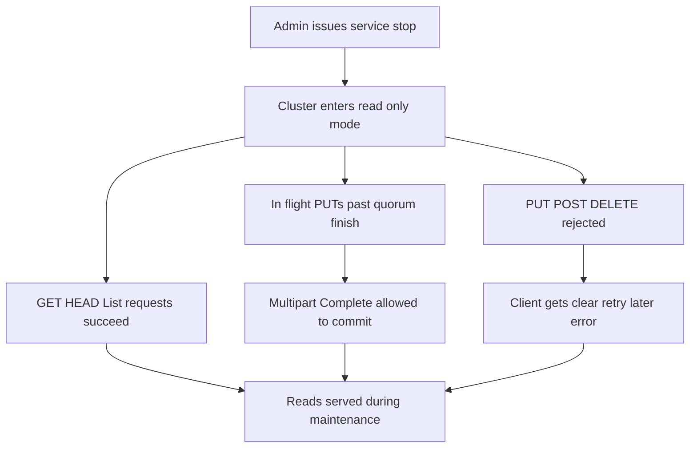

# Read-Only Mode, Maintenance Windows, and the Art of Not Losing Writes

## English

Every storage system eventually needs a maintenance window: a kernel upgrade, a drive swap, a firmware update on the JBOD. The naive approach is to stop all MinIO processes, do the work, and start them again. That works, but it means every in-flight PUT fails, every SDK retry storm hits a dead endpoint, and every application that was mid-upload has to decide whether to retry or give up. MinIO offers a gentler tool: `mc admin service stop`, which puts the cluster into a read-only mode. In this mode, GET, HEAD, and ListObjects still succeed, but PUT, POST, DELETE, and multipart operations return an error. The cluster stays alive and serves reads while you do maintenance on the write path.

Why would you want read-only rather than fully stopped? Because many applications treat a 503 from a stopped server as a transient error and retry aggressively, which can turn a planned outage into a thundering herd when the cluster comes back. A read-only cluster, by contrast, gives a clear and immediate error that a well-written client can interpret as 'try again later, but do not hammer me'. More importantly, read-only mode is safe: it guarantees that no new writes are accepted while you are, say, replacing a drive, so the healing process is not racing against new data arriving on the same erasure set.

There is a subtlety about in-flight requests. When you issue `mc admin service stop`, the cluster does not immediately drop every connection. Existing PUTs that have already passed the write quorum are allowed to finish and commit; new PUTs are rejected. This is important because a multipart upload that has already uploaded 30 parts and is calling CompleteMultipartUpload should not be told to abort — it should be allowed to finish so the object becomes visible. If you need a harder stop, you can stop the processes directly, but you accept the risk of partial writes and rely on the healing scanner to clean up.

Read-only mode is also useful for migration and replication scenarios. Suppose you are moving a bucket to another cluster and want to guarantee that no new objects appear mid-copy. You can put the source in read-only mode, run `mc mirror` to the destination, verify, then flip DNS or application config, then take the source out of read-only. This is a poor man's cutover and it works because read-only mode is enforced at the server, not at the client. You do not have to trust every application to behave; the server simply refuses writes.

Finally, remember that read-only mode is not a backup. It does not protect against a bug that deletes data, a ransomware event, or a bad operator running `mc rm --recursive --force`. For those risks you need object lock, versioning, or replication to a separate cluster. Read-only mode is a coordination tool for planned work, not a safety net for unplanned disasters. Confusing the two is how teams end up with a maintenance window that quietly becomes a data-loss incident.

## 中文

每個儲存系統最終都需要一個維護視窗：kernel 升級、換磁碟、JBOD 韌體更新。天真嘅做法係停曬所有 MinIO process，做完嘢再開返。咁做係得嘅，但代價係每個進行中嘅 PUT 都失敗，每個 SDK 嘅重試風暴都打落一個死咗嘅 endpoint，而每個上傳到一半嘅應用都要決定係重試定放棄。MinIO 提供一個溫和啲嘅工具：`mc admin service stop`，佢會將叢集置於唯讀模式。喺呢個模式下，GET、HEAD 同 ListObjects 仍然成功，但 PUT、POST、DELETE 同 multipart 操作會返回錯誤。叢集保持生存並繼續服務讀取，而你就喺寫入路徑上做維護。

點解會想要唯讀而唔係完全停機？因為好多應用會將停咗嘅伺服器返回嘅 503 當成暫時性錯誤而猛烈重試，咁樣可以將一個計劃好嘅停機變成叢集返嚟時嘅雷鳴羊群效應。相反，一個唯讀叢集會俾出清晰而即時嘅錯誤，寫得好嘅客戶端可以理解為「遲啲再試，但唔好狂打」。更重要嘅係，唯讀模式係安全嘅：佢保證你做維護期間（例如換磁碟）唔會接受新寫入，所以 healing 過程唔會同同一 erasure set 上嘅新資料鬥快。

關於進行中嘅請求有個微妙之處。當你發出 `mc admin service stop`，叢集唔會即刻斷開每一條連線。已經透過寫入 quorum 嘅現有 PUT 會獲準完成並提交；新 PUT 會被拒絕。呢點好重要，因為一個已經上傳咗 30 個 part、正喺呼叫 CompleteMultipartUpload 嘅 multipart upload 唔應該被告知中止——佢應該獲準完成，令物件變得可見。如果你需要更硬嘅停止，你可以直接停 process，但你要接受部分寫入嘅風險，並倚賴 healing scanner 去清理。

唯讀模式喺遷移同複製場景亦好有用。假設你要將一個 bucket 搬去另一個叢集，並想保證中途唔會有新物件出現。你可以將來源置於唯讀模式，跑 `mc mirror` 去目的地，驗證，然後切換 DNS 或應用配置，再將來源解除唯讀。呢個係窮人版 cutover，而佢行得通係因為唯讀模式係喺伺服器端強制執行，唔係喺客戶端。你唔需要信任每個應用都乖乖聽話；伺服器乾脆拒絕寫入。

最後要記住，唯讀模式唔係備份。佢唔會保護你免受刪除資料嘅 bug、勒索軟體事件，或者一個手滑嘅操作員跑 `mc rm --recursive --force`。對於呢啲風險你需要 object lock、versioning，或者複製去另一個叢集。唯讀模式係計劃工作嘅協調工具，唔係非計劃災難嘅安全網。將兩者混淆，就係團隊點樣令一個維護視窗悄悄變成資料丟失事故嘅原因。

## Key Takeaway

Read-only mode via `mc admin service stop` lets you do maintenance without triggering retry storms, but it is a coordination tool, not a backup.

## Related Concepts
- Maintenance windows
- Client retry behavior

## Diagram

