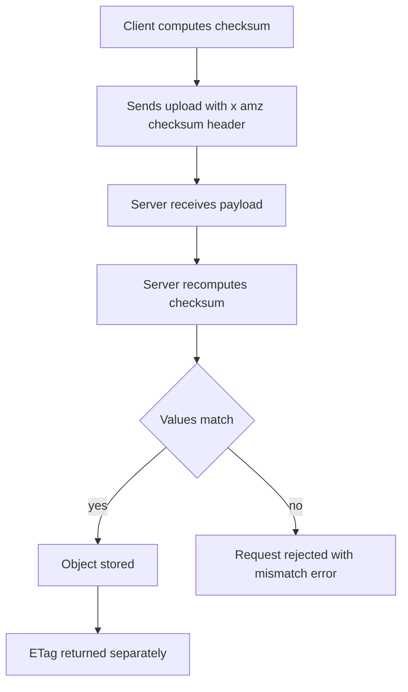

# Checksums in Practice: CRC32C, SHA-256, and the x-amz-checksum Headers

## English

Every object store eventually has to answer a deceptively simple question: did the bytes that arrived match the bytes that were sent? MinIO answers it with checksums, and the S3 API gives clients several ways to supply them. When you upload an object you can attach a checksum header such as x-amz-checksum-crc32c, x-amz-checksum-sha256, or x-amz-checksum-crc32. The server recomputes the same algorithm over the received payload and rejects the request with a mismatch error if the values differ, so a corrupted upload fails loudly at the boundary instead of silently becoming a bad object. This is different from the ETag: an ETag is an opaque identifier the server returns, and for multipart uploads it is not a simple hash of the whole object at all.

Why CRC32C specifically? CRC32C (Castagnoli) is a cyclic redundancy check using a particular polynomial, and it is cheap to compute in hardware on modern CPUs via the SSE4.2 instruction set. That matters because checksums run on every byte of every request; a fast checksum means you can afford to verify everything rather than sampling. SHA-256 is slower but cryptographically strong, which is why some compliance-minded pipelines insist on it. MinIO supports both, and the choice is a trade between CPU cost and the kind of assurance you want.

There is a subtlety with multipart uploads. A large object is uploaded in parts, and each part can carry its own checksum. The final object then has a composite checksum, and the way those part-level values combine depends on the algorithm. This is why you should not assume that a checksum you computed over a file locally will match the checksum the server reports for a multipart-uploaded object. If you need end-to-end verification, compute the checksum yourself, send it with the upload, and let the server confirm it accepted the value rather than trying to reverse-engineer the server's final number.

In day-to-day operation, checksums are your first line of defence against the boring disasters: a flaky network path, a buggy client library that truncates a stream, a proxy that mangles a chunked transfer. They do not replace the erasure-coding and bitrot scanning that protect data at rest over months, because those catch degradation that happens after the write. Think of the upload checksum as the seal on the envelope and the healing scanner as the periodic inspection of the filing cabinet.

A practical habit: when you write a client, always set a checksum header if your SDK supports it, and log the value alongside the object key. When something later looks wrong, you have a reference point that tells you whether the corruption happened on the way in or long after.

## 中文

每個對象存儲系統最終都要回答一個看似簡單的問題：到達的位元組，跟送出的位元組，是否一致？MinIO 用 checksum（校驗和）回答這個問題，而 S3 API 提供了幾種讓客戶端提供校驗和的方式。上傳對象時，你可以附上一個校驗和標頭，例如 x-amz-checksum-crc32c、x-amz-checksum-sha256 或 x-amz-checksum-crc32。伺服器會對收到的內容用同一演算法重新計算，若數值不同就以不匹配錯誤拒絕請求，於是損壞的上傳會在邊界處大聲失敗，而不是悄悄變成一個壞對象。這跟 ETag 不同：ETag 是伺服器回傳的不透明識別碼，而對於分段上傳，它根本不是整個對象的簡單雜湊。

為何特別選 CRC32C？CRC32C（Castagnoli）是一種循環冗餘校驗，使用特定的多項式，而且在現代 CPU 上可透過 SSE4.2 指令集以硬體加速，計算成本很低。這一點很重要，因為校驗和要跑過每個請求的每一個位元組；校驗和夠快，你才負擔得起「全部驗證」而不是抽樣。SHA-256 較慢但具密碼學強度，所以有些合規導向的管線堅持要用它。MinIO 兩者都支援，選擇就是在 CPU 成本與你想要的那種保證之間取捨。

分段上傳有個微妙之處。大對象會分成多個分段上傳，每個分段可以各自帶校驗和。最終對象因此有一個複合校驗和，而這些分段層級的值如何合併，取決於演算法。這就是為何你不該假設：你在本機對整個檔案算出的校驗和，會等於伺服器對分段上傳對象所報告的校驗和。若你需要端到端驗證，就自己算好校驗和、隨上傳送出，讓伺服器確認它接受了該值，而不是試圖反推伺服器最終的那個數字。

在日常運維中，校驗和是防範那些無聊災難的第一道防線：不穩定的網路路徑、會截斷串流的客戶端程式庫臭蟲、把分塊傳輸搞亂的代理。它們不能取代糾刪碼與位元腐蝕掃描——那些是用來保護靜態資料在數月之後的完整性，因為它們捕捉的是寫入之後才發生的劣化。可以把上傳校驗和想成信封上的封蠟，而修復掃描器則是對檔案櫃的定期檢查。

一個實用習慣：寫客戶端時，若 SDK 支援就一律設定校驗和標頭，並把該值與對象鍵一起記錄。日後若發現異常，你就有一個參照點，能判斷損壞是發生在寫入途中，還是很久之後。

## Key Takeaway

Upload checksums catch corruption at the boundary, while erasure coding and bitrot scanning protect data after it lands — you need both.

## Related Concepts
- ETag semantics for multipart uploads
- Bitrot detection

## Diagram

