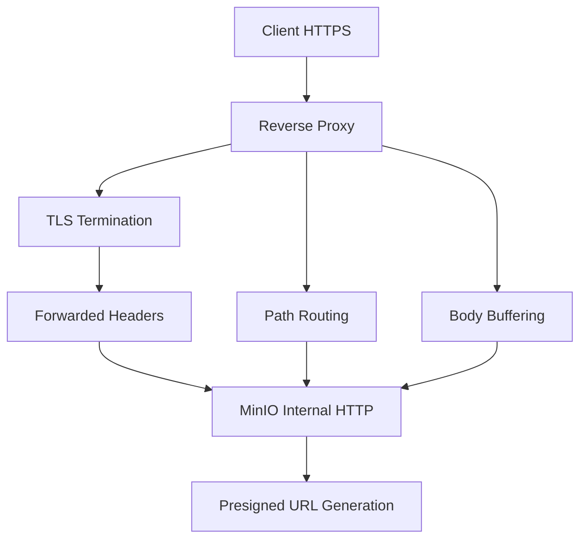

# The Reverse Proxy in Front: TLS Termination, Path Routing, and the Host Header Trap

## English

Almost nobody exposes a MinIO server directly to the internet. In practice there is a reverse proxy — nginx, HAProxy, Traefik, a cloud load balancer — sitting in front, terminating TLS and forwarding plain HTTP to the MinIO process on its internal port. This arrangement is normal and supported, but it introduces a class of failures that look mysterious until you understand what the proxy is doing to the request.

The first job of the proxy is TLS termination: the client speaks HTTPS to the proxy, the proxy holds the certificate, and MinIO sees ordinary HTTP on a private network. That is fine for confidentiality on the wire, but it means MinIO itself does not know the original scheme unless the proxy tells it. Proxies convey this with headers like X-Forwarded-Proto, X-Forwarded-For, and X-Forwarded-Host. If those are dropped or rewritten incorrectly, MinIO can generate presigned URLs with the wrong scheme or host, and those URLs will fail for the client even though the signature is perfectly valid. This is one of the most common "presigned URL works locally, breaks in production" bugs.

The second job is routing. A single proxy often fronts several services, dispatching by hostname or path prefix. With S3-style APIs, path-style addressing (where the bucket is the first path segment) is generally easier to route than virtual-host-style addressing (where the bucket becomes a subdomain). Virtual-host style requires wildcard DNS and a wildcard certificate, and some proxies need explicit configuration to pass such hostnames through untouched. If you are unsure, prefer path-style in your client configuration; it removes a whole category of confusion.

The third job is buffering and body handling. Some proxies buffer request bodies by default, which is fine for small objects but disastrous for large uploads and streaming. Others impose a default maximum body size that silently rejects a multi-gigabyte PUT. And some rewrite or strip headers, including the Authorization header that carries the S3 signature. If a proxy strips or reorders headers, the signature computed by the client will not match what MinIO recomputes, and you get a signature mismatch error that has nothing to do with your credentials.

When debugging, work from the outside in. Confirm the client's request reaches the proxy, then confirm what the proxy forwards — many proxies can log the upstream request. Check scheme and host headers first, body size limits second, and header preservation third. A proxy is a translator, and like any translator it can subtly change the meaning of what it passes along.

## 中文

幾乎沒有人會把 MinIO 伺服器直接暴露在網際網路上。實務上，前面總有一個反向代理——nginx、HAProxy、Traefik、雲端負載平衡器——負責終止 TLS，再把純 HTTP 轉送到內部埠上的 MinIO 程式。這種安排很正常也受支援，但它會帶來一類失敗，在你理解代理對請求做了什麼之前，看起來十分神秘。

代理的第一項工作是 TLS 終止：客戶端對代理講 HTTPS，代理持有憑證，而 MinIO 在私有網路上看到的是普通 HTTP。這對傳輸中的機密性沒問題，但意味著除非代理告訴它，MinIO 本身並不知道原始的 scheme。代理會用 X-Forwarded-Proto、X-Forwarded-For、X-Forwarded-Host 這類標頭傳達這些資訊。若這些標頭被丟棄或錯誤改寫，MinIO 產生的預簽名 URL 就可能帶錯 scheme 或主機，於是即使簽章完全有效，客戶端仍會失敗。這正是「預簽名 URL 在本機可用、在生產環境壞掉」最常見的臭蟲之一。

第二項工作是路由。同一個代理常常在前面服務多個後端，依主機名或路徑字首分派。對 S3 風格 API 而言，路徑式定址（bucket 是路徑的第一段）通常比虛擬主機式定址（bucket 變成子網域）更容易路由。虛擬主機式需要萬用字元 DNS 與萬用字元憑證，而且有些代理需要明確設定才能讓這類主機名原樣透過。若你不確定，客戶端設定就優先選路徑式；這樣可消除一整類混淆。

第三項工作是緩衝與請求主體處理。有些代理預設會緩衝請求主體，這對小物件無妨，對大上傳與串流卻是災難。有些代理有預設的最大主體大小，會悄悄拒絕數 GB 的 PUT。還有些代理會改寫或剝除標頭，包括承載 S3 簽章的 Authorization 標頭。若代理剝除或重排標頭，客戶端算出的簽章就跟 MinIO 重算的對不上，你會得到一個與憑證毫無關係的簽章不匹配錯誤。

除錯時，由外向內推進。先確認客戶端請求到達代理，再確認代理轉送了什麼——許多代理能記錄上游請求。先查 scheme 與 host 標頭，其次查主體大小限制，第三查標頭是否被保留。代理是翻譯員，而任何翻譯員都可能微妙地改變它所傳遞內容的意義。

## Key Takeaway

A reverse proxy is where TLS, routing, and header rewriting happen, and most mysterious signature and presigned-URL failures trace back to it.

## Related Concepts
- Presigned URL generation
- Signature Version 4

## Diagram

