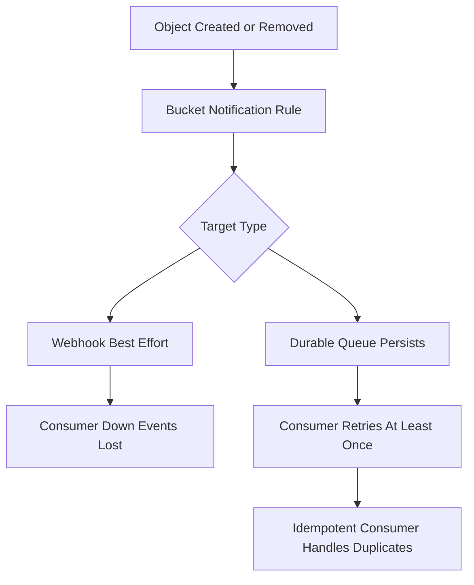

# The Bucket Notification Queue: Persisting Events When the Consumer Is Down

## English

Bucket notifications let MinIO tell the outside world that something happened: an object was created, removed, or accessed. The mechanism mirrors S3's event model. You configure a target — a webhook endpoint, a message queue such as AMQP or Kafka, or a pub/sub system — and then attach a rule to a bucket that says which event types on which key patterns should be sent there. The rule is a filter: for example, send only s3:ObjectCreated:* events for keys under the prefix uploads/.

Here is the operational question that separates a toy setup from a real pipeline: what happens when the consumer is unavailable? If the target is a plain webhook and the receiving service is down, MinIO's behaviour is essentially best-effort. Events that cannot be delivered are not magically preserved forever; the request that triggered the event should not fail because a downstream consumer is having a bad day. This is deliberate. Object writes must succeed even if your notification pipeline is broken, otherwise a monitoring outage becomes a storage outage.

The consequence is that you must design for loss. If you cannot tolerate missed events, put a durable queue between MinIO and your consumer. A message broker that persists messages to disk, acknowledges them, and retries delivery gives you at-least-once semantics: an event may be delivered more than once, but it should not vanish. That means your consumer must be idempotent — processing the same "object created" event twice must not double-charge a customer or duplicate a record. A common pattern is to key your downstream work on the bucket name plus object key plus a version or ETag, so a repeat is recognisable and harmless.

There is also an ordering question. Events for a single object arrive in a sensible order in most cases, but across objects there is no global ordering guarantee. Do not build logic that assumes the event for object B always arrives after the event for object A just because A was written first. If order matters, carry a timestamp or sequence number in your own metadata and sort downstream.

Finally, consider the failure modes you can actually test. Stop the consumer, write an object, restart the consumer, and see what arrives. Fill the queue and observe what MinIO does. Run the same event twice and confirm your handler is idempotent. A notification system you have never broken on purpose is a notification system you do not understand.

## 中文

Bucket 通知讓 MinIO 告訴外界某件事發生了：某個物件被建立、刪除或存取。這套機制對應 S3 的事件模型。你先設定一個目標——webhook 端點、AMQP 或 Kafka 之類的訊息佇列，或 pub/sub 系統——然後在 bucket 上附加一條規則，說明哪些鍵模式上的哪些事件型別要送到那裡。這條規則是過濾器：例如只送出 uploads/ 字首下鍵的 s3:ObjectCreated:* 事件。

這裡有個區分玩具設定與真實管線的運維問題：當消費者不可用時會怎樣？若目標只是單純的 webhook，而接收服務掛了，MinIO 的行為基本上是盡力而為。無法送達的事件不會神奇地永久儲存；觸發事件的請求也不該因為下游消費者今天狀況不好而失敗。這是刻意的設計。即使你的通知管線壞了，物件寫入也必須成功，否則一次監控故障就變成一次儲存故障。

其後果是你必須為遺失做設計。若你無法容忍漏事件，就在 MinIO 與消費者之間放一個持久佇列。一個會把訊息持久化到磁碟、會確認、會重試投遞的訊息仲介，能給你至少一次（at-least-once）語意：事件可能被投遞超過一次，但不應該消失。這意味著你的消費者必須冪等——同一筆「物件已建立」事件處理兩次，不能讓客戶被重複收費，也不能產生重複紀錄。常見做法是用 bucket 名稱加物件鍵加版本或 ETag 作為下游工作的鍵，這樣重複就容易被辨識且無害。

還有順序問題。單一物件的事件在大多數情況下會以合理順序到達，但跨物件之間並沒有全域順序保證。不要建立那種假設「因為 A 先寫入，所以 B 的事件一定在 A 的事件之後到達」的邏輯。若順序重要，就在你自己的中介資料裡帶時間戳或序號，在下游排序。

最後，想想你真正能測試的失敗模式。停掉消費者、寫一個物件、重啟消費者，看看送達什麼。把佇列塞滿，觀察 MinIO 的反應。把同一事件跑兩次，確認你的處理器冪等。一個你從未刻意弄壞過的通知系統，就是一個你不瞭解的通知系統。

## Key Takeaway

Notifications are best-effort by design, so put a durable queue in front of your consumer and make the consumer idempotent.

## Related Concepts
- Event-driven pipelines
- Idempotency in distributed systems

## Diagram

