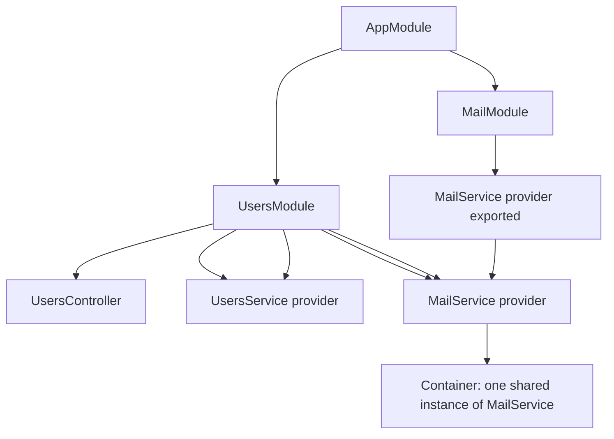

# The Dependency Injection Container and the Module System

### English

NestJS is built around **dependency injection** (DI): instead of a class creating its own collaborators with `new`, the framework constructs them and hands them in from the outside. This is the classic difference between tightly coupled and loosely coupled code. If a `UserService` builds its own `EmailClient` internally, you cannot swap in a fake one during testing. With DI, Nest injects it, so the test supplies a stub.

The **container** is the object that does this wiring. When you register a class as a **provider**, the container creates a single instance of it and remembers it, so anything that asks for that class gets the same shared object. That is why a service can hold in-memory state or a database connection pool safely: there is exactly one instance for the whole application.

**Modules** are the organisational unit. A module is a class decorated with `@Module()` whose `imports`, `providers` and `controllers` metadata tells Nest what it depends on and what it offers. `imports` make another module's exported providers visible; `providers` are the things this module owns; `controllers` are the HTTP entry points. The `exports` array lists which of this module's providers other modules are allowed to inject — if you forget to export a provider, other modules simply cannot see it, and the error message usually says the dependency is not resolvable.

Providers can also be registered with a **custom token** rather than a class, which is how you inject a configuration value or a third-party client: `{ provide: 'MAIL_SERVICE', useFactory: (config) => new MailClient(config.apiKey) }`. This is the "recipe" pattern — the factory receives the dependencies it needs and returns the instance.

Nest's default scope is **singleton**, meaning one instance per module. Request-scoped providers (with `Scope.REQUEST`) are created fresh for every incoming request, which is useful when state must not be shared between users, at the cost of extra instantiation work. Transient scope creates a new instance every time it is injected.

The result is an application whose dependencies are visible in the metadata rather than hidden inside constructors, so the structure of the system can be read from the code.

### 中文

NestJS 嘅核心係 **dependency injection**（依賴注入）：一個 class 唔會自己 `new` 佢需要嘅合作夥伴，而係由框架喺外面建立好再注入入去。呢個正正係「緊密耦合」同「鬆散耦合」程式碼嘅分別。如果 `UserService` 內部自己建立 `EmailClient`，你就冇辦法喺測試時換成一個假版本。用咗 DI，Nest 會注入個依賴，所以測試可以自己提供一個 stub。

**Container**（容器）就係負責做呢啲接線嘅物件。你將一個 class 註冊成 **provider**之後，容器會建立佢嘅單一 instance 並記住，之後任何要求呢個 class 嘅地方都會攞到同一個共享物件。所以一個 service 可以安全咁持有記憶體狀態或者資料庫連線池：成個應用程式入面其實只有一個 instance。

**Module**（模組）係組織架構嘅單位。Module 係一個加上 `@Module()` 裝飾器嘅 class，入面嘅 `imports`、`providers`、`controllers` metadata 會話畀 Nest 佢依賴咩、佢提供咩。`imports` 令另一個 module 匯出嘅 provider 喺呢度睇得見；`providers` 係呢個 module 自己擁有嘅嘢；`controllers` 係 HTTP 入口。而 `exports` 就列出呢個 module 嘅邊啲 provider 准許其他 module 注入 —— 如果你漏咗 export，其他 module 就完全睇唔到，錯誤訊息通常會話依賴無法解析（not resolvable）。

Provider 亦可以唔用 class，而係用一個 **custom token** 註冊，咁樣就可以注入設定值或者第三方 client：`{ provide: 'MAIL_SERVICE', useFactory: (config) => new MailClient(config.apiKey) }`。呢個就係「食譜」模式 —— factory 收到自己需要嘅依賴，然後返回 instance。

Nest 預設嘅 scope 係 **singleton**，即係每個 module 一個 instance。Request scope（用 `Scope.REQUEST`）會為每個 incoming request 建立全新 instance，適合狀態唔可以喺用戶之間共享嘅情況，代價係多咗建立物件嘅開支。Transient scope 則係每次注入都建立新 instance。

結果係：應用程式嘅依賴關係寫明喺 metadata 而唔係藏喺 constructor 入面，系統結構可以直接由程式碼讀出嚟。

## Key Takeaway
NestJS modules declare what a feature owns and imports, and the container builds shared singleton instances from providers so dependencies stay visible and testable.

## Related Concepts
- Inversion of control
- Provider factories and custom tokens
- Module scope and lifecycle
- Nest CLI and standalone applications

## Diagram

