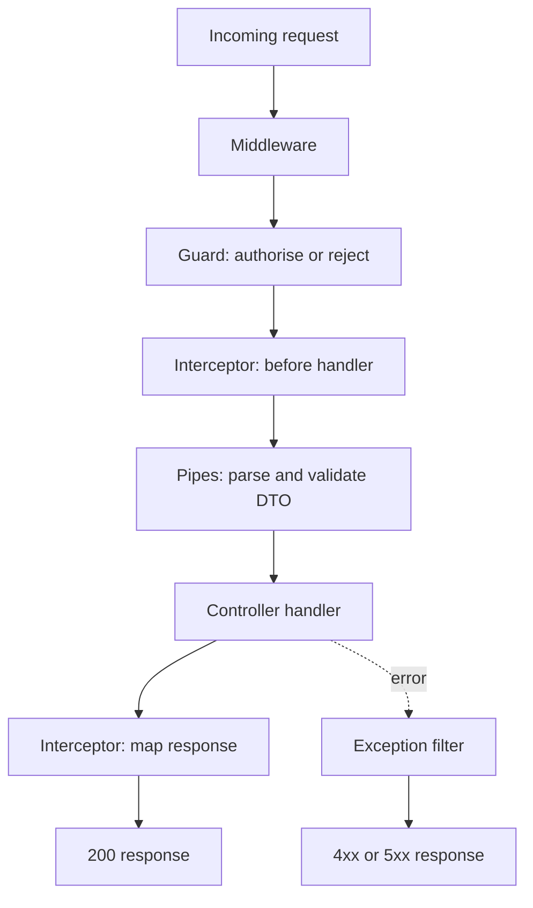

# Guards, Pipes and Interceptors: The Request Lifecycle

### English

When an HTTP request arrives, NestJS runs a fixed sequence of building blocks, each implemented as an **enhancer**. The order matters, and it is roughly: middleware → guards → interceptors (pre-controller) → pipes → controller handler → interceptors (post-controller) → filters (on error).

A **guard** decides whether a request may proceed at all. It implements `CanActivate` and returns a boolean (or throws). Guards are where authorisation belongs — checking a JWT, a role, or a feature flag. Because guards run before anything else, a rejected request never reaches your service layer. Guards can also attach data to the request context for downstream use, which is how a current-user object gets passed along without threading it through every function signature.

A **pipe** transforms or validates the incoming argument of a handler. `ParseIntPipe` turns the string `"42"` from the URL into the number `42`; `ParseUUIDPipe` rejects malformed UUIDs. The most common use is validation pipes, which take a DTO (a plain class describing the expected shape) and check the payload against it, throwing a validation error listing every bad field. Pipes run only on the parameters that are actually decorated, and they run before the handler body, so your controller always receives already-clean data.

An **interceptor** wraps the handler call itself. Its `intercept` method receives a `CallHandler` and returns an observable, so it can run code before and after the handler, and transform the response on the way out. The classic use is a response-mapping interceptor that strips sensitive fields or wraps every payload in a standard envelope; another is timing or logging instrumentation. Interceptors are also the standard way to implement caching and timeout behaviour.

A **filter** (exception filter) catches errors thrown downstream and converts them into HTTP responses, so you can turn a domain exception into a clean `404` with a consistent body instead of a stack trace.

Because these enhancers are separated by role — guards for access, pipes for shape, interceptors for cross-cutting behaviour around the handler, filters for error translation — a controller stays short and the policy lives in one place.

### 中文

當一個 HTTP 請求到咗，NestJS 會按固定次序執行一連串 building block，每個都係一種 **enhancer**（增強器）。次序好重要，大致係：middleware → guards → interceptors（controller 之前）→ pipes → controller handler → interceptors（controller 之後）→ filters（出錯時）。

**Guard**（守衛）決定一個 request 可唔可以繼續行。佢實作 `CanActivate`，返回 boolean（或者直接 throw）。Guard 就係授權應該放嘅地方 —— 檢查 JWT、角色或者 feature flag。因為 guard 喺 everything else 之前行，被拒絕嘅 request 根本唔會去到你嘅 service 層。Guard 亦可以將資料掛落 request context 俾下游用，呢個就係「目前登入用戶」點解唔使逐個 function 參數傳落去。

**Pipe**（管道）負責轉換或者驗證 handler 收到嘅參數。`ParseIntPipe` 會將 URL 入面嘅字串 `"42"` 變成數字 `42`；`ParseUUIDPipe` 就會拒絕格式唔對嘅 UUID。最常見嘅用途係 validation pipe：佢攞住一個 DTO（一個描述預期結構嘅純 class），將 payload 對住佢檢查，一旦唔對就 throw 出一個 validation error，列出所有有問題嘅欄位。Pipe 只會對實際有裝飾器嘅參數行，而且喺 handler body 之前行，所以 controller 收到嘅一定係已經乾淨嘅資料。

**Interceptor**（攔截器）會包住 handler 本身嘅呼叫。佢個 `intercept` 方法收埋一個 `CallHandler` 並返回 observable，所以可以喺 handler 之前同之後行嘢仲可以喺出口處轉換 response。最典型嘅用途係一個 response-mapping interceptor：抹走敏感欄位，或者將每個 payload 包裝成統一格式；另一個常見用途係計時同埋記錄 log。Interceptor 亦係實現快取同 timeout 嘅標準做法。

**Filter**（exception filter）會捕捉下游拋出嘅錯誤並轉成 HTTP response，令你可以將 domain exception 變成乾淨嘅 `404` 加一致嘅 body，而唔係丟一個 stack trace 出嚟。

正因為呢啲 enhancer 各司其職 —— guard 負責權限、pipe 負責形狀、interceptor 負責 handler 周圍嘅橫切行為、filter 負責錯誤翻譯 —— controller 就可以保持短小，而政策集中喺一個地方。

## Key Takeaway
NestJS splits request handling into ordered enhancers — guards for access, pipes for validation, interceptors for behaviour around the handler, filters for error translation — so controllers stay thin and cross-cutting policy lives in one place.

## Related Concepts
- JWT authentication and role-based access control
- class-validator and DTOs
- Observability and logging interceptors
- Exception handling and error codes

## Diagram

