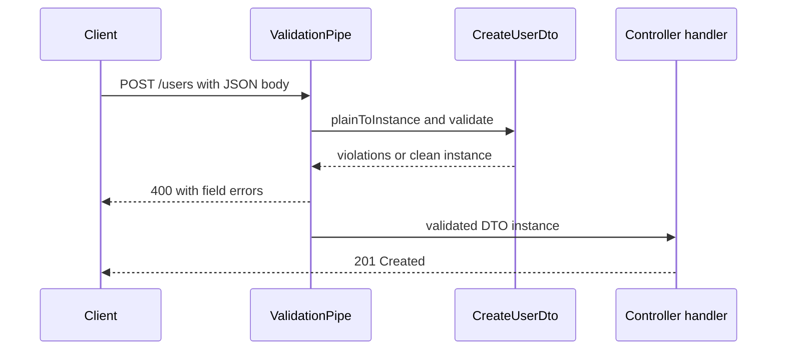

# Decorator-based Controllers, DTO Validation and Configuration

### English

NestJS controllers are plain classes decorated with `@Controller('path')`. Inside, each HTTP route is a method decorated with `@Get()`, `@Post()`, `@Put()`, `@Delete()` and friends. The decorator supplies the HTTP verb and the route segment, while the method argument supplies the data. `@Param('id')` extracts a route parameter, `@Body()` gives you the parsed request body, `@Query()` gives you the query string, and `@Headers()` a specific header. Because routing is declared with decorators rather than a central route table, the URL structure is visible right next to the code that implements it.

The type of a parameter is also part of the contract: `@Body() body: CreateUserDto` tells Nest that this payload should be validated against the `CreateUserDto` class.

**DTOs** (Data Transfer Objects) are plain classes with decorators from `class-validator` and `class-transformer`. A typical DTO declares `@IsString()` on a name field, `@IsEmail()` on an email field, and `@IsInt() @Min(0)` on an age field. Nest's global `ValidationPipe` then checks incoming payloads against these rules and rejects bad requests with a structured list of violations before your handler ever runs. Two details make this work: the payload must be a real class instance (not a plain object), which is why the global pipe is configured with `transform: true` so it calls `plainToInstance` for you; and unknown properties should be rejected with `whitelist: true` so clients cannot smuggle in fields you did not intend to accept — a small but real security win.

**Configuration** is handled with `@nestjs/config`. The `ConfigModule` loads `.env` files and can validate their shape with a schema, so a missing `DATABASE_URL` fails at boot instead of at the first request. The idiomatic way to consume configuration is to inject `ConfigService` and read typed keys from it, rather than reaching for `process.env` directly — that keeps the dependency explicit and lets tests supply a different config object.

For testing, `@nestjs/testing` gives you `Test.createTestingModule` where you can override any provider with a mock. `TestingModule` supports the same `overrideProvider` mechanism as the real container, so a unit test can replace a database service with a fake without touching application code.

### 中文

NestJS 嘅 controller 就係加上 `@Controller('path')` 裝飾器嘅普通 class。入面每條 HTTP route 都係一個方法，貼上 `@Get()`、`@Post()`、`@Put()`、`@Delete()` 之類嘅裝飾器。裝飾器負責提供 HTTP method 同 route 段落，而參數就負責提供資料內容：`@Param('id')` 攞 route 參數，`@Body()` 攞經解析過嘅 request body，`@Query()` 攞 query string，`@Headers()` 攞指定 header。由於 route 係用裝飾器宣告而唔係集中喺一份 route table，URL 結構就同實作佢嘅程式碼擺埋一齊，一眼睇得晒。

參數嘅型別本身就係一份契約：`@Body() body: CreateUserDto` 等於話畀 Nest 聽，呢個 payload 要用 `CreateUserDto` class 做驗證。

**DTO**（Data Transfer Object）就係普通 class，用 `class-validator` 同 `class-transformer` 嘅裝飾器標註。一個典型 DTO 會喺 name 欄位寫 `@IsString()`、email 欄位寫 `@IsEmail()`、age 欄位寫 `@IsInt() @Min(0)`。Nest 嘅 global `ValidationPipe` 之後就會按呢啲規則檢查 incoming payload，一旦唔對就喺 handler 行之前拒絕，並且回傳一份結構化嘅違規清單。有兩個細節令呢件事行得通：payload 必須係真正嘅 class instance（而唔係普通 object），所以 global pipe 要設定 `transform: true`，令佢自動幫你 call `plainToInstance`；另外應該用 `whitelist: true` 拒絕未知欄位，免得 client 偷偷塞入你原本唔打算接受嘅欄位 —— 睇落係小事，但係實質嘅安全改進。

**Configuration** 用 `@nestjs/config` 處理。`ConfigModule` 會讀入 `.env` 檔案，亦可以用 schema 驗證內容，令缺少 `DATABASE_URL` 呢類問題喺 boot 階段就爆，而唔係等到第一個 request 先出事。比較地道嘅做法係注入 `ConfigService` 再由佢讀取有型別嘅 key，而唔係直接伸手去攞 `process.env` —— 咁樣依賴關係係明確嘅，而且測試時可以換成另一個 config object。

至於測試，`@nestjs/testing` 提供 `Test.createTestingModule`，你可以喺度 override 任何 provider。`TestingModule` 同真實 container 用同一套 `overrideProvider` 機制，所以單元測試可以將資料庫 service 換成一個假實作，而完全唔使改動應用程式碼。

## Key Takeaway
Decorators make both routes and validation contracts explicit at the point of use, and pairing class-validator DTOs with a global ValidationPipe turns input checking into something automatic rather than something every handler must remember.

## Related Concepts
- ConfigModule and environment variables
- Unit testing and module overrides
- TypeScript decorators and reflection metadata
- OpenAPI documentation with decorators

## Diagram

