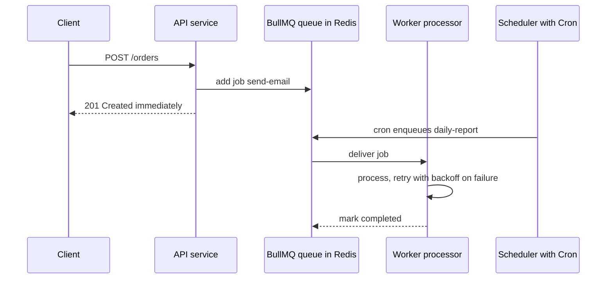

# Background Jobs and Scheduling with BullMQ and `@nestjs/schedule`

### English

A NestJS application answers requests. Some work, however, should not happen *inside* a request: sending an email, generating a PDF report, reindexing search documents, sending a nightly digest. Doing that work inline makes the caller wait, and if the process crashes mid-way the work is lost. The standard answer is to move it to a **queue**: the API writes a message and returns immediately, and a separate worker picks the message up and does the work.

NestJS supports this through `@nestjs/bullmq` (BullMQ is a Redis-backed job queue) or the older `@nestjs/bull` (Bull). The modern choice is BullMQ. The wiring has three parts.

First, register the Redis connection and the queue in a module:

```ts
import { BullModule } from '@nestjs/bullmq';

@Module({
  imports: [
    BullModule.forRoot({ connection: { host: 'localhost', port: 6379 } }),
    BullModule.registerQueue({ name: 'email' }),
  ],
})
export class AppModule {}
```

Second, a service *produces* jobs. You inject the queue with `@InjectQueue('email')` and add a job:

```ts
@Injectable()
export class MailService {
  constructor(@InjectQueue('email') private queue: Queue) {}

  async sendWelcome(userId: string) {
    await this.queue.add('welcome', { userId }, {
      attempts: 3,
      backoff: { type: 'exponential', delay: 3000 },
      removeOnComplete: true,
      removeOnFail: false,
    });
  }
}
```

The options matter. `attempts` sets how many times a failed job is retried; `backoff` with `type: 'exponential'` spaces those retries out (3s, 6s, 12s) so a temporarily broken dependency is not hammered. `removeOnComplete` cleans up the queue so it does not grow forever, while keeping failed jobs (`removeOnFail: false`) so you can inspect them.

Third, a **processor** consumes jobs. It is a class decorated with `@Processor('email')` that extends `WorkerHost` and implements `process`:

```ts
@Processor('email')
export class MailProcessor extends WorkerHost {
  async process(job: Job<{ userId: string }>) {
    await this.mailer.sendWelcome(job.data.userId);
    return { sent: true };
  }
}
```

For **recurring work**, `@nestjs/schedule` provides the `@Cron()` decorator and the `CronExpression` constants:

```ts
@Cron(CronExpression.EVERY_DAY_AT_MIDNIGHT)
async generateReports() {
  await this.queue.add('daily-report', {});
}
```

The critical design rule is that the cron method should *enqueue* a job, not do the work itself. If every instance of your service runs the cron, then with three replicas you get three executions — and the work happens inside the web process, where it competes with user traffic. Enqueuing instead means the work runs in a worker, and the queue provides a single point of coordination.

In production you usually split the deployment into two: a **scheduler** process that runs the cron expressions and pushes to the queue, and one or more **worker** processes that consume. BullMQ also provides **Job Schedulers** (`upsertJobScheduler`), which are the modern way to express recurring work directly in the queue:

```ts
await this.queue.upsertJobScheduler(
  'daily-report',
  { pattern: '0 15 3 * * *', tz: 'Asia/Hong_Kong' },
  { name: 'daily-report', data: { scope: 'stale-sessions' }, opts: { attempts: 3 } },
);
```

Using a stable scheduler id means a redeploy updates the schedule in place rather than creating duplicates. Two operational details catch people out: BullMQ cron expressions have six fields (seconds are optional but allowed), and if you omit the `tz` option the job fires in the server's default timezone — always set it explicitly if the job must run at a local wall-clock time.

### 中文

NestJS 應用程式係攞嚟應對 request 嘅。但有一啲工作**唔應該**喺 request 入面做：發 email、生成 PDF 報表、重新建立搜尋索引、寄每晚 digest。喺 inline 做，即係迫使用者等；而如果 process 中途死咗，嗰部分工作就冇咗。標準答案係將佢搬去一條 **queue**：API 寫低一條訊息即刻回應，另一個 worker 攞起訊息做工作。

NestJS 透過 `@nestjs/bullmq`（BullMQ 係一個用 Redis 做後端嘅 job queue）或者舊啲嘅 `@nestjs/bull`（Bull）支援呢件事。現代做法係 BullMQ。接駁有三部分。

第一，喺 module 入面登記 Redis 連線同 queue：

```ts
import { BullModule } from '@nestjs/bullmq';

@Module({
  imports: [
    BullModule.forRoot({ connection: { host: 'localhost', port: 6379 } }),
    BullModule.registerQueue({ name: 'email' }),
  ],
})
export class AppModule {}
```

第二，一個 service 負責**生產** job。用 `@InjectQueue('email')` 注入 queue，然後 add 一個 job：

```ts
@Injectable()
export class MailService {
  constructor(@InjectQueue('email') private queue: Queue) {}

  async sendWelcome(userId: string) {
    await this.queue.add('welcome', { userId }, {
      attempts: 3,
      backoff: { type: 'exponential', delay: 3000 },
      removeOnComplete: true,
      removeOnFail: false,
    });
  }
}
```

呢啲選項好重要。`attempts` 設定失敗嘅 job 重試幾多次；`backoff` 配 `type: 'exponential'` 會將重試逐次拉開（3 秒、6 秒、12 秒），避免一個暫時壞咗嘅下游服務被狂轟。`removeOnComplete` 會清理 queue 免得佢無限膨脹，而 `removeOnFail: false` 就保留失敗嘅 job，等你可以事後檢查。

第三，**processor** 負責**消費** job。佢係一個貼咗 `@Processor('email')` 裝飾器、繼承 `WorkerHost` 並實作 `process` 嘅 class：

```ts
@Processor('email')
export class MailProcessor extends WorkerHost {
  async process(job: Job<{ userId: string }>) {
    await this.mailer.sendWelcome(job.data.userId);
    return { sent: true };
  }
}
```

講到**週期性工作**，`@nestjs/schedule` 提供 `@Cron()` 裝飾器同 `CronExpression` 常量：

```ts
@Cron(CronExpression.EVERY_DAY_AT_MIDNIGHT)
async generateReports() {
  await this.queue.add('daily-report', {});
}
```

最關鍵嘅設計規則係：cron 方法應該只係**入隊**，唔應該自己做工作。如果你每一個 instance 都行同一個 cron，即係話你部署咗三個 replica，就會執行三次；而且工作會喺 web process 入面做，同使用者流量爭資源。改為入隊，工作就會喺 worker 執行，而 queue 就提供咗單一嘅協調點。

生產環境通常會拆成兩個部署：一個 **scheduler** process 負責行 cron 同埋推 job 入 queue，同埋一個或者多個 **worker** process 負責消費。BullMQ 亦提供 **Job Scheduler**（`upsertJobScheduler`），係用嚟直接喺 queue 表達週期性工作嘅現代方法：

```ts
await this.queue.upsertJobScheduler(
  'daily-report',
  { pattern: '0 15 3 * * *', tz: 'Asia/Hong_Kong' },
  { name: 'daily-report', data: { scope: 'stale-sessions' }, opts: { attempts: 3 } },
);
```

用一個穩定嘅 scheduler id，代表重新部署時係「就地更新」schedule，而唔係製造重複。兩個運維上嘅細節好容易踩坑：BullMQ 嘅 cron expression 有六個欄位（秒數係可選但允許），同埋如果唔填 `tz`，job 就會以 server 嘅預設時區觸發 —— 如果 job 必須喺某個本地時間跑，一定要明確設定。

## Key Takeaway
Queues decouple slow side effects from request handling, and the essential discipline is that scheduled tasks should enqueue work for a separate worker rather than execute it inside the web process.

## Related Concepts
- Redis as a queue backend
- Job retries, backoff and dead-letter handling
- Horizontal scaling of stateless services
- Graceful shutdown and connection draining

## Diagram

