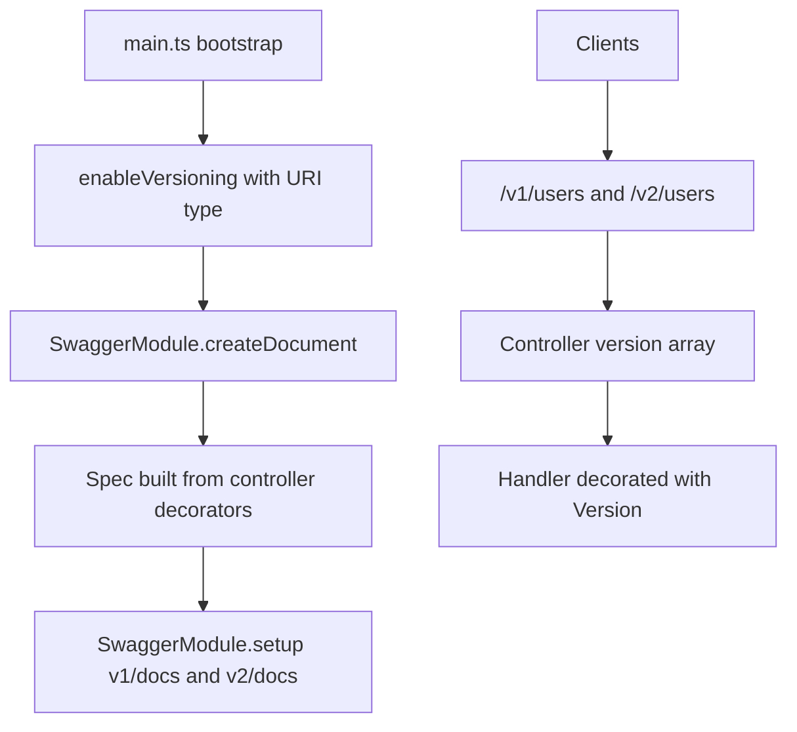

# API Versioning and OpenAPI Documentation with Swagger

### English

Once an API is public, you cannot change it freely. If you rename a field or change the meaning of a status code, every existing client breaks. The professional answer is **versioning**: run v1 and v2 side by side, migrate clients gradually, and delete v1 only when nobody uses it.

NestJS has first-class support for this. You enable it once, in `main.ts`:

```ts
app.enableVersioning({ type: VersioningType.URI });
```

Four strategies are available. **URI versioning** puts the version in the path (`/v1/users`), and it is the default and the most common, because the version is visible in logs, caches and URLs. **Header versioning** reads it from a custom header, **media type versioning** reads it from the `Accept` header, and **custom versioning** gives you an `extractor` function that can pull a version (or a list of versions) out of anything in the request — useful when a client can request several versions and the server should pick the best one.

Once versioning is on, you control it at three levels. The **global default** applies to every route:

```ts
app.enableVersioning({ type: VersioningType.URI, defaultVersion: '1' });
```

A **controller** can restrict itself to specific versions:

```ts
@Controller({ path: 'users', version: ['1', '2'] })
export class UsersController {}
```

And an individual **handler** can be bound to one version, which is how you implement the differences between versions without duplicating the whole controller:

```ts
@Get()
@Version('1')
findAllV1() { return this.usersService.listLegacy(); }

@Get()
@Version('2')
findAllV2() { return this.usersService.list(); }
```

The important detail is that a route with no version metadata falls back to the default version. So a new controller you forget to version will still be reachable — which is convenient but also means version boundaries are enforced by discipline rather than by the compiler.

**OpenAPI documentation** is generated from the same decorators, using `@nestjs/swagger`. The `SwaggerModule` reads the controller metadata and produces a JSON specification:

```ts
const config = new DocumentBuilder()
  .setTitle('Orders API')
  .setDescription('Public API for orders')
  .setVersion('1.0')
  .addBearerAuth()
  .build();

const document = SwaggerModule.createDocument(app, config);
SwaggerModule.setup('docs', app, document);
```

`@nestjs/swagger` also has CLI plugins that inspect your DTOs at compile time and inject the schema and validation metadata automatically, so you rarely hand-write `@ApiProperty` decorators. If you want the spec to describe real request and response bodies, you can use `@ApiExtraModels` and the `ApiProperty` decorators on the response DTOs, and then add `class-transformer`/`class-validator` so the runtime validation matches the documented schema.

Order matters when combining versioning with docs. `app.enableVersioning()` must be called **before** `SwaggerModule.createDocument()`, otherwise the version metadata is not registered yet and the generated document will not reflect the versioned routes. A common pattern is to build one document per version and mount each at its own path:

```ts
app.enableVersioning({ type: VersioningType.URI });

const v1 = SwaggerModule.createDocument(app, new DocumentBuilder()
  .setTitle('Orders API v1').setVersion('1.0').build());
SwaggerModule.setup('v1/docs', app, v1);

const v2 = SwaggerModule.createDocument(app, new DocumentBuilder()
  .setTitle('Orders API v2').setVersion('2.0').build());
SwaggerModule.setup('v2/docs', app, v2);
```

Why does this matter? A versioned API with no documentation is a trap for your own users: they cannot tell which version a field belongs to, and they cannot generate a client without guessing. Generating the spec from the same decorators that define the routes means the documentation cannot drift out of sync with the implementation — the route you deleted disappears from the spec too.

### 中文

一旦個 API 對外開放，就唔可以隨意改動。如果你改咗一個欄位嘅名，或者改變咗某個 status code 嘅意思，所有舊 client 就會壞晒。專業嘅做法係 **versioning**：同時行 v1 同 v2，逐步遷移 client，等冇人用咗 v1 先至刪。

NestJS 對呢件事有一級嘅支援。你喺 `main.ts` 開一次就得：

```ts
app.enableVersioning({ type: VersioningType.URI });
```

一共有四種策略。**URI versioning** 將版本擺喺路徑（`/v1/users`），係預設亦係最常用，因為版本喺 log、cache 同 URL 入面一眼睇得到。**Header versioning** 由自訂 header 讀取版本，**media type versioning** 由 `Accept` header 讀取，而 **custom versioning** 就俾你一個 `extractor` function，可以從 request 任何位置抽出版本（或者版本清單）—— 當 client 可以要求多個版本、由 server 揀最合適嗰個時候，就特別有用。

開咗 versioning 之後，你可以喺三個層級控制。第一層係**全域預設**，適用於所有 route：

```ts
app.enableVersioning({ type: VersioningType.URI, defaultVersion: '1' });
```

第二層係 **controller** 可以限制自己只支援邊啲版本：

```ts
@Controller({ path: 'users', version: ['1', '2'] })
export class UsersController {}
```

第三層係個別 **handler** 可以綁定去單一版本，正係用嚟實踐版本之間嘅差異，而唔使成個 controller 複製一份：

```ts
@Get()
@Version('1')
findAllV1() { return this.usersService.listLegacy(); }

@Get()
@Version('2')
findAllV2() { return this.usersService.list(); }
```

要留意嘅細節係：冇任何版本 metadata 嘅 route，會 fallback 去預設版本。即係話你漏咗加版本嘅新 controller 一樣可以被行到 —— 方便係方便，但亦代表版本邊界靠嘅係自律，而唔係 compiler 幫你把關。

**OpenAPI 文件**用 `@nestjs/swagger`，由同一批裝飾器產生。`SwaggerModule` 會讀取 controller metadata，輸出 JSON 規格：

```ts
const config = new DocumentBuilder()
  .setTitle('Orders API')
  .setDescription('Public API for orders')
  .setVersion('1.0')
  .addBearerAuth()
  .build();

const document = SwaggerModule.createDocument(app, config);
SwaggerModule.setup('docs', app, document);
```

`@nestjs/swagger` 亦有 CLI plugin，會喺編譯時檢查你嘅 DTO，自動注入 schema 同驗證 metadata，所以好少需要手寫 `@ApiProperty` 裝飾器。如果你想個規格真係描述緊 request 同 response body，可以用 `@ApiExtraModels` 加喺 response DTO 上寫 `@ApiProperty`，再配合 `class-transformer`/`class-validator`，令 runtime 驗證同文件描述保持一致。

版本控制同文件一齊用嘅時候，順序好重要。`app.enableVersioning()` 必須喺 `SwaggerModule.createDocument()` **之前** 呼叫，否則版本 metadata 仲未註冊，生成出嚟嘅文件唔會反映到版本化嘅 route。常見做法係每個版本各建一份文件，各自掛喺唔同路徑：

```ts
app.enableVersioning({ type: VersioningType.URI });

const v1 = SwaggerModule.createDocument(app, new DocumentBuilder()
  .setTitle('Orders API v1').setVersion('1.0').build());
SwaggerModule.setup('v1/docs', app, v1);

const v2 = SwaggerModule.createDocument(app, new DocumentBuilder()
  .setTitle('Orders API v2').setVersion('2.0').build());
SwaggerModule.setup('v2/docs', app, v2);
```

點解咁重要？一個有版本但冇文件嘅 API，對你自己嘅使用者嚟講就係個陷阱：佢哋分唔清某個欄位屬於邊個版本，亦都生成唔到 client 除非靠估。而由定義 route 嘅同一批裝飾器生成規格，就保證咗文件唔會同實作脫節 —— 你刪咗嘅 route，喺規格入面亦都會消失。

## Key Takeaway
Versioning lets you evolve a public API without breaking existing clients, and generating the OpenAPI document from the same decorators guarantees the published spec never drifts from the routes that actually exist.

## Related Concepts
- Semantic versioning of public APIs
- Deprecation headers and sunset dates
- REST resource design and DTO shaping
- Global prefixes and route registration order

## Diagram

