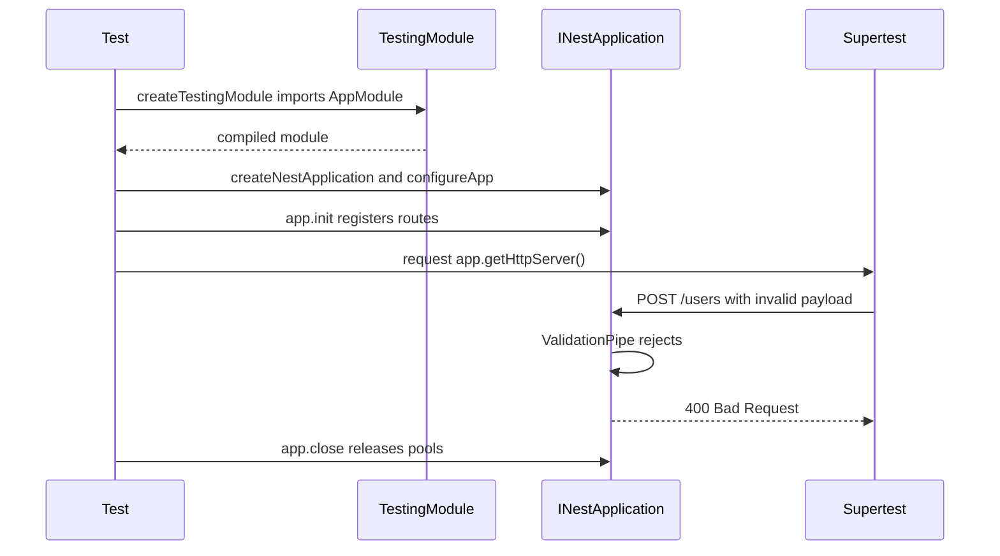

# Testing NestJS Applications: Unit Tests and End-to-End Tests with Supertest

### English

NestJS is unusually testable, and the reason is structural: because every dependency arrives through the dependency injection container, you can build the whole application in a test and then replace any part of it. The skill is knowing which level of test to write.

**Unit tests** target a single class. You create a testing module that provides the class under test plus mocks for everything it depends on:

```ts
const module = await Test.createTestingModule({
  controllers: [UsersController],
  providers: [
    UsersService,
    { provide: UsersRepository, useValue: mockRepository },
  ],
}).compile();
```

`overrideProvider` (or `useValue` as above) replaces the real dependency with a fake, so the test exercises your logic without touching a database. When the class under test has many dependencies, `Test.createTestingModule` can be replaced by instantiating the class directly with hand-written stubs — simpler, but you lose the container's guarantee that the provider's dependency graph actually resolves.

**End-to-end tests** boot the *whole* application and drive it with real HTTP requests using **supertest**:

```ts
let app: INestApplication;

beforeAll(async () => {
  const moduleRef = await Test.createTestingModule({
    imports: [AppModule],
  }).compile();

  app = moduleRef.createNestApplication();
  app.useGlobalPipes(new ValidationPipe({ whitelist: true, transform: true }));
  await app.init();
});

afterAll(async () => {
  await app.close();
});

it('rejects a user creation payload with an invalid email', async () => {
  await request(app.getHttpServer())
    .post('/users')
    .send({ email: 'not-an-email', name: 'Test' })
    .expect(400);
});
```

`createNestApplication()` returns an application wrapping the HTTP adapter, `app.init()` registers the routes and runs the lifecycle hooks **without binding a port**, and `app.getHttpServer()` gives you the underlying Node HTTP server. Supertest drives that server object directly, so tests run in parallel without port conflicts.

There is one trap that catches everybody. `createNestApplication()` does **not** execute `main.ts`. Any global pipes, exception filters, interceptors, CORS settings, global prefix or versioning you configured in `main.ts` are simply absent from the test application. The result is a test that passes but exercises a pipeline that exists nowhere else in production. The fix is to extract that configuration into a single exported function that both `main.ts` and the test call:

```ts
// src/setup-app.ts
export function configureApp(app: INestApplication) {
  app.setGlobalPrefix('api');
  app.useGlobalPipes(new ValidationPipe({ whitelist: true, transform: true }));
  app.enableVersioning({ type: VersioningType.URI });
  app.enableCors();
}
```

```ts
// main.ts
const app = await NestFactory.create(AppModule);
configureApp(app);
await app.listen(3000);
```

E2E tests are the only level that catches the things that break in production but not in unit tests: a typo in a route decorator, a misconfigured global pipe, the wrong HTTP status from an exception filter, a `@Exclude()` decorator failing to hide a password field in the response, guard ordering, or CORS misconfiguration. A useful rule: if the behaviour involves the HTTP layer, write an e2e test for it.

For the database, use a real but disposable one. An in-memory SQLite database is fast and isolated for logic tests, though it will not reproduce PostgreSQL-specific behaviour. Always close the application in `afterAll` — otherwise open sockets and connection pools keep the test process alive and the run hangs.

One import detail: with Vitest and ESM, import supertest as a default import (`import request from 'supertest'`); the `import * as request` form used in older Jest examples fails with "request is not a function".

### 中文

NestJS 特別容易寫測試，原因係結構上嘅：因為所有依賴都係經由 dependency injection container 送入嚟，所以你可以喺測試入面起完整個應用程式，然後換走任何一部分。關鍵技巧係知道應該寫邊個層級嘅測試。

**單元測試**針對單一 class。你會建一個 testing module，提供被測 class 同一份 mock 依賴：

```ts
const module = await Test.createTestingModule({
  controllers: [UsersController],
  providers: [
    UsersService,
    { provide: UsersRepository, useValue: mockRepository },
  ],
}).compile();
```

`overrideProvider`（或者上面咁樣用 `useValue`）會將真實依賴換成假貨，令測試只驗證你嘅邏輯而唔會碰資料庫。如果被測 class 依賴好多，`Test.createTestingModule` 亦可以直接由人手寫 stub 然後 new 個 class 出嚟 —— 簡單啲，但你就失去咗 container 保證「provider 依賴圖真係解得到」嘅好處。

**端到端測試**會起晒*成個*應用程式，再用 **supertest** 發真正嘅 HTTP request：

```ts
let app: INestApplication;

beforeAll(async () => {
  const moduleRef = await Test.createTestingModule({
    imports: [AppModule],
  }).compile();

  app = moduleRef.createNestApplication();
  app.useGlobalPipes(new ValidationPipe({ whitelist: true, transform: true }));
  await app.init();
});

afterAll(async () => {
  await app.close();
});

it('rejects a user creation payload with an invalid email', async () => {
  await request(app.getHttpServer())
    .post('/users')
    .send({ email: 'not-an-email', name: 'Test' })
    .expect(400);
});
```

`createNestApplication()` 回傳一個包住 HTTP adapter 嘅 application，`app.init()` 會註冊所有 route 同埋行 lifecycle hooks，但**唔會**綁定 port；`app.getHttpServer()` 就攞到底下嘅 Node HTTP server。Supertest 直接駕駛呢個 server 物件，所以測試可以並行而唔會撞 port。

有一個陷阱人人都會踩。`createNestApplication()` **唔會**執行 `main.ts`。你喺 `main.ts` 設定嘅 global pipe、exception filter、interceptor、CORS、global prefix 或者 versioning，喺測試入面全部唔存在。結果就係測試過咗，但驗證嘅係一條喺 production 邊度都冇出現過嘅 pipeline。修正方法係將呢啲設定抽成一個 exported function，`main.ts` 同測試都叫佢：

```ts
// src/setup-app.ts
export function configureApp(app: INestApplication) {
  app.setGlobalPrefix('api');
  app.useGlobalPipes(new ValidationPipe({ whitelist: true, transform: true }));
  app.enableVersioning({ type: VersioningType.URI });
  app.enableCors();
}
```

```ts
// main.ts
const app = await NestFactory.create(AppModule);
configureApp(app);
await app.listen(3000);
```

E2E 測試係唯一一個層級，可以捉到嗰啲「production 會爆但單元測試捉唔到」嘅問題：route 裝飾器打錯字、global pipe 設定錯、exception filter 回錯 HTTP status、`@Exclude()` 冇成功喺 response 隱藏 password 欄位、guard 順序、CORS 設定錯誤等等。一個實用原則：如果個行為涉及 HTTP 層，就寫個 e2e 測試。

資料庫方面，用真實但用完即棄嘅。記憶體內嘅 SQLite 快、隔離，適合邏輯測試，不過模擬唔到 PostgreSQL 專屬嘅行為。另外一定要喺 `afterAll` 關咗 application —— 否則開住嘅 socket 同 connection pool 會令測試 process 唔肯退出，成個 run 就吊住。

仲有一個 import 細節：用 Vitest 加 ESM 時，supertest 要用 default import（`import request from 'supertest'`）；舊啲 Jest 範例嗰種 `import * as request` 寫法會出現 "request is not a function"。

## Key Takeaway
The injection container makes unit tests easy, but only an end-to-end test that boots the real application and shares the same bootstrap configuration as production catches the failures that actually happen — misconfigured global pipes, wrong status codes and leaky responses.

## Related Concepts
- Dependency injection and provider overrides
- Test doubles, mocks and fakes
- CI pipelines and test reporting
- Database isolation between test runs

## Diagram

