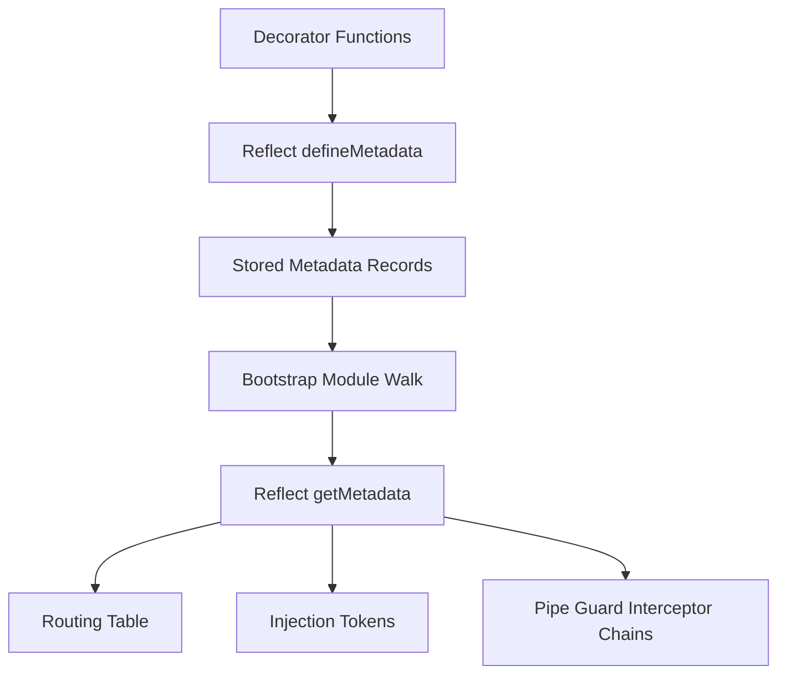

# Custom Decorators and Metadata: How NestJS Reads Your Code

## English

Almost everything in NestJS is a decorator, and decorators in TypeScript are just functions that attach metadata to classes, methods, or parameters. When you write `@Controller('users')` or `@Get(':id')`, NestJS is not doing anything magical at compile time; it is calling `Reflect.defineMetadata` under the hood to store small key-value records on the class or method. At bootstrap, the framework walks your modules, reads that metadata back with `Reflect.getMetadata`, and builds the routing table, the injection tokens, and the pipe/guard/interceptor chains from those records. Understanding this turns NestJS from 'magic' into a predictable system.

A practical consequence is that you can write your own decorators to package repeated logic. For example, a `@CurrentUser()` parameter decorator can read the request object that a guard already populated and hand the user straight to your handler, so every controller method stops repeating `req.user`. Internally you use `createParamDecorator((data, ctx) => ctx.switchToHttp().getRequest().user)`. Similarly, `SetMetadata('roles', ['admin'])` combined with a guard that reads it via `Reflector.getAllAndOverride` is the classic pattern for role-based access control, and it keeps the guard generic instead of hard-coding role checks per route.

Metadata is also inherited in ways that surprise people. `Reflector.getAllAndOverride` exists precisely because metadata can live on both the handler and the controller class, and you usually want the handler to win. If you only read one level, a controller-level `@Roles('admin')` might silently be ignored or silently override a method-level rule. Knowing which level wins is the difference between a secure API and a subtle permission bug.

One more useful trick: decorators compose. You can write a single `@Auth()` decorator that applies `UseGuards(JwtGuard)`, `ApiBearerAuth()` for Swagger, and `SetMetadata` in one line, then reuse it across dozens of routes. This is the NestJS equivalent of a macro, and it keeps intent visible at the call site while the implementation stays in one place. The cost is indirection: a reader must know what `@Auth()` expands to, so name custom decorators clearly and document them.

Finally, be aware that decorators run at class-definition time, not per request. Anything expensive (database lookups, HTTP calls) inside a decorator factory will run once at startup and can crash your app before it even listens. Keep decorator bodies pure and cheap; defer real work to guards, pipes, or interceptors, which run per request with access to the live context.

## 中文

NestJS 幾乎所有東西都是 decorator（裝飾器），而 TypeScript 的 decorator 本質上就係一個函數，負責將 metadata（元資料）掛到 class、method 或參數上面。當你寫 `@Controller('users')` 或 `@Get(':id')`，NestJS 並唔係喺編譯期做咩魔法，而係喺底層呼叫 `Reflect.defineMetadata`，將一啲細細嘅 key-value 記錄存入 class 或 method。到應用啟動嗰陣，框架會行遍你嘅 module，用 `Reflect.getMetadata` 讀返呢啲 metadata，再憑佢哋砌出路由表、注入 token，同埋 pipe／guard／interceptor 嘅鏈。明白呢一點，NestJS 就由「魔法」變成一個可預測嘅系統。

實際好處係你可以自己寫 decorator，將重複邏輯打包。例如一個 `@CurrentUser()` 參數 decorator，可以讀返 guard 已經填入 request 嘅用戶資料，直接交俾 handler，咁每個 controller method 就唔使再重複寫 `req.user`。內部你用 `createParamDecorator((data, ctx) => ctx.switchToHttp().getRequest().user)`。同樣道理，`SetMetadata('roles', ['admin'])` 配合一個用 `Reflector.getAllAndOverride` 讀取嘅 guard，就係角色權限控制嘅經典做法，令 guard 保持通用，而唔使喺每條路由硬編碼角色檢查。

Metadata 嘅繼承方式亦經常令人意外。`Reflector.getAllAndOverride` 之所以存在，正因為 metadata 可以同時存在於 handler 同 controller class 兩層，而你通常想 handler 勝出。如果你只讀一層，controller 層嘅 `@Roles('admin')` 可能被靜靜咁忽略，或者反過來蓋過 method 層嘅規則。知道邊一層勝出，就係安全 API 同隱蔽權限漏洞之間嘅分別。

另一個好用技巧：decorator 可以組合。你可以寫一個 `@Auth()` decorator，一次過套用 `UseGuards(JwtGuard)`、俾 Swagger 用嘅 `ApiBearerAuth()`，同埋 `SetMetadata`，然後喺幾十條路由重用。呢個就係 NestJS 版本嘅巨集（macro），令呼叫位置一眼睇到意圖，而實作只集中喺一處。代價係多咗一層間接：讀者要知道 `@Auth()` 展開成咩，所以自訂 decorator 要改名清晰，並且寫好文件。

最後要留意，decorator 係喺 class 定義時執行，而唔係每個 request 執行。任何喺 decorator factory 入面做嘅昂貴操作（資料庫查詢、HTTP 呼叫）都只會喺啟動時跑一次，甚至可能喺 app 開始監聽之前就令佢崩潰。保持 decorator 內容純粹同便宜；真正嘅工作留俾 guard、pipe 或 interceptor，佢哋先會每個 request 執行，並且有得用即時嘅 context。

## Key Takeaway

NestJS decorators are metadata writers read back at bootstrap, so custom decorators and Reflector are how you package repeated routing, auth, and parameter logic cleanly.

## Related Concepts
- Reflect metadata API
- Role-based access control

## Diagram

