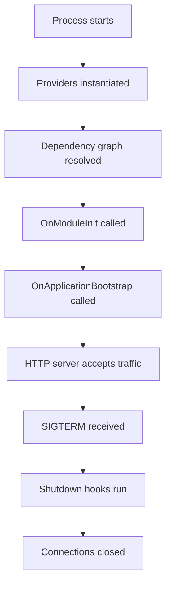

# Lifecycle Hooks and Graceful Shutdown: Controlling Startup and Teardown

## English

A NestJS app has a lifecycle that goes far beyond handling requests. During startup, the framework instantiates providers, resolves the dependency graph, and then calls lifecycle hooks in a defined order. Providers that implement `OnModuleInit` run after their module's dependencies are resolved; `OnApplicationBootstrap` runs after every module is initialised. This ordering matters: if you open a database connection in `OnModuleInit`, you can be confident that the config service it depends on has already been constructed, because the container resolves dependencies before calling the hook.

The classic use case is warming up caches, validating configuration, or registering consumers. A message-queue consumer, for instance, should subscribe in `OnModuleInit` so it is listening before the HTTP server starts accepting traffic. If you subscribe too early (in the constructor), you might process a message that needs a service that has not finished initialising. If you subscribe too late, you drop messages. Hooks give you a precise, documented slot for that kind of work.

Shutdown is the mirror image and is often neglected. When the process receives SIGTERM (for example from Kubernetes or Docker), you want to stop accepting new requests, finish in-flight ones, close database pools, and flush logs. NestJS supports this via `app.enableShutdownHooks()`, which makes the framework listen for termination signals and call `OnModuleDestroy` and `OnApplicationShutdown` on providers. Without enabling it, your `onModuleDestroy` methods simply never run, and connections leak until the process is killed. This is a very common production bug in otherwise well-written apps.

There is a subtlety with `beforeApplicationShutdown`: it fires after shutdown has been triggered but before the HTTP server is closed, which is the right place to stop background workers so they do not pick up new jobs while you are tearing down. Ordering here is not arbitrary; it is designed so that in-flight work can complete while new work stops arriving. Knowing the sequence lets you reason about what happens during a rolling deploy instead of guessing.

A practical rule: keep hooks short and idempotent. If `OnModuleInit` throws, the whole app fails to start, which is usually what you want for a bad database URL but not for an optional cache warm-up. Wrap optional work in try/catch and log clearly. And test shutdown explicitly, for example by sending SIGTERM to a running container and checking the logs show a clean close; graceful shutdown that has never been tested is often just a hopeful comment.

## 中文

NestJS 應用嘅生命週期遠不止處理 request。啟動期間，框架會實例化 provider、解析依賴圖，然後按既定次序呼叫生命週期 hook（鉤子）。實作了 `OnModuleInit` 嘅 provider，會喺所屬 module 嘅依賴解析完成之後執行；`OnApplicationBootstrap` 就會喺所有 module 初始化之後執行。呢個次序好重要：如果你喺 `OnModuleInit` 開啟資料庫連線，你可以放心佢依賴嘅 config service 已經建構好，因為容器會先解析依賴，再呼叫 hook。

經典用途包括預熱快取、驗證設定，或者註冊消費者。例如一個訊息佇列消費者，應該喺 `OnModuleInit` 訂閱，咁佢就會喺 HTTP 伺服器開始接收流量之前已經監聽緊。如果訂閱得太早（喺 constructor 入面），你可能會處理一條需要某個尚未初始化完成嘅 service 嘅訊息。如果訂閱得太遲，你就會漏訊息。Hook 就係俾呢類工作一個精確、有文件記載嘅位置。

關閉就係鏡像另一面，但經常被忽略。當程序收到 SIGTERM（例如嚟自 Kubernetes 或 Docker），你想停止接收新 request、完成進行中嘅 request、關閉資料庫連線池，同埋沖走 log。NestJS 透過 `app.enableShutdownHooks()` 支援呢點，令框架監聽終止訊號，並對 provider 呼叫 `OnModuleDestroy` 同 `OnApplicationShutdown`。如果唔啟用，你嘅 `onModuleDestroy` 方法根本永遠唔會執行，連線會一直洩漏，直到程序被殺。呢個係寫得幾好嘅 app 都好常見嘅生產環境 bug。

`beforeApplicationShutdown` 有個微妙之處：佢喺關閉已被觸發、但 HTTP 伺服器仲未關閉之前觸發，正正係停止背景 worker 嘅合適位置，咁佢哋就唔會喺你拆緊嘢嗰陣再接新工作。呢度嘅次序唔係隨意，而係設計到令進行中嘅工作可以完成，同時新工作停止流入。知道呢個序列，你就可以推理滾動部署期間會發生咩事，而唔使靠估。

實用守則：hook 要短，而且要 idempotent（冪等）。如果 `OnModuleInit` 拋出錯誤，成個 app 都啟動唔到，對於錯嘅資料庫 URL 呢個通常係你想要嘅行為，但對於可選嘅快取預熱就唔係。將可選工作包喺 try/catch 入面，並且清楚記錄 log。另外要明確測試關閉流程，例如向運行中嘅容器送 SIGTERM，再檢查 log 有冇顯示乾淨關閉；未經測試嘅優雅關閉，好多時只係一句充滿希望嘅註解。

## Key Takeaway

Lifecycle hooks give you precise startup and teardown slots, and enabling shutdown hooks is essential for clean deploys and avoiding leaked connections.

## Related Concepts
- OnModuleInit
- Graceful shutdown

## Diagram

