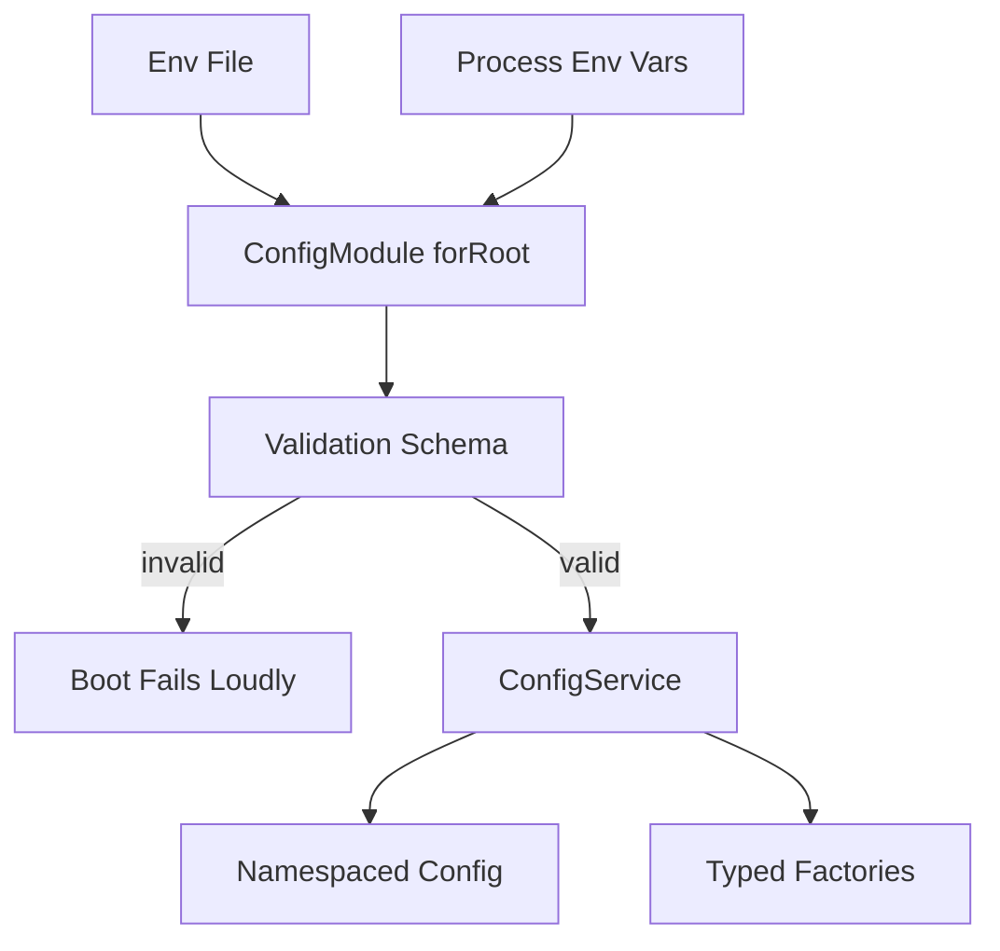

# Configuration Management and Environment Validation

## English

Hard-coding secrets and URLs is the fastest way to break an app across environments, and NestJS gives you a structured answer through `@nestjs/config`. The `ConfigModule.forRoot()` call loads `.env` files, merges them with real environment variables, and exposes a `ConfigService` you can inject anywhere. The subtle part is precedence: real process environment variables win over the `.env` file, which is exactly what you want in production, where the platform injects secrets and the file may not even exist.

The bigger lesson is validation. A missing `DATABASE_URL` should fail loudly at startup, not mysteriously at 3 a.m. when the first query runs. `@nestjs/config` integrates with Joi or class-validator so you can describe the shape of your environment: which keys are required, what types they are, and what defaults apply. When validation fails, the app refuses to boot with a clear message listing the offending variables. This is the same philosophy as validating request bodies with pipes, applied to the configuration layer.

Beyond loading, you should think about structure. Dumping everything into one flat object makes it hard to know what a module actually needs. A common pattern is to register namespaced configuration, for example a `database` namespace that groups host, port, and credentials, then read it with `ConfigService.get('database.host')`. Typed configuration factories let you return a strongly typed object, so TypeScript catches typos in key names at compile time instead of at runtime. You can also mark a config module as global so you do not have to import it in every feature module.

Secrets deserve special care. `.env` files should be git-ignored; only a `.env.example` with placeholder keys belongs in the repository. In containerised deployments, secrets are usually injected as environment variables or mounted files, and the app should never log them. A useful habit is to log a redacted summary of loaded configuration at startup, showing which keys are present but masking values, so you can confirm the right environment is active without leaking credentials into log aggregation systems.

Finally, remember that configuration is read at startup but may need to change behaviour at runtime, for example feature flags. Keep the distinction clear: environment variables are for deployment-time settings that require a restart to change, while feature flags and dynamic settings usually belong in a database or a config service with a refresh mechanism. Mixing the two leads to confusing bugs where changing an env var appears to do nothing until someone redeploys.

## 中文

將金鑰同 URL 硬編碼，係令應用喺唔同環境之間壞得最快嘅方法，而 NestJS 透過 `@nestjs/config` 提供一個有結構嘅答案。`ConfigModule.forRoot()` 會載入 `.env` 檔案，同真實環境變數合併，並提供一個可以喺任何地方注入嘅 `ConfigService`。微妙之處在於優先次序：真實嘅 process 環境變數會蓋過 `.env` 檔案，呢個正正係生產環境想要嘅行為，因為平臺會注入金鑰，而檔案甚至可能唔存在。

更大嘅一課係驗證。缺少 `DATABASE_URL` 應該喺啟動時大聲失敗，而唔係喺凌晨三點第一個查詢執行嗰陣神神秘秘咁爆。`@nestjs/config` 可以同 Joi 或 class-validator 整合，俾你描述環境嘅形狀：邊啲 key 係必需、係咩型別、有咩預設值。驗證失敗時，應用會拒絕啟動，並清楚列出有問題嘅變數。呢個同用 pipe 驗證 request body 係同一套哲學，只係應用喺設定層。

除咗載入，你亦要諗結構。將所有嘢倒進一個扁平物件，會令人好難知道某個 module 實際需要咩。常見做法係註冊具名稱空間嘅設定，例如一個 `database` 名稱空間，將 host、port 同憑證group埋一齊，然後用 `ConfigService.get('database.host')` 讀取。有型別嘅設定 factory 可以回傳強型別物件，令 TypeScript 喺編譯期就捉到 key 名嘅錯字，而唔係等到執行期。你亦可以將 config module 標記為全域，咁就唔使喺每個功能 module 都 import 一次。

金鑰要特別小心處理。`.env` 檔案應該加入 git ignore；只有一個放住佔位 key 嘅 `.env.example` 應該留喺 repository。喺容器化部署入面，金鑰通常以環境變數或掛載檔案形式注入，而應用絕對唔應該將佢哋寫入 log。一個好習慣係喺啟動時記錄一份遮蔽咗嘅設定摘要，顯示邊啲 key 存在但遮住數值，咁你就可以確認行緊正確環境，又唔會將憑證洩漏到 log 聚合系統。

最後要記住，設定喺啟動時讀取，但有時需要喺執行期改變行為，例如功能開關（feature flag）。要保持界線清晰：環境變數係用於部署期設定，要改就要重啟；而功能開關同動態設定通常應該放喺資料庫或者有重新整理機制嘅設定服務。將兩者混埋一齊，就會產生令人困惑嘅 bug：改咗環境變數好似冇反應，直到有人重新部署先得。

## Key Takeaway

Treat configuration as a validated, typed, namespaced contract loaded at startup, and keep deployment-time env vars separate from runtime feature flags.

## Related Concepts
- @nestjs/config
- Joi schema validation

## Diagram

