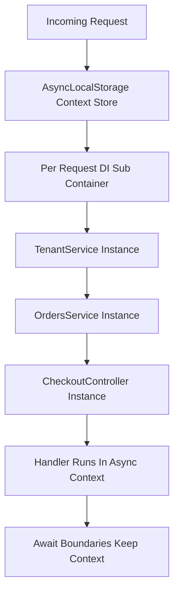

# Request-Scoped Providers and the AsyncLocalStorage Trick

## English

Most NestJS providers are singletons: one instance shared by every request, created once when the module boots. That is fast and memory-cheap, but some providers genuinely need per-request state — a tenant ID read from a header, a correlation ID for tracing, or a user object loaded from a token. NestJS solves this with request-scoped providers, declared by adding `scope: Scope.REQUEST` to the `@Injectable()` decorator options. When a provider becomes request-scoped, its entire injection chain becomes request-scoped too: any service that injects it is instantiated fresh per request, and so on up the tree. This is called scope bubbling, and it is the single most important gotcha — one request-scoped leaf can silently turn half your application into per-request instances, costing you the performance benefits of singleton reuse.

Under the hood, NestJS needs a way to give each concurrent request its own copy of the provider while the same service class is being used everywhere. The mechanism is Node.js's `AsyncLocalStorage`, part of the built-in `async_hooks` module. When a request enters the pipeline, NestJS runs the handler inside an async context store that maps to a per-request dependency injection sub-container. Any lookup of a request-scoped provider during that async call chain resolves to the correct instance. This is why request scope works transparently across `await` boundaries — the context follows the asynchronous call chain rather than being tied to a specific function call stack.

A concrete example: a `TenantService` reads the `X-Tenant-Id` header and looks up tenant configuration. If it is request-scoped, an `OrdersService` that injects it becomes request-scoped, and a `CheckoutController` that injects `OrdersService` also becomes request-scoped. Every request now constructs three objects instead of reusing cached ones. For a high-traffic endpoint this matters. The usual fix is to keep the request-scoped provider as a thin leaf and inject it only where truly needed, or to avoid request scope entirely by passing the tenant ID explicitly as a method argument or via a custom decorator that reads from the request object.

Performance aside, request scope interacts awkwardly with some features. Lifecycle hooks like `onModuleInit` fire per request-scoped instance, not once per module, so putting expensive setup there is a mistake. WebSocket gateways and microservice handlers also have their own scoping semantics, and mixing request-scoped providers into a singleton event listener can produce stale instances. A good mental model: singletons are the default because they are cheap and stateless; request scope is an escape hatch for genuinely per-request data, and should be used surgically, not architecturally.

Finally, request scope is not the only way to carry request context. Many teams use a singleton `ContextService` backed by `AsyncLocalStorage` directly — NestJS exposes the underlying primitive, and you can wrap it yourself. This gives you request-scoped data without triggering scope bubbling, because the provider itself stays a singleton and only the stored value changes per request. That pattern is common in logging, tracing, and multi-tenancy libraries, and it is worth knowing before you reach for `Scope.REQUEST`.

## 中文

大部分 NestJS 的 provider 都是單例（singleton）：每個請求共用同一個實例，在模組啟動時只建立一次。這樣既快速又省記憶體，但有些 provider 確實需要「每個請求各自一份」的狀態——例如從 header 讀取的租戶 ID、用於追蹤的關聯 ID，或從 token 載入的使用者物件。NestJS 用請求作用域 provider（request-scoped provider）解決這個問題，做法是在 `@Injectable()` 裝飾器的選項中加入 `scope: Scope.REQUEST`。一旦某個 provider 變成請求作用域，它整條注入鏈都會跟着變成請求作用域：任何注入它的 service 都會每個請求重新建立，並一路向上蔓延。這叫做作用域冒泡（scope bubbling），也是最重要的一個陷阱——一個位於鏈末端的請求作用域 provider，可以無聲無息地把半個應用程式變成每請求實例，令你失去單例重用的效能好處。

在底層，NestJS 需要一種方法，讓每個並行請求都拿到自己那份 provider，而同一時間同一個 service 類別又在各處被使用。機制就是 Node.js 內建 `async_hooks` 模組中的 `AsyncLocalStorage`。當請求進入管線時，NestJS 會在一個非同步上下文儲存區中執行處理器，該儲存區對應一個「每請求」的依賴注入子容器。在這條非同步呼叫鏈中任何對請求作用域 provider 的查找，都會解析到正確的實例。這就是為何請求作用域可以透明地跨越 `await` 邊界運作——上下文跟隨的是非同步呼叫鏈，而不是某個具體的函式呼叫堆疊。

舉個具體例子：一個 `TenantService` 讀取 `X-Tenant-Id` header 並查找租戶設定。如果它是請求作用域，那麼注入它的 `OrdersService` 也會變成請求作用域，而注入 `OrdersService` 的 `CheckoutController` 同樣變成請求作用域。每個請求現在要建立三個物件，而不是重用快取的實例。對高流量端點來說，這是有影響的。常見的解法是把請求作用域 provider 保持為薄薄的末端節點，只在真正需要的地方注入；或者乾脆完全避開請求作用域，改為把租戶 ID 明確地當作方法參數傳遞，或透過自訂裝飾器從 request 物件讀取。

撇除效能，請求作用域與某些功能配合起來也有點尷尬。像 `onModuleInit` 這類生命週期鉤子會按每個請求作用域實例觸發，而不是每個模組一次，所以把昂貴的初始化放在那裏是錯的。WebSocket gateway 與微服務處理器亦有各自的範疇語意，把請求作用域 provider 混入單例事件監聽器，可能會產生過時的實例。一個好的心智模型是：單例是預設，因為它便宜且無狀態；請求作用域是逃生門，用於真正屬於每請求的資料，應該精準地使用，而不是當作架構基礎。

最後，請求作用域並非承載請求上下文的唯一方法。很多團隊會用一個單例的 `ContextService`，背後直接以 `AsyncLocalStorage` 支撐——NestJS 有暴露這個底層原語，你也可以自己包一層。這樣就能在不觸發作用域冒泡的情況下取得每請求資料，因為 provider 本身仍是單例，只有儲存的值會按請求改變。這個模式在日誌、追蹤與多租戶函式庫中很常見，在你伸手去拿 `Scope.REQUEST` 之前，值得先認識它。

## Key Takeaway

Request-scoped providers give each request its own instance via AsyncLocalStorage, but scope bubbling can silently turn your whole injection chain per-request, so use them surgically or wrap AsyncLocalStorage in a singleton instead.

## Related Concepts
- AsyncLocalStorage
- Singleton vs request scope

## Diagram

