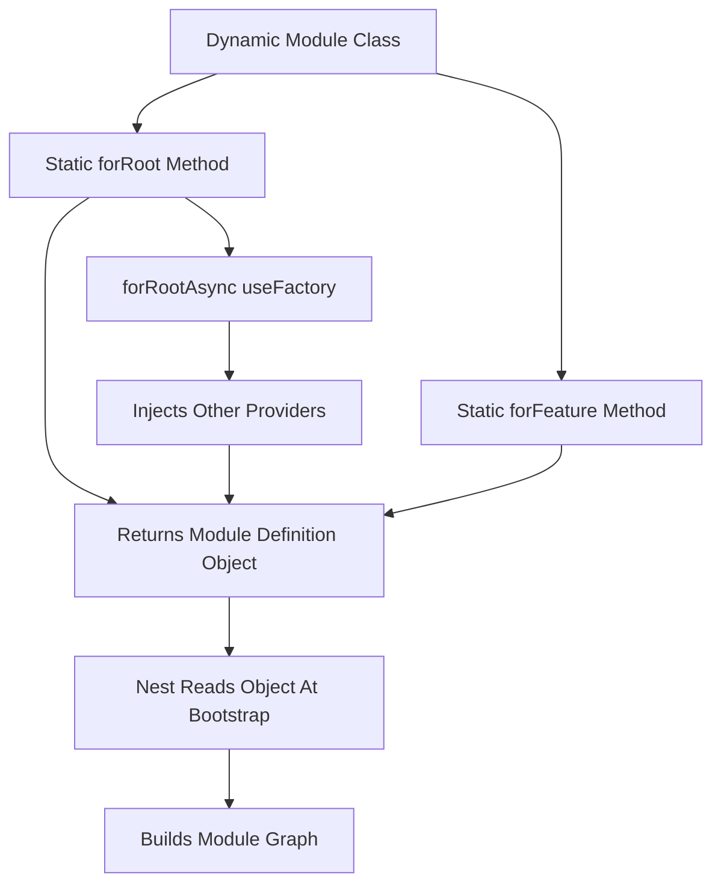

# Dynamic Modules: forRoot, forRootAsync and forFeature

## English

A static module in NestJS is a class annotated with `@Module({...})` whose imports, providers, and exports are fixed at compile time. A dynamic module is the same class, but with a static method that returns a module definition object at runtime, allowing the caller to pass configuration. You have almost certainly used one: `TypeOrmModule.forRoot({...})`, `ConfigModule.forRoot()`, and `JwtModule.register({ secret })` are all dynamic modules. The convention is that `forRoot` is called once, usually in the root `AppModule`, and configures the module globally or provides singleton services; `forFeature` is called in each feature module and registers feature-specific pieces, like entities or repositories, that depend on the root configuration.

The mechanism is simple once you see it. A dynamic module's static method returns an object with the same shape as `@Module` metadata — `module`, `imports`, `providers`, `exports` — plus an optional `global: true` flag. NestJS reads this returned object at bootstrap and builds the module graph from it. Because the method is just TypeScript, you can branch on `process.env`, read a config file, or call `forRootAsync` with a `useFactory` that receives injected dependencies. That last part is key: `forRootAsync({ imports: [ConfigModule], inject: [ConfigService], useFactory: (cfg) => ({...}) })` lets a module's configuration depend on other providers, which is how database URLs and secrets get resolved without hardcoding.

Think of a dynamic module as a factory that produces a module recipe rather than a fixed module. A static module is like a pre-built IKEA shelf; a dynamic module is the instruction sheet plus a configurable drill bit — you supply the measurements and it assembles the shelf to fit. This is why `forRoot` and `forFeature` are separate: the root call sets up the shared connection pool, while each feature call registers a slice of the schema against that same pool. If you call `forRoot` twice you will usually get two connection pools and confusing errors, which is why the docs insist on calling it once.

A subtle but important detail is that dynamic modules do not automatically share their providers with other modules unless they are marked `global: true` or explicitly re-exported. `ConfigModule.forRoot({ isGlobal: true })` is the classic example — it sets the global flag so every module can inject `ConfigService` without importing `ConfigModule`. Without that flag you would have to import `ConfigModule` in every feature module, which is tedious and easy to forget. Understanding this flag explains a lot of confusing "provider not found" errors.

When you write your own dynamic module, a clean pattern is to define an options interface, a static `forRoot(options)` that returns the module definition, and an optional `forRootAsync` that accepts a factory. Inside the module, provide an injection token (often a string constant or a symbol) holding the resolved options, and have your services inject that token. This keeps configuration explicit, testable, and free of global state, and it is exactly how the official NestJS packages are built.

## 中文

NestJS 中的靜態模組，就是一個以 `@Module({...})` 標註的類別，其 imports、providers 與 exports 在編譯時就已固定。動態模組（dynamic module）則是同一個類別，但帶有一個靜態方法，在執行時回傳一個模組定義物件，讓呼叫者可以傳入設定。你幾乎一定用過：`TypeOrmModule.forRoot({...})`、`ConfigModule.forRoot()`、`JwtModule.register({ secret })` 全都是動態模組。慣例是：`forRoot` 只呼叫一次，通常在根 `AppModule`，用來全域設定模組或提供單例服務；`forFeature` 則在每個功能模組中呼叫，註冊依賴根設定的功能專屬元件，例如 entity 或 repository。

一旦你看穿它，機制其實很簡單。動態模組的靜態方法回傳一個物件，形狀與 `@Module` 中介資料相同——`module`、`imports`、`providers`、`exports`——再加上一個可選的 `global: true` 旗標。NestJS 在啟動時讀取這個回傳物件，並據此建立模組圖。因為這個方法只是 TypeScript，你可以依 `process.env` 分支、讀取設定檔，或用 `forRootAsync` 配 `useFactory` 來接收被注入的依賴。最後一點是關鍵：`forRootAsync({ imports: [ConfigModule], inject: [ConfigService], useFactory: (cfg) => ({...}) })` 讓模組的設定可以依賴其他 provider，這正是資料庫 URL 與密鑰得以在不寫死的情況下解析出來的方式。

把動態模組想像成一個「生產模組配方」的工廠，而不是一個固定模組。靜態模組像預先組裝好的 IKEA 層架；動態模組則是說明書加上一支可調校的鑽頭——你提供尺寸，它就組出合身的層架。這就是為何 `forRoot` 與 `forFeature` 要分開：根呼叫建立共用的連線池，而每個功能呼叫則在同一連線池上註冊 schema 的一部分。若你呼叫 `forRoot` 兩次，通常會得到兩個連線池和令人困惑的錯誤，所以官方文件堅持只呼叫一次。

一個微妙但重要的細節：動態模組不會自動把 provider 分享給其他模組，除非它被標記為 `global: true` 或明確重新匯出。`ConfigModule.forRoot({ isGlobal: true })` 就是經典例子——它設定全域旗標，讓每個模組都能注入 `ConfigService` 而不必匯入 `ConfigModule`。沒有這個旗標，你就得在每個功能模組中匯入 `ConfigModule`，既麻煩又容易忘記。理解這個旗標，就能解釋很多令人困惑的「找不到 provider」錯誤。

自己寫動態模組時，一個乾淨的模式是：定義一個選項介面、一個回傳模組定義的靜態 `forRoot(options)`，以及一個可選的 `forRootAsync` 接受工廠函式。在模組內部，用一個注入 token（通常是字串常數或 symbol）提供已解析的選項，並讓你的 service 注入該 token。這樣能讓設定明確、可測試、免於全域狀態，而這正是官方 NestJS 套件的建構方式。

## Key Takeaway

Dynamic modules are classes whose static forRoot/forFeature methods return module definitions at runtime, letting configuration be injected and shared — and the global flag is what makes ConfigModule usable everywhere without repeated imports.

## Related Concepts
- forRootAsync useFactory
- Injection tokens

## Diagram

