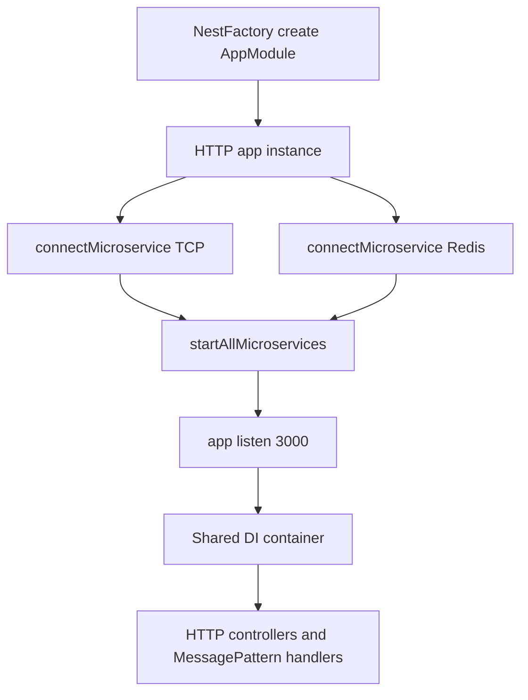

# Hybrid Applications: One NestJS App, Multiple Transports

## English

A standard NestJS app listens on HTTP via `NestFactory.create(AppModule)` followed by `app.listen(3000)`. A hybrid application is one where the same NestJS container also serves a second transport — typically a microservice transport like TCP, Redis, NATS, Kafka, or gRPC — without running two separate processes. You create the HTTP app as usual, then call `app.connectMicroservice(options)` for each additional transport, and finally `await app.startAllMicroservices()` before `app.listen()`. The result is a single process whose dependency injection container, modules, and providers are shared between the HTTP controllers and the microservice message handlers.

The practical benefit is that a service can expose both a REST API for browsers and a message-based interface for internal services, sharing the same business logic. A `PaymentsService` might be injected into an `PaymentsController` (HTTP) and also into a `PaymentsConsumer` decorated with `@MessagePattern` or `@EventPattern` for the microservice transport. Because both resolve to the same singleton instance, caches, database connections, and configuration are shared. This is a genuinely useful pattern in transitional architectures where some clients still speak HTTP while newer services speak gRPC or Kafka.

There are real trade-offs. Running both transports in one process means a crash in the microservice handler can take down the HTTP server, and resource limits (memory, CPU, event loop) are shared. Scaling is also coupled: you cannot independently scale the HTTP side and the message-consumer side. For these reasons, teams often start with a hybrid for simplicity and later split into two deployments once traffic patterns justify it. The hybrid approach is also handy in development, where one process is easier to debug than two.

Configuration requires attention. Each microservice transport has its own options object — for TCP you specify `host` and `port`; for Redis you specify the connection URL and channel; for Kafka you specify brokers, group ID, and client ID. These are passed to `connectMicroservice`. If you use `@nestjs/config`, remember that the microservice bootstrap happens before `app.listen()`, so any config the transport needs must be available at that point. Errors in microservice connection often surface as the app hanging on startup rather than throwing, so logging around `startAllMicroservices` is worth adding.

A useful mental model: the NestJS application context is the brain, and transports are mouths. HTTP, gRPC, and Kafka are different ways of speaking to the same brain, which holds the modules and providers. Once you see it this way, hybrid apps stop feeling like a special case and start looking like the natural consequence of NestJS separating the application context from the transport layer. That separation is also why you can test the application context without any network transport at all, using `Test.createTestingModule`.

## 中文

標準的 NestJS 應用透過 `NestFactory.create(AppModule)` 再 `app.listen(3000)` 在 HTTP 上監聽。混合式應用（hybrid application）則是同一個 NestJS 容器同時服務第二種傳輸——通常是 TCP、Redis、NATS、Kafka 或 gRPC 這類微服務傳輸——而不需要跑兩個獨立程序。你照常建立 HTTP 應用，然後對每種額外傳輸呼叫 `app.connectMicroservice(options)`，最後在 `app.listen()` 之前 `await app.startAllMicroservices()`。結果是一個單一程序，其依賴注入容器、模組與 provider 在 HTTP controller 與微服務訊息處理器之間共用。

實際好處是：一個服務可以同時為瀏覽器提供 REST API，又為內部服務提供訊息式介面，並共用同一套業務邏輯。一個 `PaymentsService` 可能被注入到 `PaymentsController`（HTTP），也被注入到一個以 `@MessagePattern` 或 `@EventPattern` 標註的 `PaymentsConsumer`（微服務傳輸）。因為兩者都解析到同一個單例實例，快取、資料庫連線與設定都共用。這在過渡期架構中非常有用：有些客戶端仍講 HTTP，而較新的服務講 gRPC 或 Kafka。

當中有真實的取捨。兩種傳輸跑在同一個程序，意味着微服務處理器一旦崩潰，可以拖垮 HTTP 伺服器，而資源限制（記憶體、CPU、事件迴圈）也是共用的。擴展也被綁在一起：你無法獨立地擴展 HTTP 端與訊息消費端。基於這些原因，團隊通常先以混合式求簡單，待流量模式證明有必要時再拆成兩個部署。混合式在開發時也很方便，一個程序比兩個更容易除錯。

設定需要留心。每種微服務傳輸都有自己的選項物件——TCP 要指定 `host` 與 `port`；Redis 要指定連線 URL 與 channel；Kafka 要指定 brokers、group ID 與 client ID。這些都傳給 `connectMicroservice`。若你用 `@nestjs/config`，要記住微服務啟動發生在 `app.listen()` 之前，所以傳輸所需的任何設定必須在該刻已可用。微服務連線的錯誤往往表現為應用在啟動時卡住而非拋出異常，所以在 `startAllMicroservices` 附近加日誌是值得的。

一個有用的心智模型：NestJS 的應用上下文是大腦，傳輸是嘴巴。HTTP、gRPC 與 Kafka 只是對同一個大腦說話的不同方式，而大腦持有模組與 provider。一旦這樣看，混合式應用就不再像特殊情況，而像是 NestJS 把應用上下文與傳輸層分離之後的自然結果。這種分離也正是為何你可以完全不用任何網絡傳輸，只用 `Test.createTestingModule` 就能測試應用上下文。

## Key Takeaway

A hybrid app runs HTTP and a microservice transport in one process sharing the same DI container, which is convenient but couples scaling and failure domains — a stepping stone rather than a final architecture.

## Related Concepts
- connectMicroservice
- MessagePattern vs EventPattern

## Diagram

