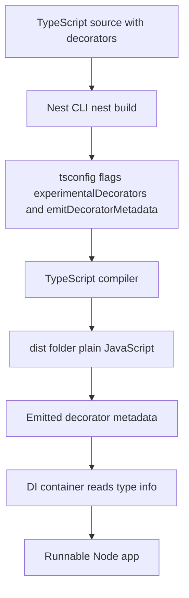

# The Nest CLI and the Build Pipeline: From Decorators to Runnable JavaScript

## English

NestJS source code is not what Node runs. You write TypeScript with decorators like @Controller and @Injectable, and Node cannot execute any of it directly. The Nest CLI (invoked as nest) is a thin wrapper around the TypeScript compiler and a build orchestrator. When you run nest build, it compiles your .ts files into plain JavaScript in a dist folder, and it does so through one of three builders, chosen with the --builder flag: tsc, which emits files one-to-one; swc, which compiles much faster and is the recommended fast path; and rspack, which bundles everything into a single file. The older --webpack flag still exists but is documented as a deprecated legacy flag in favour of --builder rspack. The choice matters when you deploy: the tsc builder keeps your folder structure intact and is easier to debug, while a bundling builder produces a smaller artifact and is often preferred for serverless functions or Docker images where cold-start size counts.

The most important thing the CLI does is enable the decorator metadata that Nest depends on. In your tsconfig.json you will find two flags: experimentalDecorators, which turns on the @ syntax, and emitDecoratorMetadata, which makes the compiler write hidden type information next to each decorated class. That second flag is the secret sauce. When you write constructor(private readonly usersService: UsersService), the emitted metadata records that the parameter's type is UsersService, and the dependency injection container reads that record at runtime to know what to inject. Strip the metadata and the container has nothing to work with. This is why NestJS dependency injection is described as reflection-based: it is inspecting type information the compiler baked into your output.

The CLI also scaffolds code. Commands like nest generate module users, nest generate controller users, or the shorthand nest g resource users create files AND register them in the nearest module automatically (a controller goes into its controllers array, a provider or service into providers, a module into imports). That automatic wiring is a small convenience with a big effect: it keeps the module graph consistent, so you rarely forget to register a provider. The schematics are configurable, so a team can standardise file naming, test scaffolding, and folder layout across an entire codebase.

A practical detail: nest start --watch runs your app and recompiles on file changes, restarting the process when the build succeeds. This is different from a bundler dev server that hot-swaps modules in memory. Because Node processes are restarted, in-memory state (caches, connection pools, open sockets) is lost on each reload, which is worth remembering when debugging something that only happens after a restart. In production you typically run the compiled output with plain node dist/main.js rather than through the CLI, keeping the runtime image lean.

Finally, the CLI is optional. You can compile with plain tsc, bundle with esbuild or SWC for much faster builds, and run node directly. Many teams swap the default compiler for SWC in development because it compiles TypeScript dramatically faster, at the cost of slightly different metadata emission behaviour that you should verify. The key mental model: the CLI is a convenience layer over the TypeScript compiler, and the compiler is what makes decorator-driven dependency injection possible at all.

## 中文

NestJS 的原始碼並不是 Node 直接執行的東西。你寫的是帶有 @Controller、@Injectable 等裝飾器的 TypeScript，而 Node 根本無法直接執行這些內容。Nest CLI（以 nest 指令呼叫）本質上是 TypeScript 編譯器的一層薄封裝，再加上一個建置協調器。當你執行 nest build，它會把你的 .ts 檔案編譯成純 JavaScript 放到 dist 資料夾，而且有兩種模式：預設的 tsc 模式會一對一輸出檔案，webpack 模式則把所有東西打包成單一檔案。這個模式在部署時很關鍵：tsc 模式保留原本的資料夾結構，除錯較容易；webpack 模式產物較小，常用於伺服器無伺服器函數或 Docker 映像，因為冷啟動大小很重要。

CLI 最重要的功能，是啟用 Nest 所依賴的裝飾器中繼資料（decorator metadata）。在你的 tsconfig.json 裡會看到兩個旗標：experimentalDecorators 開啟 @ 語法，emitDecoratorMetadata 則讓編譯器在每個被裝飾的類別旁寫下隱藏的型別資訊。第二個旗標就是關鍵所在。當你寫 constructor(private readonly usersService: UsersService)，編譯出的中繼資料會記錄該參數的型別是 UsersService，而依賴注入容器在執行時讀取這筆記錄，才知道要注入什麼。把中繼資料拿掉，容器就無從下手。這就是為何 NestJS 的依賴注入被形容為「基於反射」：它檢視的是編譯器烘焙進輸出檔的型別資訊。

CLI 也會產生骨架程式碼。像 nest generate module users、nest generate controller users，或簡寫 nest g resource users 這類指令，不只建立檔案，還會自動更新最近模組的 imports 陣列。這個自動接線看似小方便，影響卻很大：它讓模組圖保持一致，你幾乎不會忘記註冊 provider。這些 schematics 可設定，因此團隊可以統一整個程式庫的檔名、測試骨架與資料夾結構。

一個實務細節：nest start --watch 會執行你的應用並在檔案變更時重新編譯，建置成功後重啟行程。這和 bundler 開發伺服器在記憶體中熱替換模組不同。因為 Node 行程會被重啟，每次重載都會遺失記憶體中的狀態（快取、連線池、開啟的 socket），當你除錯只在重啟後才出現的問題時，這點值得記住。在正式環境你通常用純 node dist/main.js 執行編譯後的產物，而不是透過 CLI，讓執行時映像保持精簡。

最後，CLI 是可選的。你可以用純 tsc 編譯、用 esbuild 或 SWC 打包以獲得快得多的建置速度，並直接執行 node。許多團隊在開發時改用 SWC，因為它編譯 TypeScript 快得多，代價是中繼資料的輸出方式略有不同，值得你自行驗證。關鍵心智模型是：CLI 是 TypeScript 編譯器之上的便利層，而編譯器才是讓裝飾器驅動的依賴注入得以成立的基礎。

## Key Takeaway

The Nest CLI is a convenience wrapper around the TypeScript compiler, and the emitDecoratorMetadata flag is what makes decorator-based dependency injection work at runtime.

## Related Concepts
- TypeScript decorators
- dependency injection container

## Diagram

