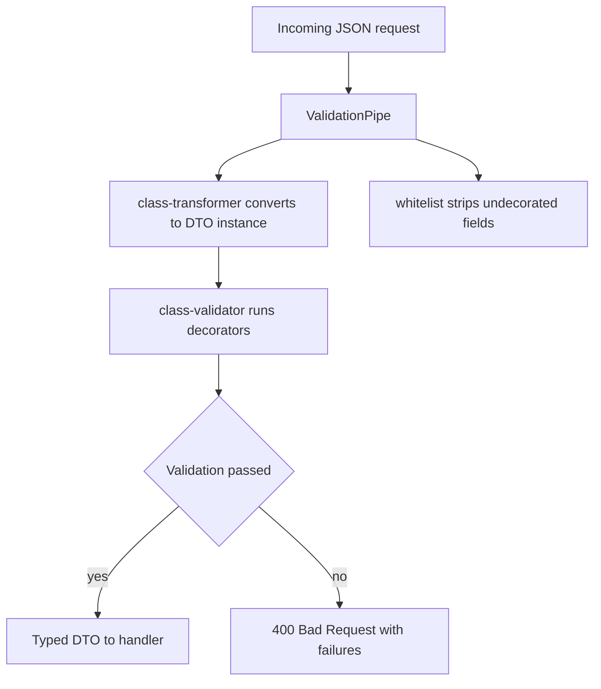

# Request Validation End to End: class-validator, DTOs and the Whitelist

## English

A DTO (Data Transfer Object) is a plain class that describes the shape of data crossing your API boundary. In NestJS the typical pattern is to declare a class with decorated properties, then attach a ValidationPipe to the route or globally. The pipe inspects the incoming body, query, or params, runs the validators, and either passes a typed instance to your handler or throws a 400 Bad Request with a list of failures. The reason a class is used rather than an interface is that interfaces vanish at compile time, while classes survive as runtime values that decorators and metadata can attach to.

Concretely, you write something like a CreateUserDto class with @IsEmail() on an email property and @MinLength(8) on a password property, using decorators from the class-validator package. The ValidationPipe is built on class-transformer, which converts the plain JSON object into an instance of your DTO class before validation. This conversion step matters more than it looks: JSON has no concept of numbers, so a query-string value like ?page=2 arrives as the string "2". With transform enabled, class-transformer can coerce it to a number, but only when it can tell what type you want — and by default it cannot, because TypeScript's design:type metadata for a plain property is not a reliable source of the intended type. To get the coercion you need either a @Type(() => Number) decorator on the property or enableImplicitConversion: true on the pipe. Without one of those, the value stays the string "2" and the validators check the wrong type.

Two options on the pipe deserve special attention. whitelist: true strips any properties from the payload that have no validation decorator, which defends against mass-assignment attacks where an attacker sneaks in an extra field like isAdmin. forbidNonWhitelisted: true goes further and rejects the request outright instead of silently dropping the field. The difference is a design decision: silent stripping is forgiving for clients, hard rejection surfaces mistakes early. There is also skipMissingProperties, which changes how optional fields are treated, so read the docs carefully before relying on it.

The global setup is usually done in main.ts with app.useGlobalPipes(new ValidationPipe({ whitelist: true, transform: true })). Alternatively you can register the pipe as a provider in a module and use APP_PIPE, which lets the pipe itself receive dependency injection, for example to read configuration. Prefer the provider approach if your validation needs anything injected; use the direct call for simple cases.

A subtle but important point: validation is not sanitisation and it is not authorisation. A validator confirms that a value looks like a valid email; it does not confirm that the caller is allowed to set that email. Similarly, validation does not escape HTML or prevent SQL injection; those are handled elsewhere (parameterised queries, output encoding). Treat the DTO plus ValidationPipe as the first gate at the edge of your API, and keep business-rule checks and permission checks in the service or guards layer where they belong.

## 中文

DTO（Data Transfer Object，資料傳輸物件）是一個描述跨越 API 邊界之資料形狀的普通類別。在 NestJS 裡典型做法是宣告一個帶有裝飾屬性的類別，然後在路由或全域掛上 ValidationPipe。這個 pipe 會檢視進來的 body、query 或 params，執行驗證器，然後要麼把一個有型別的實例交給你的處理函式，要麼拋出 400 Bad Request 並附上失敗清單。之所以用類別而不用介面，是因為介面在編譯期就消失，而類別會以執行時期的值存活下來，讓裝飾器與中繼資料可以附著其上。

具體來說，你會寫一個像 CreateUserDto 的類別，在 email 屬性上放 @IsEmail()，在 password 屬性上放 @MinLength(8)，用的是 class-validator 套件的裝飾器。ValidationPipe 建構在 class-transformer 之上，它在驗證之前先把純 JSON 物件轉換成你 DTO 類別的實例。這個轉換步驟比表面看來更重要：JSON 沒有數字的概念，所以像 ?page=2 這種查詢字串值會以字串 "2" 抵達。開啟 transform 後，class-transformer 可以依宣告的 TypeScript 型別把它轉成數字，驗證器接著檢查真正的型別，而不是字串。

pipe 上有兩個選項值得特別注意。whitelist: true 會把 payload 中沒有驗證裝飾器的屬性剝除，這可防禦大量賦值攻擊——攻擊者偷偷塞進像 isAdmin 這種額外欄位。forbidNonWhitelisted: true 更進一步，直接拒絕請求，而不是默默丟棄該欄位。差別是設計取捨：默默剝除對用戶端較寬容，強硬拒絕則讓錯誤及早浮現。另外還有 skipMissingProperties，它會改變選填欄位的處理方式，依賴它之前請仔細閱讀文件。

全域設定通常在 main.ts 裡用 app.useGlobalPipes(new ValidationPipe({ whitelist: true, transform: true })) 完成。或者你可以把 pipe 註冊為模組中的 provider 並使用 APP_PIPE，這樣 pipe 本身就能接受依賴注入，例如讀取設定。若你的驗證需要注入任何東西，偏好 provider 做法；簡單情況則直接用呼叫。

一個微妙但重要的重點：驗證不是消毒（sanitisation），也不是授權。驗證器確認某個值看起來像合法 email，但不確認呼叫者是否有權設定該 email。同樣地，驗證不會跳脫 HTML 或防止 SQL 注入；那些在別處處理（參數化查詢、輸出編碼）。把 DTO 加 ValidationPipe 視為 API 邊界的第一道關卡，而業務規則檢查與權限檢查則留在 service 或 guards 層，那才是它們該在的地方。

## Key Takeaway

DTOs plus ValidationPipe form the first gate at your API edge, and options like whitelist and transform turn loosely-typed JSON into checked, typed objects.

## Related Concepts
- class-validator
- Data Transfer Objects

## Diagram

