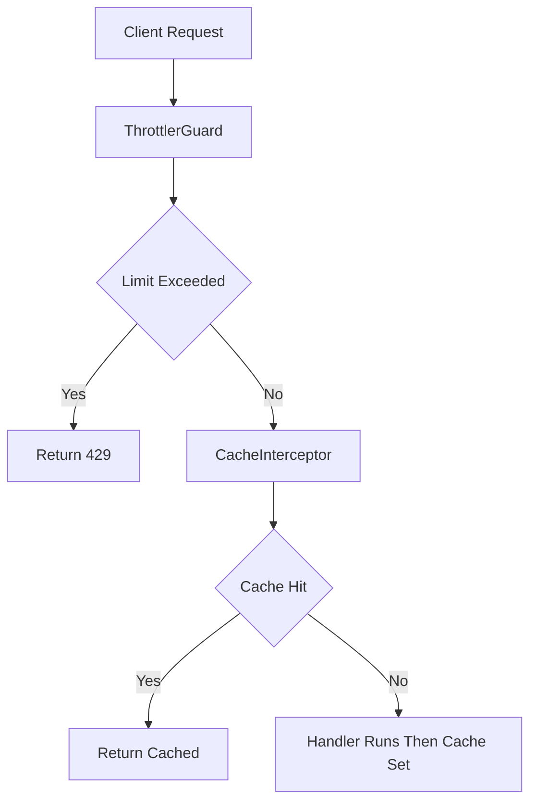

# Caching and Rate Limiting: Protecting Your API Without Rewriting It

## English

Two cross-cutting concerns show up in almost every production API: repeated identical reads that hammer the database, and clients (or attackers) sending too many requests. NestJS addresses both with dedicated modules that plug into the interceptor and guard pipeline you already have, so you rarely touch your controller logic.

Caching in NestJS is provided by the @nestjs/cache-manager module. You register it in a module with CacheModule.register(), optionally passing options such as a time-to-live in milliseconds. There is no maximum-items option at that level: capacity limiting belongs to the underlying Keyv store, where you configure it on the store itself (for example an lruSize on the in-memory Keyv store) rather than on the cache module. Then you inject the cache manager and call get and set around expensive work, or use the declarative route: decorate a controller method with @UseInterceptors(CacheInterceptor) and a @CacheKey, and the interceptor will check the cache before invoking your handler and store the result afterwards. The default store is in-memory, which is fine for a single process but useless across multiple instances; for a cluster you swap in a shared store such as Redis by configuring the module with a Redis-backed store. The mental model is a key-value lookup keyed by route and parameters, with a TTL that bounds staleness.

Rate limiting is provided by @nestjs/throttler. You import ThrottlerModule and configure a default limit, for example a number of requests per time window expressed in milliseconds, then bind ThrottlerGuard globally or per route. The guard tracks request counts per client, typically keyed by IP address, and returns HTTP 429 Too Many Requests when the limit is exceeded. The default in-memory storage works for a single instance; for a horizontally scaled deployment you configure a shared storage so all instances see the same counters, otherwise a client can multiply its allowance by hitting different pods. You can also override limits per route with a decorator, which is useful for expensive endpoints like login or password reset.

Both features illustrate a broader NestJS philosophy: cross-cutting behaviour belongs in infrastructure, not scattered through handlers. Caching is an interceptor because it wraps the handler call; rate limiting is a guard because it decides whether the request may proceed at all. That placement is not arbitrary. If you find yourself writing cache lookups inside every service method, or counting requests manually, you are fighting the framework rather than using it.

A caution about caching: it hides bugs. A stale cache can make a bug appear intermittently, and a cache key that ignores a relevant parameter (say, the current user's ID) can leak one user's data to another. Always decide deliberately what belongs in the key. Similarly, rate limiting by IP alone breaks behind a reverse proxy unless you configure trust proxy so the real client address is read from the forwarded header. These are the kind of details that separate a demo from a deployable service.

## 中文

幾乎每個正式環境的 API 都會出現兩個橫切關注點：重複的相同讀取把資料庫打爆，以及用戶端（或攻擊者）送出過多請求。NestJS 用專屬模組來處理這兩者，它們掛進你既有的 interceptor 與 guard 管線，因此你幾乎不必改動 controller 邏輯。

NestJS 的快取由 @nestjs/cache-manager 模組提供。你在模組裡用 CacheModule.register() 註冊它，可選擇傳入選項，例如以毫秒為單位的存活時間（time-to-live）與最大項目數。接著你注入 cache manager，在昂貴工作前後呼叫 get 與 set，或使用宣告式做法：在 controller 方法上裝飾 @UseInterceptors(CacheInterceptor) 與 @CacheKey，interceptor 會在呼叫你的處理函式前檢查快取，並在之後儲存結果。預設儲存是記憶體內的，對單一行程沒問題，但跨多個實例就沒用；若要在叢集上運作，你得換成共享儲存，例如透過設定 Redis 後端的 store 來配置該模組。心智模型是：以路由與參數為鍵的鍵值查詢，並用 TTL 界定過期程度。

限流由 @nestjs/throttler 提供。你匯入 ThrottlerModule 並設定預設限制，例如以毫秒表示的時間窗內允許多少請求，然後把 ThrottlerGuard 全域或逐路由綁定。這個 guard 會依用戶端（通常以 IP 位址為鍵）追蹤請求計數，超過限制時回傳 HTTP 429 Too Many Requests。預設的記憶體儲存對單一實例可行；水平擴展的部署則要設定共享儲存，讓所有實例看到相同的計數器，否則用戶端只要打不同 pod 就能把額度倍增。你也可以用裝飾器逐路由覆寫限制，對登入或密碼重設這類昂貴端點很有用。

這兩個功能都體現了 NestJS 更廣泛的哲學：橫切行為應放在基礎設施層，而不是散落在各處理函式中。快取是 interceptor，因為它包住處理函式的呼叫；限流是 guard，因為它決定請求到底能不能繼續。這個位置安排並非隨意。如果你發現自己在每個 service 方法裡寫快取查詢，或手動計數請求，那你是在和框架對抗，而不是在使用它。

關於快取的警告：它會掩蓋 bug。過期的快取會讓 bug 間歇出現，而忽略相關參數（比如目前使用者的 ID）的快取鍵，可能把某個使用者的資料洩漏給另一個。永遠要刻意決定什麼該放進鍵裡。同樣地，只依 IP 限流在反向代理後面會失效，除非你設定 trust proxy，讓真實用戶端位址從轉送的標頭讀取。這些細節正是區分展示品與可部署服務的地方。

## Key Takeaway

Caching and rate limiting are cross-cutting concerns that NestJS places in interceptors and guards, so you configure them once instead of polluting every handler.

## Related Concepts
- interceptors
- guards

## Diagram

