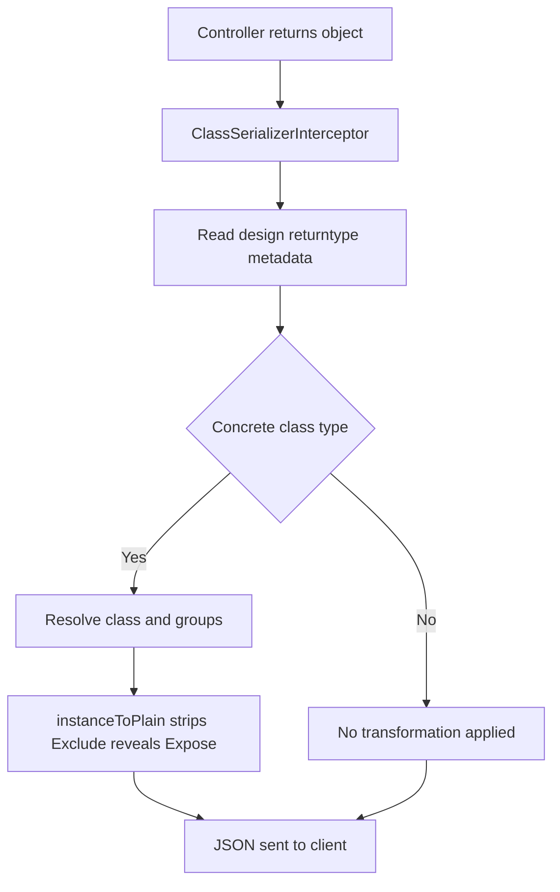

# Serialization: How NestJS Decides What Leaves Your API

## English

Every controller method returns a plain JavaScript object, but what the client actually receives is the result of a serialization step you can control. NestJS ships an interceptor called ClassSerializerInterceptor that, when enabled (commonly globally via app.useGlobalInterceptors(new ClassSerializerInterceptor(app.get(Reflector)))), inspects the declared return type of your handler and runs the response object through class-transformer's instanceToPlain. That means if you annotate a field with @Exclude() or @Expose() from class-transformer, the interceptor will strip or reveal it before the JSON is written. This is how you avoid leaking a password hash without hand-writing a mapping function in every service.

The key subtlety is that serialization depends on runtime metadata. NestJS uses reflect-metadata and the design:returntype metadata emitted by the TypeScript compiler to know which class to instantiate and transform. If your handler is typed as Promise<UserEntity>, the interceptor can resolve UserEntity; if you type it as any or a plain interface, the metadata is lost and no transformation happens. This is a common source of confusion: your @Exclude() decorators silently do nothing because the return type was erased. Always return a concrete class instance from your service, not a plain object literal, if you rely on serialization.

You can also do explicit serialization with @SerializeOptions({ groups: ['public'] }) on a handler, or by calling plainToInstance / instanceToPlain yourself. Groups let one entity serve multiple views: an admin route exposes the email and role fields, a public route exposes only the display name. The group names are matched against the @Expose({ groups: [...] }) options on the class properties. This keeps a single source of truth for your data shape while giving each endpoint a tailored projection.

A practical pattern is to define response DTOs separately from persistence entities. Your TypeORM or Prisma entity models the database; your response DTO models the wire format. The DTO uses @Expose() on the fields you want and omits everything else, so even if someone later adds a sensitive column to the entity, it will not accidentally appear in the API. This separation also makes your OpenAPI schema accurate, because Swagger reads the DTO, not the entity.

Finally, remember that serialization is not validation. Validation (class-validator) runs on the way in; serialization (class-transformer) runs on the way out. They are complementary halves of the DTO story: one protects your database from bad input, the other protects your clients from bad output. Treat both as first-class concerns and your API contract stays honest as the codebase grows.

## 中文

每個 controller 方法都回傳一個普通的 JavaScript 物件，但客戶端真正收到的，其實是經過一層你可以控制的序列化（serialization）步驟之後的結果。NestJS 內建一個叫 ClassSerializerInterceptor 的 interceptor，當你啟用它（常見做法是透過 app.useGlobalInterceptors(new ClassSerializerInterceptor(app.get(Reflector))) 全域註冊），它會檢查 handler 宣告的回傳型別，並把回應物件交給 class-transformer 的 instanceToPlain 處理。意思是：如果你在某個欄位上標註 class-transformer 的 @Exclude() 或 @Expose()，這個 interceptor 會在 JSON 寫出之前把該欄位剝除或揭露。這就是你不用在每個 service 裡手寫 mapping 函式，也能避免密碼雜湊外洩的方法。

關鍵的微妙之處在於：序列化依賴執行期的 metadata。NestJS 使用 reflect-metadata，以及 TypeScript 編譯器發出的 design:returntype metadata，來得知該實例化並轉換哪個 class。如果你的 handler 型別寫成 Promise<UserEntity>，interceptor 就解析得到 UserEntity；但如果你寫成 any 或普通 interface，metadata 就消失了，轉換根本不會發生。這是常見的困惑來源：你的 @Exclude() 裝飾器默默失效，只因為回傳型別被抹除。只要你依賴序列化，service 就應該回傳具體的 class 實例，而不是物件字面量。

你也可以在 handler 上使用 @SerializeOptions({ groups: ['public'] }) 做顯式序列化，或自行呼叫 plainToInstance / instanceToPlain。Groups 讓同一個 entity 服務多種視角：admin 路由揭露 email 與 role 欄位，公開路由只揭露顯示名稱。group 名稱會與 class 屬性上的 @Expose({ groups: [...] }) 選項比對。這樣一來，資料形狀只有單一真相來源，同時每個 endpoint 又能有量身打造的投影。

一個實用的模式，是把回應 DTO 與持久化 entity 分開定義。你的 TypeORM 或 Prisma entity 描述資料庫；你的回應 DTO 描述網路格式。DTO 只在想暴露的欄位上使用 @Expose()，其餘一律省略，於是即使日後有人對 entity 加了敏感欄位，它也不會意外出現在 API 裡。這種分離也讓你的 OpenAPI schema 更準確，因為 Swagger 讀的是 DTO，不是 entity。

最後要記得：序列化不是驗證。驗證（class-validator）在請求進來時執行；序列化（class-transformer）在回應出去時執行。它們是 DTO 故事的互補兩半：一個保護你的資料庫免受壞輸入，另一個保護你的客戶端免受壞輸出。把兩者都當作一等公民來對待，你的 API 契約就會隨著程式碼成長而始終誠實。

## Key Takeaway

NestJS serialization is a separate, metadata-driven outbound step that strips or exposes fields via class-transformer, and it only works when your handlers return concrete class types.

## Related Concepts
- class-transformer
- ClassSerializerInterceptor

## Diagram

