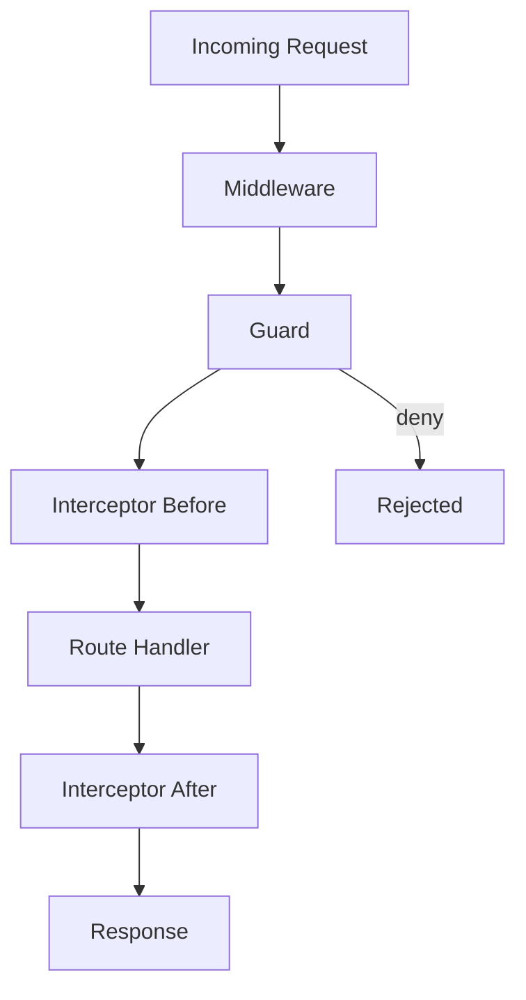

# Cross-Cutting Concerns: The NestJS Way to Wrap Everything

## English

A cross-cutting concern is a behaviour that applies to many parts of an application but does not belong to any single one: logging, timing, tracing, auditing, tenant resolution, feature flags. In a plain Express app you sprinkle middleware and hope every route remembers to use it. NestJS gives you three composable tools for these concerns — middleware, interceptors, and guards — and knowing which to reach for is the difference between a clean codebase and a tangle.

Middleware is the lowest-level tool. It runs before the route handler, has access to the raw req and res objects, and is registered per-module via configure(consumer: MiddlewareConsumer). Use it for things that must touch the raw HTTP layer: parsing cookies, attaching a request ID, or integrating a third-party Express middleware. Middleware does not know about your controller or handler, so it cannot easily read route metadata.

Interceptors wrap the handler call itself. They receive an ExecutionContext, which exposes the handler, the class, the arguments, and the transport type; they also receive a CallHandler you can invoke to run the downstream logic. This makes them ideal for timing a request (record the start, await next.handle(), record the end), transforming the response, mapping errors, or retrying. Because an interceptor can run code before and after next.handle(), it can wrap the whole request like an onion layer. That is exactly what a logging interceptor does: log on the way in, log on the way out, and measure the delta.

Guards answer one question — may this request proceed? — and they run before interceptors. They return a boolean or a Promise/Observable of one, and they can read metadata attached to the handler via SetMetadata and Reflector. Use guards for authentication and authorization, not for logging. Pipes run even later, transforming or validating individual arguments. The order is fixed: middleware, then guards, then interceptors (before), then pipes, then the handler, then interceptors (after), then exception filters if anything threw.

A common mistake is putting authorization logic in an interceptor because it is 'easier to access the user'. Guards are the correct place because they can short-circuit the request cleanly and are designed for the allow/deny decision. Conversely, don't put response-shaping logic in middleware; by the time middleware sees the response it is too late to use the ExecutionContext or the return value cleanly. Match the tool to the layer, and each concern gets one obvious home.

## 中文

橫切關注點（cross-cutting concern）是指適用於應用程式許多部分、卻不屬於任何單一部分的行為：日誌、計時、追蹤、稽核、租戶解析、功能旗標。在純 Express 應用裡，你會四處散佈 middleware，然後祈禱每個路由都記得使用它。NestJS 給你三個可組合的工具來處理這類關注點——middleware、interceptor、guard——知道該用哪一個，就是乾淨程式碼與一團亂之間的差別。

Middleware 是最低階的工具。它在路由 handler 之前執行，能存取原始的 req 與 res 物件，並透過 configure(consumer: MiddlewareConsumer) 按模組註冊。凡是必須碰觸原始 HTTP 層的事情就用它：解析 cookie、附加 request ID，或整合第三方 Express middleware。Middleware 不認識你的 controller 或 handler，所以它不容易讀取路由 metadata。

Interceptor 包住 handler 呼叫本身。它會收到 ExecutionContext，可取得 handler、class、參數與傳輸型別；它也會收到一個 CallHandler，你可以呼叫它來執行下游邏輯。這讓 interceptor 非常適合為請求計時（記錄開始、await next.handle()、記錄結束）、轉換回應、對應錯誤或重試。因為 interceptor 能在 next.handle() 前後執行程式碼，它可以像洋蔥層一樣包住整個請求。日誌 interceptor 正是這樣做的：進來的路徑記一筆、出去的路徑記一筆，並量測時間差。

Guard 只回答一個問題——這個請求可以繼續嗎？——而且它在 interceptor 之前執行。它回傳布林值，或布林值的 Promise/Observable，並且能透過 SetMetadata 與 Reflector 讀取掛在 handler 上的 metadata。Guard 用於身分驗證與授權，不要用於日誌。Pipe 執行得更晚，負責轉換或驗證個別參數。順序是固定的：middleware、guard、interceptor（前段）、pipe、handler、interceptor（後段），若中途拋錯則進入 exception filter。

常見的錯誤，是因為「比較容易存取 user」就把授權邏輯放進 interceptor。Guard 才是正確的位置，因為它能乾淨地短路請求，而且本來就是為允許/拒絕的決策而設計。反過來說，也不要把塑造回應的邏輯放進 middleware；等到 middleware 看到回應時，已經太晚乾淨地使用 ExecutionContext 或回傳值了。把工具對應到正確的層，每個關注點就會有唯一明顯的歸屬。

## Key Takeaway

Middleware, guards, and interceptors each own a distinct layer of the request, and choosing the right one keeps cross-cutting concerns from leaking into your business logic.

## Related Concepts
- Execution Layer Ordering
- MiddlewareConsumer

## Diagram

