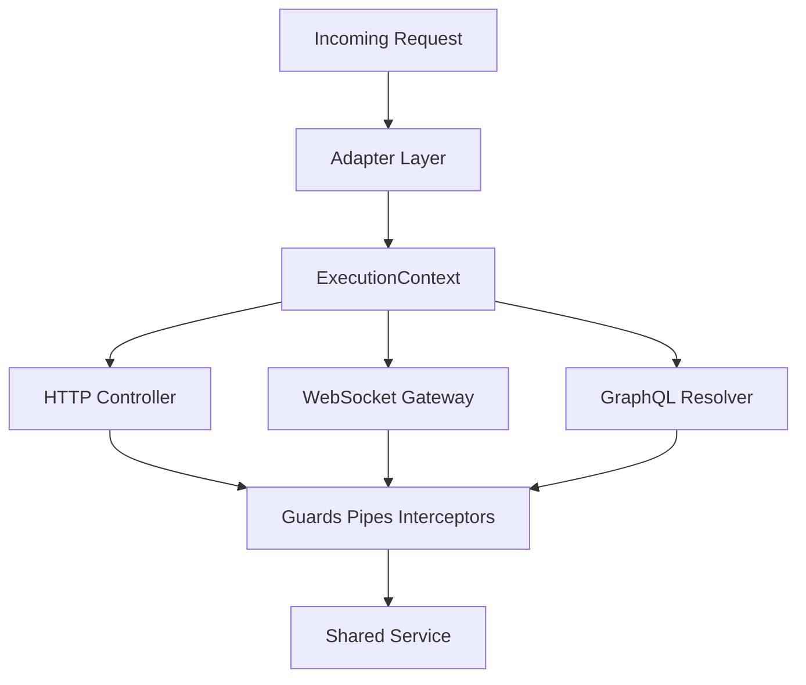

# Going Beyond HTTP: WebSockets, GraphQL and the Adapter Abstraction

## English

NestJS is often described as an HTTP framework, but its real design goal is transport-agnosticism. Underneath every controller sits an adapter: Express by default, Fastify if you opt in via NestFactory.create(AppModule, new FastifyAdapter()). The adapter abstracts the HTTP server, so the same controllers, guards, pipes, and interceptors work regardless of which HTTP library you choose. This is why you can swap Express for Fastify later and keep your application code untouched — the framework translates your decorators into whatever the adapter understands.

WebSockets follow the same philosophy. With @WebSocketGateway() you declare a gateway class, and @SubscribeMessage('event') methods handle incoming frames. The gateway can be configured for the socket.io or ws platform, and NestJS injects the underlying server so you can broadcast to rooms or clients. What is powerful is that guards, pipes, and interceptors apply to gateways too, because they operate on the ExecutionContext, which knows the transport type. A single AuthGuard can protect both HTTP routes and WebSocket events, reading the token from the handshake headers in one case and from the message payload in the other.

GraphQL is another adapter surface. With @nestjs/graphql you write resolvers using decorators like @Query, @Mutation, and @Resolver, and NestJS wires them into Apollo or Mercurius. The same dependency injection container, module system, and provider graph are reused, so a service can be shared between a REST controller and a GraphQL resolver without duplication. The GraphQL context is exposed through the ExecutionContext, so guards and interceptors can read the current user in exactly the same way they do for HTTP.

The ExecutionContext is the unifying abstraction. It offers switchToHttp(), switchToRpc(), switchToWs(), and getType(), so cross-cutting code can ask 'what kind of transport am I handling?' and adapt. A logging interceptor can log an HTTP method and path for REST, a message pattern for microservices, or an event name for WebSockets, all from one class. This is the payoff of the adapter design: you write behaviour once against the context, and it works everywhere.

One practical caveat: not every feature is portable. File uploads, for example, are HTTP-specific; streaming responses behave differently across Express and Fastify; and some middleware only exists in the Express world. When you adopt a non-default adapter, verify that the ecosystem plugins you rely on support it. The abstraction is strong, but it is not magic — it is a well-designed seam, and seams reward you for understanding where they are.

## 中文

NestJS 常被描述成 HTTP 框架，但它真正的設計目標是傳輸無關性（transport-agnosticism）。每個 controller 底下都坐著一個 adapter：預設是 Express，若你透過 NestFactory.create(AppModule, new FastifyAdapter()) 選擇加入，則是 Fastify。Adapter 抽象了 HTTP 伺服器，所以無論你選哪個 HTTP 函式庫，同一批 controller、guard、pipe、interceptor 都能運作。這就是為什麼你日後可以把 Express 換成 Fastify 而應用程式碼原封不動——框架會把你的裝飾器翻譯成 adapter 聽得懂的語言。

WebSocket 遵循同樣的哲學。你用 @WebSocketGateway() 宣告一個 gateway class，並用 @SubscribeMessage('event') 方法處理進來的訊框。Gateway 可以設定為 socket.io 或 ws 平台，NestJS 會注入底層伺服器，讓你能廣播到 room 或 client。強大之處在於 guard、pipe、interceptor 也適用於 gateway，因為它們操作的是 ExecutionContext，而它知道傳輸型別。同一個 AuthGuard 可以同時保護 HTTP 路由與 WebSocket 事件：前者從 handshake 標頭讀 token，後者從訊息 payload 讀。

GraphQL 是另一個 adapter 介面。用 @nestjs/graphql，你以 @Query、@Mutation、@Resolver 等裝飾器撰寫 resolver，NestJS 會把它們接進 Apollo 或 Mercurius。同一套依賴注入容器、模組系統與 provider 圖都被重複使用，所以一個 service 可以在 REST controller 與 GraphQL resolver 之間共用而不重複。GraphQL context 透過 ExecutionContext 暴露，因此 guard 與 interceptor 可以用與 HTTP 完全相同的方式讀取目前使用者。

ExecutionContext 是統一的抽象。它提供 switchToHttp()、switchToRpc()、switchToWs() 與 getType()，讓橫切程式碼可以問「我現在處理的是哪種傳輸？」並據此調整。一個日誌 interceptor 可以為 REST 記錄 HTTP 方法與路徑、為微服務記錄訊息樣式、為 WebSocket 記錄事件名稱，全都出自同一個 class。這就是 adapter 設計的回報：你針對 context 寫一次行為，它就能處處運作。

一個實務上的提醒：並非所有功能都可攜。例如檔案上傳是 HTTP 專屬；串流回應在 Express 與 Fastify 上行為不同；有些 middleware 只存在於 Express 世界。當你採用非預設 adapter 時，要確認你依賴的生態系外掛支援它。抽象很強，但不是魔法——它是一道設計良好的接縫，而接縫會回報那些理解它位於何處的人。

## Key Takeaway

NestJS's adapter and ExecutionContext abstractions let the same controllers, guards, and interceptors serve HTTP, WebSockets, GraphQL, and microservices with minimal duplication.

## Related Concepts
- FastifyAdapter
- ExecutionContext

## Diagram

