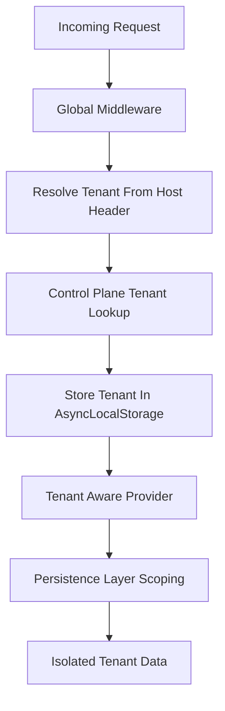

# Multi-Tenancy and Request Isolation in a Single NestJS Codebase

## English

Multi-tenancy means one running application serves many separate customers (tenants) while keeping their data and behaviour isolated. In NestJS there are three classic shapes: database-per-tenant, schema-per-tenant, and shared tables with a tenant column. The first two give the strongest isolation but multiply connection pools and migrations; the third is cheapest but pushes the burden of correctness onto every query. NestJS does not ship a built-in tenancy feature, so the usual pattern is a middleware or guard that resolves the tenant from a subdomain, header, or JWT claim, then stores it in a request-scoped provider or in AsyncLocalStorage so downstream services can read it without threading a parameter through every function call.

A concrete wiring looks like this: a global middleware reads the Host header, looks up a tenant record in a control-plane database, and attaches the result to the request object. A tenant-aware provider (often request-scoped, or backed by AsyncLocalStorage to avoid the per-request object cost) exposes the current tenant. Your persistence layer — whether TypeORM, Prisma, or MikroORM — then either swaps a DataSource per tenant from a cache of connection pools, or appends a where tenantId = ... clause automatically through a repository wrapper or query interceptor.

The dangerous part is leakage. A single forgotten filter turns one customer's invoices into another's. Defences: enforce tenant scoping at the lowest layer possible (repository base class, ORM middleware), write integration tests that assert cross-tenant reads return nothing, and treat any raw query as a code-review red flag. For schema-per-tenant, a common trick is to set the search path or schema on the connection before the query runs, which means connection pooling must be tenant-aware — otherwise a pooled connection leaks the previous tenant's schema.

Caching and background jobs need the same discipline. A Redis cache key that omits the tenant ID is a cross-tenant data breach waiting to happen, and a scheduled job that iterates all tenants must re-enter the tenant context before touching the database. NestJS's request-scoped providers help here, but remember that request scope bubbles up: any provider injected into a request-scoped provider also becomes request-scoped, which can hurt performance if applied carelessly.

Finally, think about noisy neighbours. One tenant hammering your API should not starve others. Per-tenant rate limits (for example, a custom ThrottlerGuard keyed on tenant ID), per-tenant queue concurrency in BullMQ, and per-tenant metrics let you see and contain the damage. Multi-tenancy is less a feature you install and more a discipline you enforce at every layer.

## 中文

多租戶（multi-tenancy）是指同一個運行中的應用程式同時服務多個獨立客戶（租戶），同時保持彼此的資料與行為隔離。在 NestJS 裡有三種經典形態：每個租戶一個資料庫、每個租戶一個 schema，以及共用資料表但加一個租戶欄位。前兩者隔離最強，但連線池與遷移（migration）會成倍增加；第三者成本最低，但把正確性的責任推到每一條查詢上。NestJS 本身沒有內建租戶功能，所以常見做法是用一個 middleware 或 guard，從子網域、header 或 JWT claim 解析出租戶，然後存進 request-scoped provider 或 AsyncLocalStorage，讓下游的 service 不必把參數一層層傳下去就能讀到。

具體接線大概是這樣：一個全域 middleware 讀取 Host header，在控制平面（control-plane）資料庫查出對應的租戶記錄，再把結果掛到 request 物件上。一個租戶感知的 provider（通常是 request-scoped，或用 AsyncLocalStorage 避免每個請求建立物件的成本）對外暴露目前的租戶。你的持久層——不論是 TypeORM、Prisma 還是 MikroORM——要麼從一個連線池快取中按租戶切換 DataSource，要麼透過 repository 包裝或查詢攔截器自動加上 where tenantId = ... 的條件。

最危險的地方是洩漏。一個忘記加的過濾條件，就會把某客戶的發票送到另一個客戶眼前。防禦方法：把租戶範圍盡量壓到最低層（repository 基底類別、ORM middleware），寫整合測試斷言跨租戶讀取必須回傳空結果，並把任何原生 SQL 查詢視為 code review 的紅旗。若採用 schema-per-tenant，常見技巧是在查詢前於連線上設定 search path 或 schema，這意味著連線池必須租戶感知——否則池中連線會殘留上一個租戶的 schema。

快取與背景任務也需要同樣的紀律。一個沒有帶租戶 ID 的 Redis 快取鍵，就是一個等著發生的跨租戶資料外洩；一個遍歷所有租戶的排程任務，在碰資料庫之前必須重新進入該租戶的 context。NestJS 的 request-scoped provider 在這裡幫得上忙，但記住 request scope 會向上蔓延：任何被注入到 request-scoped provider 的 provider 也會變成 request-scoped，用得不小心會拖慢效能。

最後，想想「吵鬧的鄰居」問題。一個狂打你 API 的租戶不應該餓死其他租戶。按租戶限流（例如自訂一個以租戶 ID 為 key 的 ThrottlerGuard）、在 BullMQ 裡按租戶設定佇列併發數，以及按租戶輸出的指標，讓你看到並圍堵損害。多租戶與其說是一個你安裝的功能，不如說是一種你在每一層都要貫徹的紀律。

## Key Takeaway

Multi-tenancy in NestJS is enforced by resolving the tenant early, propagating it through request-scoped or AsyncLocalStorage context, and scoping every query, cache key, and job at the lowest possible layer.

## Related Concepts
- AsyncLocalStorage
- Request-scoped providers

## Diagram

