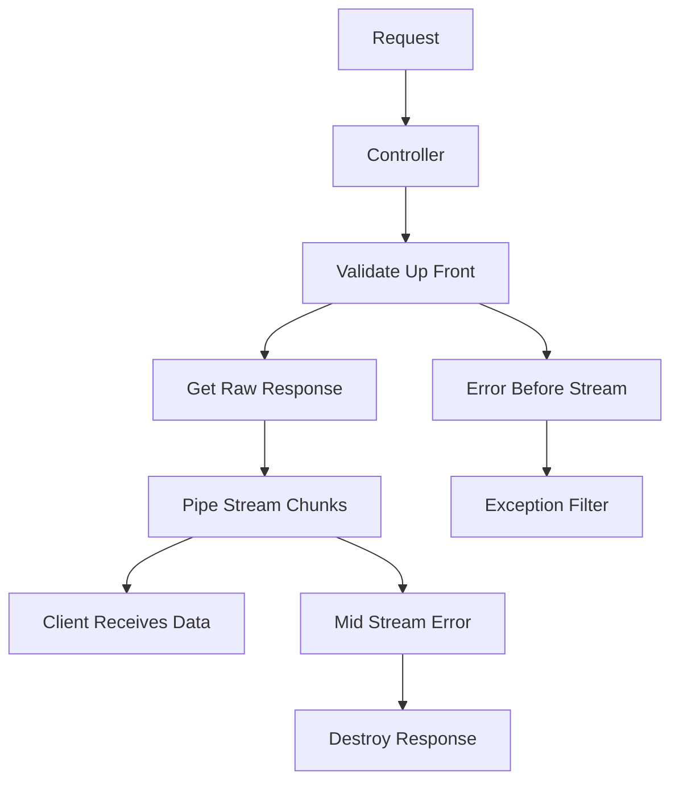

# Streaming Responses and Large Payloads in NestJS

## English

Most NestJS controllers return plain objects that the framework serialises to JSON and sends in one shot. That is fine for a few kilobytes, but wrong for a 200 MB CSV export, a live log tail, or a file download. NestJS exposes the underlying Express or Fastify response object via @Res() (or @Res({ passthrough: true }) when you still want Nest's own handling for status codes and headers), which lets you use Node's streaming APIs directly. In Express you pipe a Readable into res; in Fastify you return a stream from the handler. The key mental shift: instead of building the whole payload in memory, you produce it chunk by chunk.

For file uploads the mirror image applies. NestJS has a built-in FileInterceptor from @nestjs/platform-express that wraps Multer, and by default Multer buffers the whole file in memory or writes it to a temporary directory. For large uploads you configure storage: diskStorage writes directly to a path, and Multer's limits option caps file size so a malicious client cannot exhaust RAM. Fastify users instead reach for @fastify/multipart. Either way, validate the MIME type and size before touching disk, and never trust the client-supplied filename — generate your own.

Streaming has consequences for error handling. Once you have started writing bytes to the response, you cannot change the status code. If an error occurs halfway through a 500 MB export, the client receives a truncated file with a 200 OK. The pragmatic pattern is to validate everything that could fail up front (authorisation, query parameters, existence of the resource) and only then begin streaming; for genuine mid-stream failures, destroy the response so the client sees a connection reset rather than silent corruption. Exception filters do not help once headers are flushed.

Backpressure is the other subtlety. Node streams have a highWaterMark; when the consumer is slower than the producer, write() returns false and you should wait for the 'drain' event before pushing more. pipe() handles this for you, but hand-rolled loops that ignore the return value of write() will balloon memory. For database cursors, libraries like Prisma or TypeORM expose async iterators that you can wrap in a Readable, which keeps memory flat regardless of row count.

Finally, think about the HTTP layer itself. Chunked transfer encoding works without a Content-Length, but proxies and load balancers sometimes buffer responses unless configured otherwise (for example, nginx's proxy_buffering off). Compression interacts badly with streaming if applied naively, and Server-Sent Events need the right headers (Content-Type: text/event-stream, Cache-Control: no-cache) plus periodic heartbeats so intermediaries do not time out the connection. Streaming is powerful, but it moves complexity from the framework into your code.

## 中文

大多數 NestJS controller 回傳普通物件，框架會把它序列化成 JSON 一次送出。這對幾 KB 的資料沒問題，但對 200 MB 的 CSV 匯出、即時 log 追蹤或檔案下載就完全不適合。NestJS 透過 @Res()（或 @Res({ passthrough: true })，當你仍想讓 Nest 處理狀態碼與 header 時）暴露底層的 Express 或 Fastify response 物件，讓你直接使用 Node 的串流 API。在 Express 裡你把 Readable pipe 進 res；在 Fastify 裡你從 handler 回傳一個 stream。關鍵的心態轉變是：不要先在記憶體裡組出整個 payload，而是一塊一塊地產生。

檔案上傳是鏡像的另一面。NestJS 內建來自 @nestjs/platform-express 的 FileInterceptor，包裝了 Multer，預設情況下 Multer 會把整個檔案緩衝在記憶體或寫到暫存目錄。處理大檔案上傳時你要設定 storage：diskStorage 直接寫到指定路徑，而 Multer 的 limits 選項可限制檔案大小，避免惡意客戶端耗盡 RAM。Fastify 使用者則改用 @fastify/multipart。不論哪一種，都要在碰磁碟之前驗證 MIME 類型與大小，而且永遠不要信任客戶端提供的檔名——自己產生一個。

串流對錯誤處理有影響。一旦你開始把位元組寫進 response，就無法再改狀態碼。如果在 500 MB 匯出到一半時出錯，客戶端會收到一個截斷的檔案，卻帶著 200 OK。務實的做法是把所有可能失敗的事都提前驗證（授權、查詢參數、資源是否存在），然後才開始串流；對於真正的中途失敗，直接 destroy response，讓客戶端看到連線重置，而不是無聲的損壞。一旦 header 已送出，exception filter 就幫不上忙了。

背壓（backpressure）是另一個微妙之處。Node stream 有 highWaterMark；當消費者比生產者慢時，write() 會回傳 false，你應該等待 'drain' 事件再繼續推送。pipe() 會幫你處理這件事，但手寫迴圈若忽略 write() 的回傳值，記憶體就會膨脹。對於資料庫游標，Prisma 或 TypeORM 之類的函式庫提供 async iterator，你可以包成 Readable，這樣不論資料列有多少，記憶體都保持平穩。

最後，想想 HTTP 層本身。分塊傳輸編碼（chunked transfer encoding）不需要 Content-Length 也能運作，但代理與負載平衡器有時會緩衝回應，除非特別設定（例如 nginx 的 proxy_buffering off）。壓縮若用得不當，會與串流衝突；而 Server-Sent Events 需要正確的 header（Content-Type: text/event-stream、Cache-Control: no-cache），加上定期心跳，避免中間層把連線逾時切斷。串流很強大，但它把複雜度從框架搬進了你的程式碼。

## Key Takeaway

Streaming in NestJS means using @Res() or returning a stream to push bytes chunk by chunk, validating before the first byte leaves, respecting backpressure, and remembering that error handling and proxies behave differently once headers are flushed.

## Related Concepts
- FileInterceptor
- Backpressure

## Diagram

