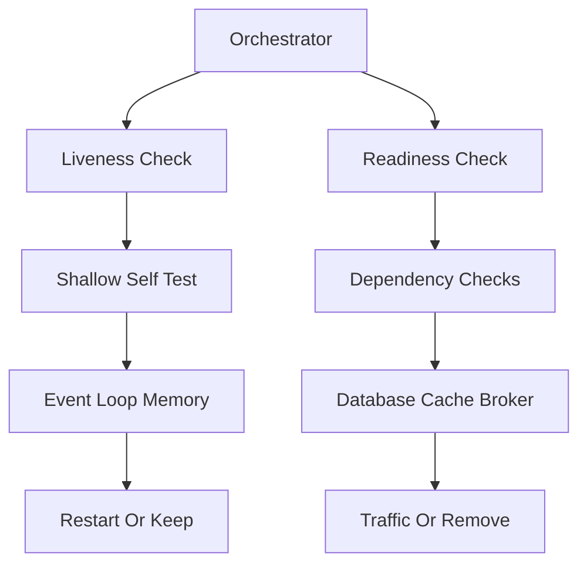

# Health Checks, Readiness and Observability Wiring

## English

A health check is an endpoint that answers the question 'is this process able to serve traffic right now?' Kubernetes and most orchestrators distinguish two flavours: liveness (should the container be restarted?) and readiness (should the load balancer send traffic here?). NestJS ships @nestjs/terminus, a small library that provides a HealthCheckService and a set of built-in indicators such as TypeOrmHealthIndicator, PrismaHealthIndicator, MemoryHealthIndicator, DiskHealthIndicator, and HttpHealthIndicator. You write a controller that calls health.check([...]) with the indicators you care about, and Terminus returns 200 with a JSON body when all pass, or 503 when any fails.

The design trap is making the liveness check too clever. If liveness pings the database and the database is briefly down, Kubernetes will restart every pod in a rolling loop — making the outage worse. Liveness should be shallow: is the event loop responsive, is memory within bounds? Readiness is where you check dependencies: can I reach the database, the Redis cache, the message broker? A pod that fails readiness is simply removed from the load balancer until it recovers, which is far gentler.

Beyond pass/fail, health checks are a place to expose build metadata: version, git SHA, start time. Terminus lets you attach custom indicators easily — a small class implementing HealthIndicator with a method that returns { status: 'up' } or throws a HealthCheckError. This is handy for feature flags ('is the payment provider reachable?') or for readiness gates during a rolling deploy, where a new pod should not receive traffic until its warm-up cache has been populated.

Observability is the broader umbrella. Structured logging (for example with nestjs-pino or a Winston-based logger) gives you JSON logs with request IDs, which is essential when you are tracing a single request across services. OpenTelemetry instrumentation, usually wired in before the Nest app is created so it can hook into HTTP, Express, and database drivers, produces traces and metrics. Prometheus metrics via a /metrics endpoint (often exposed with prom-client) let you alert on latency and error rates rather than waiting for users to complain. None of this is built into NestJS core, but the module system makes it natural to wrap each concern in its own module — ObservabilityModule, HealthModule — and import them where needed.

One last practical note: protect your health and metrics endpoints. Health checks are usually unauthenticated because orchestrators need to reach them, so keep them on a separate port or path that is not exposed to the public internet. Metrics endpoints can leak internal topology and should almost always be firewalled. Observability is only useful if it does not become an attack surface.

## 中文

健康檢查（health check）是一個端點，回答「這個行程現在能不能服務流量？」Kubernetes 與大多數編排器區分兩種：liveness（容器是否該被重啟？）與 readiness（負載平衡器是否該把流量送過來？）。NestJS 提供 @nestjs/terminus，一個小型的函式庫，內含 HealthCheckService 與一系列內建指標，例如 TypeOrmHealthIndicator、PrismaHealthIndicator、MemoryHealthIndicator、DiskHealthIndicator 和 HttpHealthIndicator。你寫一個 controller 呼叫 health.check([...]) 並傳入你關心的指標，Terminus 會在所有指標通過時回傳 200 與 JSON 內容，任一失敗則回傳 503。

設計陷阱是讓 liveness 檢查變得太聰明。如果 liveness 去 ping 資料庫，而資料庫短暫掛掉，Kubernetes 會把每個 pod 輪流重啟——讓故障更嚴重。Liveness 應該很淺：event loop 有沒有反應、記憶體是否在範圍內？Readiness 才是你檢查依賴的地方：我能連到資料庫、Redis 快取、訊息 broker 嗎？一個 readiness 失敗的 pod 只是被移出負載平衡器，直到恢復為止，溫和得多。

除了通過與否，健康檢查也是暴露建置中繼資料的地方：版本、git SHA、啟動時間。Terminus 讓你很容易加上自訂指標——一個實作 HealthIndicator 的小類別，方法回傳 { status: 'up' } 或拋出 HealthCheckError。這對功能旗標（「付款供應商是否可達？」）或在滾動部署期間的 readiness 閘門很有用，例如新的 pod 在預熱快取填滿之前不該收到流量。

可觀測性（observability）是更大的傘。結構化日誌（例如用 nestjs-pino 或以 Winston 為基礎的 logger）給你帶有請求 ID 的 JSON 日誌，這在跨服務追蹤單一請求時不可或缺。OpenTelemetry 的 instrumentation 通常在 Nest 應用建立之前接上，好讓它能掛進 HTTP、Express 與資料庫驅動，產生 trace 與 metric。透過 /metrics 端點（常用 prom-client 暴露）的 Prometheus 指標，讓你能對延遲與錯誤率告警，而不是等使用者抱怨。這些都不是 NestJS 核心內建，但模組系統讓把每個關注點包成自己的模組——ObservabilityModule、HealthModule——並在需要的地方 import 變得很自然。

最後一個實務提醒：保護你的健康檢查與指標端點。健康檢查通常是無需認證的，因為編排器需要能搆到它們，所以把它們放在不對外網際網路暴露的獨立埠或路徑上。指標端點可能洩漏內部拓撲，幾乎總該用防火牆擋住。可觀測性只有在它不成為攻擊面時才有用。

## Key Takeaway

Use @nestjs/terminus with shallow liveness and dependency-aware readiness checks, expose build metadata and metrics deliberately, and always firewall the observability endpoints that orchestrators need to reach.

## Related Concepts
- Kubernetes readiness probes
- OpenTelemetry

## Diagram

