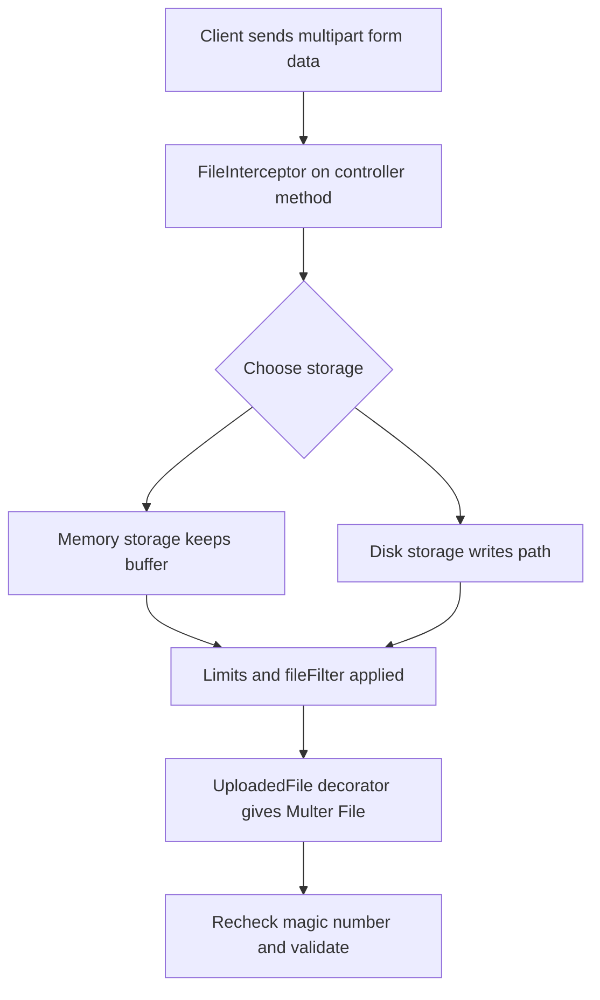

# File Uploads with Multer: The NestJS Way to Receive Binary Data

## English

HTTP is mostly about JSON, but sometimes you need to accept a file: a profile picture, a CSV import, an audio clip. NestJS wraps the popular Multer middleware through a dedicated adapter, exposed via `@nestjs/platform-express` (the default platform). You install `@types/multer` for TypeScript types, then use the `FileInterceptor` from `@nestjs/platform-express` on a controller method. The interceptor takes a field name and an options object, and it writes the incoming multipart/form-data body into `req.file` (single file) or `req.files` (multiple). The `@UploadedFile()` parameter decorator then hands you a `Multer.File` object with `originalname`, `mimetype`, `size`, `buffer` or `path`, and so on. The `@UploadedFiles()` decorator gives you an array when you use `FilesInterceptor` or `FileFieldsInterceptor`.

Storage is the first decision. Multer's default is memory storage, which keeps the whole file in a Buffer — fine for small files, dangerous for anything large because it eats RAM. Disk storage writes to a directory you configure and gives you a `path` instead of a `buffer`. You configure this via `MulterModule.register({ storage: diskStorage({...}) })` at the module level, or pass options directly to the interceptor. The `limits` option caps file size (`fileSize`), field count, and field size — always set `fileSize`, otherwise a malicious client can stream gigabytes until your process dies. You can also supply a `fileFilter` callback to reject files by mimetype or extension before they hit disk.

Validation is the part people skip. Checking `mimetype` alone is unreliable because the client controls it. A robust pipeline re-checks the file after upload: read the first few bytes and compare against the magic number (the file signature) for the claimed type. For images, libraries like `file-type` or `sharp` can detect the real format; for PDFs, check the `%PDF-` header. Combine this with a whitelist of extensions and a size cap, and you have defence in depth. Also remember filename sanitisation: never trust `originalname` — generate your own UUID-based name and store the original separately if you need to display it.

Where do the files go? Local disk is fine for a single-server toy, but breaks the moment you scale horizontally or deploy to a container that gets rescheduled. Object storage (S3, GCS, Azure Blob) is the production answer — upload the buffer directly with the SDK, or use presigned URLs so the browser uploads straight to the bucket and your server only issues a short-lived credential. Presigned URLs are attractive because they bypass your Node process entirely, but they complicate validation: you can't inspect the bytes before they land. A common compromise is a two-step flow: client requests a presigned PUT, uploads, then calls a confirmation endpoint that triggers an async job to validate and, if needed, quarantine the object.

Finally, think about the response contract. Never echo back a raw filesystem path; return an opaque identifier or a signed download URL. If you serve files back through NestJS, use `StreamableFile` from `@nestjs/common` so you get backpressure instead of loading the whole file into memory. Set `Content-Type` and `Content-Disposition` explicitly, and consider a `Content-Security-Policy: sandbox` header for user-uploaded HTML or SVG to prevent stored XSS. File upload is one of the few places where a small mistake becomes a serious security incident, so treat every byte as untrusted.

## 中文

HTTP 大部分時間講 JSON，但有時你要接收檔案：頭像、CSV 匯入、音訊片段。NestJS 透過專屬 adapter 包裝了流行的 Multer 中介軟件，經 `@nestjs/platform-express`（預設平台）對外提供。你需要安裝 `@types/multer` 取得 TypeScript 型別，然後在 controller 方法上用 `@nestjs/platform-express` 的 `FileInterceptor`。這個 interceptor 接受欄位名與選項物件，會把進來的 multipart/form-data body 寫入 `req.file`（單一檔案）或 `req.files`（多個檔案）。接著 `@UploadedFile()` 參數裝飾器交給你一個 `Multer.File` 物件，內含 `originalname`、`mimetype`、`size`、`buffer` 或 `path` 等。用 `FilesInterceptor` 或 `FileFieldsInterceptor` 時，`@UploadedFiles()` 會給你陣列。

儲存方式是第一個決定。Multer 預設用 memory storage，把整個檔案留在 Buffer 中——小檔案無妨，大檔案就危險，因為會吃掉 RAM。disk storage 則寫入你設定的目錄，並給你 `path` 而非 `buffer`。你可在模組層用 `MulterModule.register({ storage: diskStorage({...}) })` 設定，或直接把選項傳給 interceptor。`limits` 選項可限制檔案大小（`fileSize`）、欄位數與欄位大小——務必設定 `fileSize`，否則惡意客戶端可持續串流 GB 級資料直到你的進程死亡。你還可提供 `fileFilter` 回呼，在檔案落到磁碟前依 mimetype 或副檔名拒絕。

驗證是最常被跳過的一環。只檢查 `mimetype` 並不可靠，因為客戶端可自行控制。穩健的流程要在上傳後重新檢查：讀取檔頭幾個位元組，與聲稱型別的 magic number（檔案簽章）比對。圖片可用 `file-type` 或 `sharp` 偵測真實格式；PDF 則檢查 `%PDF-` 檔頭。再加上副檔名白名單與大小上限，就有縱深防禦。別忘了檔名清洗：永遠不要信任 `originalname`——自己用 UUID 產生名稱，若需顯示原名就另存。

檔案放哪裡？本機磁碟對單機玩具可以，但一旦水平擴展或部署到會被重新排程的容器就崩潰。物件儲存（S3、GCS、Azure Blob）是生產答案——用 SDK 直接上傳 buffer，或用 presigned URL 讓瀏覽器直接上傳到 bucket，你的伺服器只簽發短效憑證。Presigned URL 很吸引人，因為它完全繞過 Node 進程，但令驗證變複雜：位元組落地前你無法檢查。常見折衷是兩步流程：客戶端請求 presigned PUT、上傳，然後呼叫確認端點觸發非同步工作去驗證，必要時隔離該物件。

最後，想想回應契約。永遠不要回傳原始檔案系統路徑；回傳不透明識別碼或簽名下載 URL。若經 NestJS 提供檔案下載，用 `@nestjs/common` 的 `StreamableFile`，可獲得背壓而非把整個檔案載入記憶體。明確設定 `Content-Type` 與 `Content-Disposition`，並考慮對使用者上傳的 HTML 或 SVG 加上 `Content-Security-Policy: sandbox` 標頭，防止儲存型 XSS。檔案上傳是少數小錯誤就變成嚴重安全事故的地方，請把每個位元組都當作不可信。

## Key Takeaway

File uploads in NestJS are Multer interceptors plus decorators, but the real work is validating untrusted bytes, capping size, and choosing storage that survives horizontal scaling.

## Related Concepts
- Multer middleware
- Object storage presigned URLs

## Diagram

