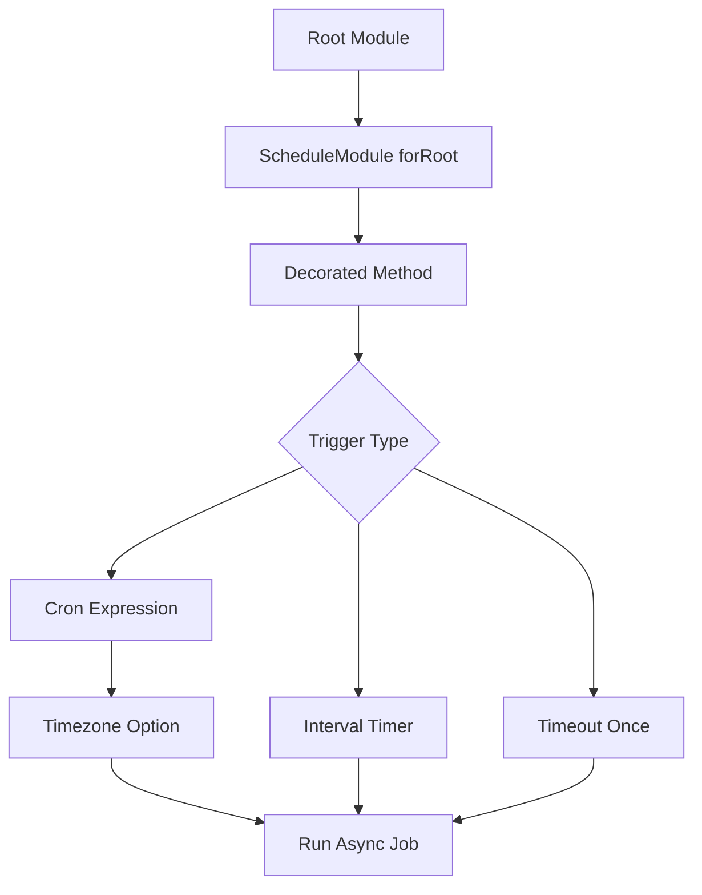

# Task Scheduling and Cron Jobs Inside a NestJS Process

## English

Not every job needs a queue. Some work is periodic and cheap: refreshing a cache every five minutes, expiring stale sessions nightly, sending a daily digest at 08:00. NestJS ships `@nestjs/schedule`, which wraps the `cron` package and gives you declarative scheduling through decorators. You import `ScheduleModule.forRoot()` once in your root module, then decorate methods with `@Cron()`, `@Interval()`, or `@Timeout()`. `@Cron('0 8 * * *')` runs at 08:00 every day using standard cron syntax; `@Interval(60_000)` runs every 60 seconds; `@Timeout(5_000)` runs once, five seconds after bootstrap. The decorated method can be async — the scheduler awaits the returned promise before considering the run complete, which matters for overlap handling.

A critical subtlety: cron expressions are evaluated in a timezone. By default the library uses the process timezone, which on servers is often UTC. If you want 08:00 Hong Kong time, either pass `{ timeZone: 'Asia/Hong_Kong' }` to the decorator or accept that you're scheduling in UTC and document it. Mixing the two silently is a classic production bug: your nightly cleanup runs at the wrong hour after a daylight-saving shift, or your digest lands at 16:00 local time. Also beware that `@Interval` and `@Timeout` are not timezone-aware — they're just timers.

What happens if a job takes longer than its interval? By default, the next tick fires anyway, and you get overlapping executions racing on the same database rows. The `cron` package supports a `waitForCompletion` option in newer versions; `@nestjs/schedule` exposes it via the decorator options. When in doubt, guard with a simple in-process lock: a boolean flag, or better, an advisory lock in your database (`SELECT ... FOR UPDATE` or Postgres advisory locks). Even with a lock, remember this only protects one process — if you run three replicas, three schedulers will fire. The usual fix is to designate one instance as the scheduler (via an environment flag or leader election) or to move the job into a queue where only one worker picks it up.

That last point is the key architectural decision. In-process scheduling is simple and fine for idempotent housekeeping on a single instance. It is the wrong tool for anything that must run exactly once, must not be lost on restart, or must scale. If your process crashes mid-job, the job is simply gone — there's no persistence, no retry, no dead-letter. For those guarantees you need a queue (BullMQ, for example), where the schedule enqueues a job and workers consume it with retries and backoff. A useful pattern is a hybrid: `@Cron` on a single elected scheduler that enqueues jobs, and separate worker processes that consume them. The cron is the trigger; the queue is the durable execution.

Operationally, log the start and end of every scheduled job with a correlation id, and emit a metric for duration and outcome. A job that silently fails for a week is worse than one that crashes loudly. Also consider jitter: if you deploy many instances and they all schedule the same nightly task, they'll stampede your database at the same second. Adding a random delay of a few seconds spreads the load. Finally, respect graceful shutdown — `@nestjs/schedule` integrates with the lifecycle so timers stop on `onApplicationShutdown`, but an in-flight async job should be tracked and awaited (or cancelled) so you don't kill it mid-write.

## 中文

不是每個工作都需要佇列。有些工作是週期性且便宜的：每五分鐘刷新快取、每晚讓過期 session 失效、每天 08:00 寄送摘要。NestJS 內建 `@nestjs/schedule`，它包裝 `cron` 套件，透過裝飾器提供宣告式排程。你在根模組匯入一次 `ScheduleModule.forRoot()`，然後用 `@Cron()`、`@Interval()` 或 `@Timeout()` 裝飾方法。`@Cron('0 8 * * *')` 用標準 cron 語法每天 08:00 執行；`@Interval(60_000)` 每 60 秒執行；`@Timeout(5_000)` 在啟動後五秒執行一次。被裝飾的方法可以是 async——排程器會等待回傳的 promise 才視為該次執行完成，這對重疊處理很重要。

一個關鍵細節：cron 運算式是在某個時區下求值的。預設用進程時區，伺服器上通常是 UTC。若你要香港時間 08:00，可傳 `{ timeZone: 'Asia/Hong_Kong' }` 給裝飾器，或接受以 UTC 排程並記錄下來。默默混用兩者是經典的生產事故：你的每晚清理在日光節約時間切換後跑錯時段，或摘要落在當地時間 16:00。另外注意 `@Interval` 與 `@Timeout` 不涉時區——它們只是計時器。

若工作執行時間比間隔長會怎樣？預設下一次仍會觸發，造成重疊執行在同一批資料列上競爭。`cron` 套件較新版本支援 `waitForCompletion` 選項；`@nestjs/schedule` 透過裝飾器選項暴露它。有疑問時用簡單的進程內鎖保護：布林旗標，或更好用資料庫的 advisory lock（`SELECT ... FOR UPDATE` 或 Postgres advisory lock）。即使有鎖，記住這只保護單一進程——若你跑三個副本，就有三個排程器同時觸發。常見解法是指定一個實例當排程器（用環境變數旗標或 leader election），或把工作移進佇列，讓只有一個 worker 取走。

上一點是關鍵架構決策。進程內排程簡單，對單實例的冪等家務工作足夠。對於必須恰好執行一次、重啟不能遺失、或必須擴展的工作，它就是不適合的工具。若進程在工作中途崩潰，工作就消失了——沒有持久化、沒有重試、沒有死信。要這些保證就得用佇列（例如 BullMQ），由排程把工作入列，worker 以重試與退避消費。一個有用模式是混合：在單一被選出的排程器上用 `@Cron` 把工作入列，另用獨立 worker 進程消費。cron 是觸發器；佇列是持久執行。

營運上，為每個排程工作記錄開始與結束並附關聯 id，並輸出時長與結果的指標。一個默默失敗一週的工作比大聲崩潰的更糟。也考慮 jitter：若你部署多個實例且都排同一晚間任務，它們會在同一秒鐘壓垮你的資料庫。加幾秒隨機延遲可分散負載。最後，尊重優雅關機——`@nestjs/schedule` 與生命週期整合，會在 `onApplicationShutdown` 停止計時器，但進行中的 async 工作應被追蹤並等待（或取消），以免在寫入中途被殺。

## Key Takeaway

In-process scheduling with @nestjs/schedule is perfect for idempotent housekeeping on one instance, but anything that must run exactly once or survive a crash belongs in a durable queue.

## Related Concepts
- Cron expressions and timezones
- BullMQ durable queues

## Diagram

