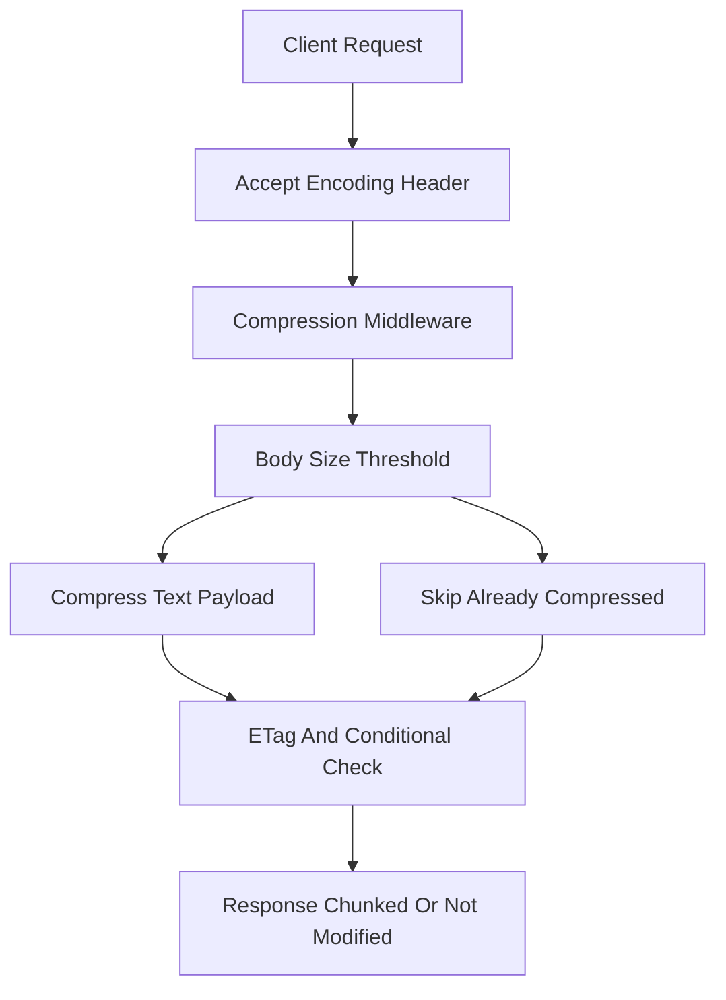

# Compression, ETags and Conditional Requests: Making Responses Cheap

## English

Once your API works, the next question is how much bandwidth and CPU each response costs. Two layers matter: making the payload smaller before it leaves the server (compression), and letting clients skip the download entirely when nothing changed (conditional requests). NestJS doesn't hide either, but you have to opt in. Compression comes from the `compression` middleware, which you enable by calling `app.use(compression())` in `main.ts` — it's the same Express middleware, just mounted on the underlying platform. It negotiates via the `Accept-Encoding` request header and typically uses gzip or brotli. Brotli usually compresses text better than gzip but costs more CPU per byte, so the middleware may pick based on the client's advertised encodings and your threshold settings.

Compression is not free, and it's not always a win. It helps text (JSON, HTML, CSS, SVG) enormously — often 5–10x for verbose JSON — but barely helps already-compressed formats like JPEG, PNG, MP4, or ZIP, and can even grow them slightly. The middleware has a `threshold` option (in bytes) below which it skips compression, because the gzip header overhead can exceed the savings for tiny bodies. If you serve files through `StreamableFile`, compression still applies to the stream, but be careful with `Content-Length`: compressed responses are chunked, so the original length header must not be sent. Also, never compress responses that contain secrets over TLS without understanding BREACH-style attacks — an attacker who can inject content and observe compressed sizes can sometimes infer plaintext. For most APIs this is theoretical, but it's why some teams disable compression on responses that mix secrets and attacker-controlled input.

Conditional requests are the other half. Every response can carry an `ETag` header — an opaque identifier for that version of the resource. On the next request, the client sends `If-None-Match: <etag>`, and if the server's current ETag matches, it replies `304 Not Modified` with no body. That saves the entire payload. Express (and therefore NestJS on the default platform) generates weak ETags automatically for responses it sends, based on a hash of the body. Weak means semantically equivalent, not byte-identical — fine for caching, not for range requests. You can disable automatic ETags with `app.set('etag', false)` if you want to control them yourself, for example by hashing your database row's `updatedAt` timestamp or a version column.

`Last-Modified` and `If-Modified-Since` are the older sibling. If your resource has a reliable modification time, send `Last-Modified` and Express will handle `If-Modified-Since` automatically. The catch is granularity: HTTP dates have one-second resolution, so two updates in the same second look identical. ETags avoid that. In practice, prefer ETags for JSON APIs and `Last-Modified` for static files where the filesystem mtime is trustworthy. Combine with `Cache-Control` to tell clients and proxies how long they may reuse a response without revalidating: `max-age=60` means fresh for 60 seconds, `no-cache` means revalidate every time (despite the confusing name), `no-store` means never persist.

The biggest win is often at the edge, not in NestJS. A CDN or reverse proxy can cache responses and serve `304`s without your Node process ever waking up. For that to work, your `Cache-Control` and `ETag` headers must be correct and consistent — a random ETag per request defeats caching entirely. Design your endpoints so the cache key is obvious (URL plus `Vary` headers), and use `Vary: Accept-Encoding` when compression is on so caches don't serve a gzipped body to a client that can't decode it. Measure before and after with real payload sizes; a few headers can cut bandwidth by more than any code optimisation you'll write this quarter.

## 中文

API 能跑之後，下一個問題是每個回應花多少頻寬與 CPU。兩層很重要：讓 payload 在離開伺服器前變小（壓縮），以及讓客戶端在內容沒變時完全跳過下載（條件式請求）。NestJS 沒有隱藏這兩者，但你要主動開啟。壓縮來自 `compression` 中介軟件，在 `main.ts` 呼叫 `app.use(compression())` 啟用——就是同一個 Express 中介軟件，只是掛在底層平台。它透過 `Accept-Encoding` 請求標頭協商，通常用 gzip 或 brotli。Brotli 對文字通常壓得比 gzip 好，但每 byte 的 CPU 成本更高，中介軟件可能依客戶端宣告的編碼與你的門檻設定來選擇。

壓縮不是免費，也不總是划算。對文字（JSON、HTML、CSS、SVG）幫助極大——冗長的 JSON 常可壓 5–10 倍——但對已壓縮格式如 JPEG、PNG、MP4、ZIP 幾乎沒用，甚至略微變大。中介軟件有 `threshold` 選項（以 byte 計），低於此值就跳過壓縮，因為對極小 body 而言 gzip 標頭開銷可能超過節省。若你用 `StreamableFile` 提供檔案，壓縮仍作用於串流，但要小心 `Content-Length`：壓縮後的回應是分塊的，不可送出原始長度標頭。另外，別在不懂 BREACH 類攻擊的情況下壓縮含機密的 TLS 回應——能注入內容並觀察壓縮大小的攻擊者有時可推斷明文。對多數 API 這是理論風險，但這正是有些團隊對混合機密與攻擊者可控輸入的回應關閉壓縮的原因。

條件式請求是另一半。每個回應可帶 `ETag` 標頭——該資源某個版本的不透明識別碼。下次請求時客戶端送 `If-None-Match: <etag>`，若伺服器目前 ETag 相符，就回 `304 Not Modified` 且無 body，省下整個 payload。Express（因此預設平台上的 NestJS）會依 body 雜湊自動為它送出的回應產生弱 ETag。弱表示語意等價而非位元組相同——對快取足夠，對 range 請求則否。若你想自己控制，可用 `app.set('etag', false)` 關閉自動 ETag，例如改用資料列 `updatedAt` 時間戳或版本欄位做雜湊。

`Last-Modified` 與 `If-Modified-Since` 是較舊的兄弟。若資源有可靠的修改時間，送 `Last-Modified`，Express 會自動處理 `If-Modified-Since`。陷阱是粒度：HTTP 日期只有一秒解析度，同一秒內的兩次更新看起來一樣。ETag 可避開此問題。實務上，JSON API 偏好 ETag，靜態檔案則用 `Last-Modified`（檔案系統 mtime 可信時）。再配合 `Cache-Control` 告訴客戶端與代理可重用回應多久而不重新驗證：`max-age=60` 表示 60 秒內新鮮，`no-cache` 表示每次都重新驗證（名字雖易誤解），`no-store` 表示永不儲存。

最大的收益往往在邊緣而非 NestJS 內。CDN 或反向代理可快取回應並回 `304`，你的 Node 進程根本不必醒來。要讓它運作，你的 `Cache-Control` 與 `ETag` 標頭必須正確一致——每次請求都不同的隨機 ETag 會完全破壞快取。設計端點時讓快取鍵顯而易見（URL 加 `Vary` 標頭），並在壓縮開啟時用 `Vary: Accept-Encoding`，以免快取把 gzip body 送給無法解碼的客戶端。用真實 payload 大小前後量測；幾個標頭省下的頻寬，可能比你這季寫的任何程式優化都多。

## Key Takeaway

Compression shrinks payloads and conditional requests (ETag, Last-Modified) eliminate them entirely, but both only pay off when your Cache-Control and Vary headers are correct enough for shared caches to trust.

## Related Concepts
- HTTP conditional requests
- Cache-Control and Vary headers

## Diagram

