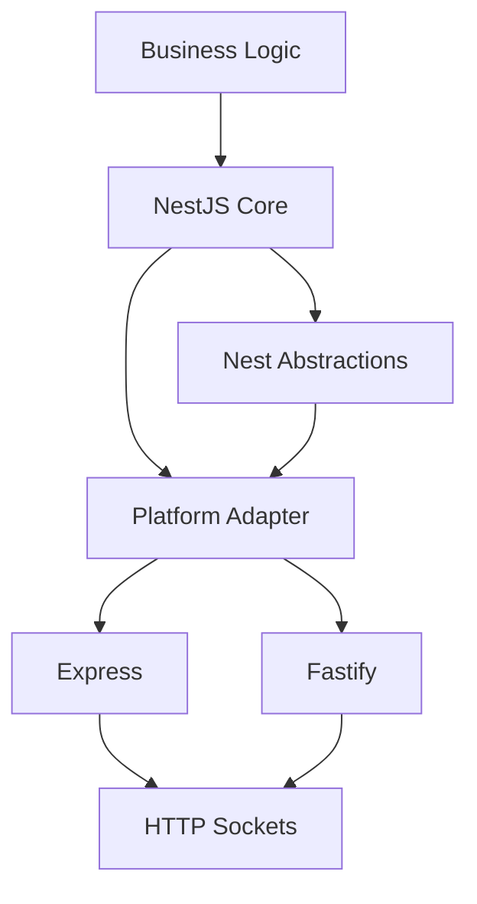

# The Platform Abstraction: Express vs Fastify Under the Hood

## English

NestJS does not talk to HTTP directly. It talks to a platform adapter, an interface that wraps whichever HTTP library actually opens sockets and parses bytes. By default that adapter is Express; you can swap it for Fastify, and the rest of your code — controllers, guards, pipes, interceptors — stays untouched. This is why NestJS can claim to be framework-agnostic while still giving you a familiar decorator API. The adapter is the seam between your business logic and the runtime.

The trade-off is real. Express is mature, has a huge middleware ecosystem, and its request/response objects are the ones most tutorials assume. Fastify is faster on raw throughput, has a built-in JSON schema validation and serialization pipeline, and is more opinionated about how plugins work. Switching means changing how you bootstrap the app: instead of NestFactory.create(AppModule) you call NestFactory.create(AppModule, new FastifyAdapter()). From that moment on, the underlying request object is a Fastify request, not an Express one, so any code that reaches for Express-specific properties will break.

That last point is the practical trap. Middleware written for Express — like the classic body-parser or a session library — expects (req, res, next) signatures. Fastify middleware uses (req, res) and expects you to call reply.send() yourself. NestJS gives you a compatibility layer through the MiddlewareConsumer, but the compatibility is not perfect. If you switch platforms, audit every place where you touch the raw request or response object, and prefer NestJS abstractions (decorators like @Body, @Query, @Headers) wherever possible.

Performance is not the only reason to choose. Fastify's schema-based serialization can be significantly faster for large JSON payloads because it compiles a serializer from a schema rather than inspecting objects at runtime. On the other hand, Express has more battle-tested integrations and a larger pool of community answers. For a small internal API, Express is fine. For a high-throughput public service, Fastify's design pays off. The important thing is that the decision is reversible and isolated — that is the whole point of the adapter.

There is also a third path: writing your own adapter for an unusual runtime, or using one of the community adapters. This is rare, but it illustrates the design. The adapter contract is small: it must create the underlying server, register routes, and translate platform-specific request/response objects into the shapes NestJS expects. Once you understand that boundary, the framework stops feeling magical and starts feeling like a well-drawn diagram.

## 中文

NestJS 並不直接與 HTTP 對話，它對話的物件是「平臺介面卡」（platform adapter）——一層包裝真正負責開 socket、解析位元組的 HTTP 函式庫的介面。預設情況下這個介面卡是 Express；你可以換成 Fastify，而控制器、守衛、管道、攔截器這些程式碼完全不動。這就是為何 NestJS 能號稱與框架無關，同時又給你熟悉的裝飾器 API。介面卡就是你商業邏輯與執行環境之間的接縫。

取捨是真實存在的。Express 成熟、中介軟體生態龐大，而且大部分教學都假設你用的是它的 request/response 物件。Fastify 在原始吞吐量上更快，內建以 JSON schema 為基礎的驗證與序列化流程，對外掛的運作方式也更有主見。切換意味著改變啟動應用的方式：不是 NestFactory.create(AppModule)，而是 NestFactory.create(AppModule, new FastifyAdapter())。從那一刻起，底層的 request 物件就是 Fastify 的 request，不再是 Express 的，所以任何伸手去拿 Express 專有屬性的程式碼都會壞掉。

這一點就是實務上的陷阱。為 Express 寫的中介軟體——例如經典的 body-parser 或 session 函式庫——期待 (req, res, next) 的簽名。Fastify 的中介軟體用 (req, res)，並且要你自己呼叫 reply.send()。NestJS 透過 MiddlewareConsumer 提供相容層，但相容並不完美。如果你切換平臺，請稽核每一處碰觸原始 request 或 response 物件的地方，並盡量優先使用 NestJS 的抽象（@Body、@Query、@Headers 這類裝飾器）。

效能不是唯一的選擇理由。Fastify 以 schema 為基礎的序列化對大型 JSON 負載可能明顯更快，因為它會從 schema 編譯出序列化器，而不是在執行期逐一檢視物件。另一方面，Express 有更多久經實戰的整合與更龐大的社群答案庫。小型內部 API 用 Express 就好；高吞吐量的公開服務，Fastify 的設計就划算。重點是這個決定可逆、被隔離——這正是介面卡存在的全部意義。

還有第三條路：為特殊執行環境自己寫一個介面卡，或使用社群提供的介面卡。這很罕見，但正好說明設計。介面卡契約很小：它必須建立底層伺服器、註冊路由，並把平臺專屬的 request/response 物件轉譯成 NestJS 期待的形狀。一旦你理解這條邊界，這個框架就不再神奇，而開始像一張畫得清楚的圖。

## Key Takeaway

The platform adapter is the thin, swappable seam between NestJS abstractions and the real HTTP library, so choosing Express or Fastify is a reversible decision as long as you avoid touching raw platform-specific objects.

## Related Concepts
- Express vs Fastify trade-offs
- Middleware compatibility layers

## Diagram

