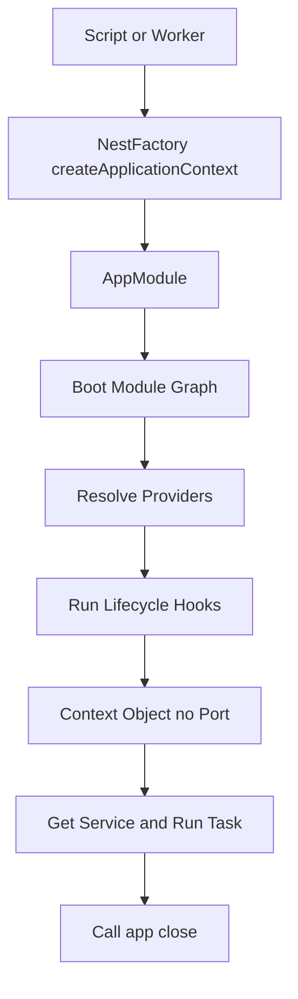

# Standalone Applications: Running NestJS Without a Server

## English

Most people meet NestJS as a web framework, but the container and module system work perfectly well without any HTTP server at all. NestFactory.createApplicationContext(AppModule) boots your module graph, resolves every provider, runs lifecycle hooks like onModuleInit, and then hands you a context object — but never opens a port. This is the "standalone application" mode, and it is the cleanest way to reuse your services from a command-line script, a worker process, or a scheduled job runner.

Why would you want that? Imagine your domain logic lives in services that depend on a database repository, a config service, and a logger. In a normal script you would wire all of those by hand, which is tedious and easy to get wrong. In standalone mode you just ask the container for the service: const app = await NestFactory.createApplicationContext(AppModule); const svc = app.get(OrdersService); await svc.reconcile(); await app.close(). The container does the wiring exactly as it would in production, so your script and your HTTP app share identical behaviour.

This pattern is especially useful for one-off maintenance tasks: backfilling a column, migrating data, sending a batch of emails, or generating a report. Instead of writing raw SQL in a shell script, you invoke the same service the API uses, which means the same validation, the same logging, and the same transaction boundaries. It is also handy for integration tests that need the real dependency graph but not a listening port.

There are a few gotchas. First, standalone contexts do not run HTTP-specific lifecycle hooks, so anything tied to the server will not fire. Second, you must call app.close() when done, otherwise the process may hang because database connections and timers are still open — this is where onModuleDestroy and onApplicationShutdown hooks earn their keep. Third, some providers are request-scoped, and without an incoming request there is no scope to attach to; those providers will either fail or be instantiated in a default scope, so avoid depending on them in standalone scripts.

A common real-world variation is the "worker" pattern: a long-running process with no HTTP listener that consumes messages from a queue. It boots the same modules, connects to the same database, and uses the same services, but its entry point is a queue consumer rather than a route. Keeping the codebase unified this way means bug fixes reach both the API and the worker at once, and you avoid the classic drift between a web app and a separate script that slowly diverges.

## 中文

大部分人認識 NestJS 是把它當成網頁框架，但容器與模組系統在完全沒有 HTTP 伺服器的情況下也能運作得很好。NestFactory.createApplicationContext(AppModule) 會啟動你的模組圖、解析每一個 provider、執行 onModuleInit 這類生命週期鉤子，然後交給你一個 context 物件——但從不開啟埠口。這就是「獨立應用程式」（standalone application）模式，也是從命令列腳本、worker 程序或排程任務執行器中重用服務最乾淨的方式。

為什麼會想要這樣做？想像你的領域邏輯住在服務裡，而這些服務依賴資料庫 repository、config service 和 logger。在普通腳本裡你得手動把這些全部接起來，既繁瑣又容易出錯。在獨立模式下，你只要向容器要服務：const app = await NestFactory.createApplicationContext(AppModule); const svc = app.get(OrdersService); await svc.reconcile(); await app.close()。容器會像在生產環境一樣完成接線，所以你的腳本和 HTTP 應用行為完全一致。

這個模式對一次性維護任務特別有用：回填欄位、遷移資料、寄送一批電郵，或產生報表。與其在 shell 腳本裡寫原始 SQL，你呼叫 API 用的同一個服務，意味著同樣的驗證、同樣的日誌、同樣的交易邊界。對於需要真實依賴圖但不需要監聽埠口的整合測試，這也很方便。

有幾個坑。第一，獨立 context 不會執行 HTTP 專屬的生命週期鉤子，所以任何綁在伺服器上的東西都不會觸發。第二，結束時必須呼叫 app.close()，否則程序可能卡住，因為資料庫連線與計時器還開著——這正是 onModuleDestroy 和 onApplicationShutdown 鉤子派上用場的地方。第三，有些 provider 是 request-scoped，而沒有進來的請求就沒有 scope 可依附；這些 provider 要麼失敗，要麼以預設 scope 實例化，所以在獨立腳本裡要避免依賴它們。

常見的真實變體是「worker」模式：一個長時間執行、沒有 HTTP 監聽器、從佇列消費訊息的程序。它啟動同樣的模組、連上同樣的資料庫、使用同樣的服務，但它的進入點是佇列消費者而不是路由。這樣統一程式碼庫，意味著錯誤修正會同時到達 API 與 worker，也避免網頁應用與獨立腳本之間那種經典的、緩慢的分歧。

## Key Takeaway

createApplicationContext boots the full dependency graph without an HTTP listener, letting CLI scripts, workers and tests reuse the exact same services and lifecycle as your API.

## Related Concepts
- Application context vs HTTP server
- Worker processes sharing a module graph

## Diagram

