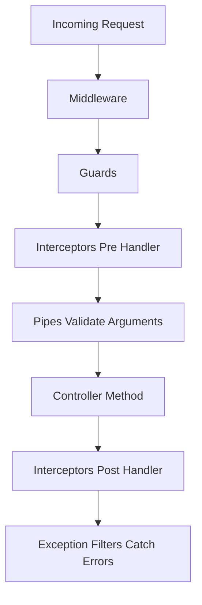

# Request Lifecycle in Depth: What Actually Happens, In Order

## English

It is easy to talk about guards, pipes and interceptors as separate ideas, but the real learning is in their ordering. When a request arrives, NestJS runs a fixed sequence, and knowing that sequence is what lets you predict where a bug lives. The pipeline is not a vague "stuff happens" — it is a deterministic chain, and every stage has a defined job.

The order, broadly: incoming middleware runs first, then guards decide whether the request may proceed, then interceptors run their pre-handler logic, then pipes transform and validate the incoming arguments, then your controller method executes, then interceptors run their post-handler logic on the way out, and finally exception filters catch anything that was thrown anywhere in that chain. Middleware is the only stage that sees the raw platform request before NestJS has resolved which route handler will run; guards run after routing, so they know the handler and its metadata.

Interceptors wrap the handler like an onion. The code before await next.handle() runs on the way in; the code after runs on the way out, and it can transform the emitted value or catch and rethrow errors. This is why interceptors are the natural home for logging durations, mapping responses into a standard envelope, or retrying a flaky downstream call. Pipes, by contrast, are argument-scoped: they run per parameter, which is why validation errors from class-validator surface as a 400 before your controller body ever executes.

Exception filters are the safety net. They catch exceptions thrown by guards, pipes, interceptors or the handler itself, and turn them into HTTP responses. A global filter can normalise every error into the same JSON shape, which is a huge win for API consumers. But note the subtlety: if a guard throws, the interceptor never runs at all — guards execute before interceptors, so the interceptor's `intercept()` is never entered and neither its pre- nor post-handler code runs. Understanding that asymmetry explains many confusing "my logging interceptor missed this request" stories.

A useful mental model is a layered sandwich: middleware is the outermost bread, then guards, then interceptors, then pipes, with the controller as the filling. On the way out the layers peel in reverse. Once you can draw this diagram from memory, debugging becomes much faster — you can look at a symptom like "the validation message is wrong" and immediately know it is a pipe issue, or "the error shape is inconsistent" and know it is a filter issue. The framework stops being a black box and becomes a map you can read.

## 中文

把守衛、管道、攔截器當成各自獨立的概念來談很容易，但真正的學習在於它們的順序。當請求抵達時，NestJS 執行一套固定序列，知道這個序列才能預測錯誤住在哪裡。這條管線不是含糊的「一堆事情發生」——它是一條確定性的鏈，每個階段都有明確的工作。

大致順序是：進來的請求先跑中介軟體，然後守衛決定請求可否繼續，接著攔截器執行處理前的邏輯，然後管道轉換並驗證進來的引數，然後你的控制器方法執行，然後攔截器在出去的路上執行處理後的邏輯，最後由例外過濾器接住這條鏈上任何地方丟擲的東西。中介軟體是唯一在 NestJS 解析出哪個路由處理器會執行之前、就看到原始平臺請求的階段；守衛在路由之後執行，所以它知道處理器及其 metadata。

攔截器像洋蔥一樣包住處理器。await next.handle() 之前的程式碼在進來的路上執行；之後的程式碼在出去的路上執行，而且它可以轉換發出的值，或接住並重新丟擲錯誤。這就是為何攔截器是記錄耗時、把回應對映成標準信封、或重試不穩定下游呼叫的天然歸宿。相對地，管道是引數範圍的：它對每個引數執行，這就是為何 class-validator 的驗證錯誤會在你的控制器主體執行之前就以 400 浮現。

例外過濾器是安全網。它接住守衛、管道、攔截器或處理器本身丟擲的例外，並把它們轉成 HTTP 回應。全域過濾器可以把每個錯誤正規化成同一個 JSON 形狀，這對 API 消費者是一大勝利。但要注意微妙之處：如果守衛丟擲錯誤，攔截器根本完全不會執行——守衛在攔截器之前執行，所以攔截器的 `intercept()` 從未被進入，處理前與處理後的程式碼都不會跑。理解這個不對稱，就能解釋許多令人困惑的「我的日誌攔截器漏掉這個請求」的故事。

一個有用的心智模型是分層三明治：中介軟體是最外層的麵包，然後是守衛，然後是攔截器，然後是管道，控制器是餡料。出去的時候，層次反向剝開。一旦你能憑記憶畫出這張圖，除錯就快得多——你可以看著「驗證訊息不對」這種症狀，立刻知道是管道問題；或「錯誤形狀不一致」，知道是過濾器問題。框架不再是黑箱，而是一張你能讀懂的地圖。

## Key Takeaway

Middleware, guards, interceptors, pipes and filters run in a fixed, predictable order, and internalising that sandwich model turns debugging from guesswork into diagnosis.

## Related Concepts
- Interceptor onion model
- Exception filter catch-all behaviour

## Diagram

