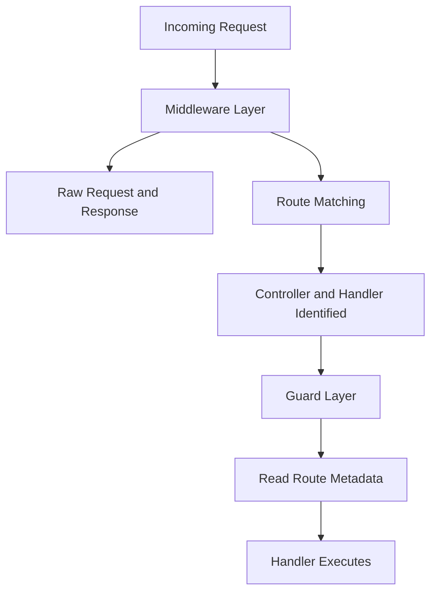

# Middleware vs Guards: The Two Different Kinds of Gate

## English

People often ask why NestJS has both middleware and guards when both seem to run 'before the handler'. The key difference is knowledge. Middleware is a thin function with the signature `(req, res, next)` that receives only the raw platform request and response objects. It knows nothing about which controller or method will eventually handle the request, because routing has not been resolved yet — middleware runs at the Express/Fastify layer, before NestJS even decides where the request is going. That makes it perfect for things that are genuinely transport-level: parsing cookies, attaching a request ID, logging the raw URL, or serving static files.

Guards run later, after the router has matched a route and identified the controller and handler method. Because of that, a guard can call `ExecutionContext` methods like `switchToHttp()`, `getHandler()` and `getClass()`, and it can read metadata that decorators placed on that specific route. This is why authorization belongs in a guard: a guard can ask 'does this user have the `admin` role required by this particular endpoint?' Middleware physically cannot, because at middleware time the endpoint is still unknown.

A practical example: suppose you want to block requests from certain IP ranges. Middleware is fine — the IP is on the request object regardless of route. But suppose you want only users with the `editor` role to reach `PATCH /articles/:id`. A guard can inspect `Reflector.get('roles', context.getHandler())`, because the `@Roles('editor')` decorator wrote that metadata onto the handler. Middleware would have to re-implement routing logic to know the same thing, which is fragile.

Another distinction is ordering and scope. Middleware is configured in a module's `configure(consumer: MiddlewareConsumer)` method and applies by path patterns or HTTP verbs — it is essentially Express-style. Guards are declared per-controller or per-handler with `@UseGuards()`, or globally with `app.useGlobalGuards()`. Guards also run for every transport NestJS supports (HTTP, WebSocket, gRPC microservice handlers), whereas Express-style middleware is HTTP-specific. If you write a guard, it protects your GraphQL resolvers and your message handlers too.

One more subtlety: middleware can send a response and end the chain (e.g. `res.status(401).send(...)`), but that bypasses NestJS's exception filters and response serialization. A guard, by contrast, throws `UnauthorizedException` or `ForbiddenException`, which flow through the normal exception filter pipeline and produce a consistent error shape. Prefer guards for anything that is really about authorization, and reserve middleware for cross-cutting concerns that truly do not care which route is being called.

## 中文

很多人會問：既然 middleware（中間件）同 guard（守衛）都好似係「喺 handler 之前執行」，點解 NestJS 要分開兩樣嘢？關鍵分別係「佢知唔知道」。Middleware 係一條好薄嘅函數，簽名係 `(req, res, next)`，佢只係收到原始平台嘅 request 同 response 物件。佢完全唔知最後邊個 controller、邊個方法會處理呢個請求，因為嗰陣路由都未解析好——middleware 係喺 Express/Fastify 層面行，喺 NestJS 決定請求去邊之前就已經執行。所以佢最適合做真正屬於傳輸層嘅嘢：解析 cookie、加 request ID、記錄原始 URL、或者 serve 靜態檔案。

Guard 就遲啲先執行，喺 router 已經配對到路由、認出 controller 同 handler 方法之後。正因為咁，guard 可以呼叫 `ExecutionContext` 嘅方法，例如 `switchToHttp()`、`getHandler()`、`getClass()`，亦可以讀取 decorator 寫喺嗰條特定路由上面嘅 metadata。呢個就係點解授權（authorization）應該放喺 guard：guard 可以問「呢個用戶有冇呢個 endpoint 要求嘅 `admin` 角色？」Middleware 物理上做唔到，因為 middleware 執行嗰陣，endpoint 仲係未知之數。

舉個實例：假設你想封鎖某啲 IP 範圍嘅請求。用 middleware 冇問題——IP 喺 request 物件度，唔理咩路由都一樣。但假設你想只有 `editor` 角色嘅用戶先可以入到 `PATCH /articles/:id`。Guard 可以檢查 `Reflector.get('roles', context.getHandler())`，因為 `@Roles('editor')` decorator 已經將呢個 metadata 寫咗喺 handler 上面。Middleware 就要自己重新實作路由邏輯先知道同一件事，非常脆弱。

另一個分別係排序同範圍。Middleware 喺 module 嘅 `configure(consumer: MiddlewareConsumer)` 方法入面設定，按路徑 pattern 或者 HTTP 動詞套用——基本上就係 Express 風格。Guard 就按 controller 或者 handler 用 `@UseGuards()` 宣告，或者用 `app.useGlobalGuards()` 全域套用。Guard 仲會喺 NestJS 支援嘅所有 transport 上面執行（HTTP、WebSocket、gRPC 微服務 handler），而 Express 風格嘅 middleware 就只限 HTTP。你寫一個 guard，佢連 GraphQL resolver 同 message handler 都保護到。

仲有一個細節：middleware 可以直接送 response 結束條鏈（例如 `res.status(401).send(...)`），但咁樣會繞過 NestJS 嘅 exception filter 同回應序列化。相反，guard 會 throw `UnauthorizedException` 或者 `ForbiddenException`，呢啲會行正常嘅 exception filter pipeline，產生一致嘅錯誤格式。凡係真正關於授權嘅嘢，都應該用 guard；middleware 就留返俾啲真係唔理邊條路由嘅橫切關注點。

## Key Takeaway

Middleware runs before routing and knows only the raw request; guards run after routing and can read per-route metadata, which is why authorization belongs in guards.

## Related Concepts
- ExecutionContext
- MiddlewareConsumer

## Diagram

