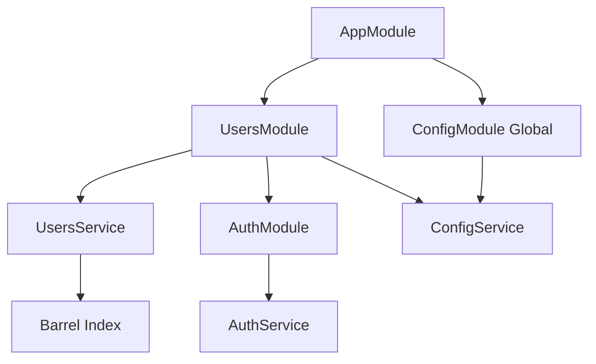

# Global Modules, Barrel Exports and the Import Graph

## English

A NestJS application is, at heart, a directed graph of modules. When module A imports module B, A can inject providers that B exports. If B does not export a provider, A cannot see it — even if the provider is registered, even if it is used elsewhere in the app. This explicit export rule is what keeps the graph honest: you cannot accidentally reach across the codebase and grab some random service. The compiler will not stop you at type level, but at runtime the injector will throw 'Nest can't resolve dependencies of X'.

The `@Global()` decorator is an escape hatch. A global module is registered once (usually in the root `AppModule`) and its exported providers become available everywhere without anyone importing it. This is exactly how `ConfigModule.forRoot({ isGlobal: true })` works — after that call, `ConfigService` is injectable from any module. Global modules are convenient but they hide edges in the graph, so use them sparingly. A good rule of thumb: things that are truly ambient — configuration, logging, a database connection wrapper — can be global; domain services should not be.

Barrel files (an `index.ts` that re-exports everything from a folder) are a common source of confusion. They are fine for consumers, but inside a module's own folder they can create circular imports. If `users.service.ts` imports from `./index.ts` and `index.ts` also re-exports `users.service.ts`, you get a cycle that may cause `undefined` at module-evaluation time. The symptom is often a decorator receiving `undefined` as its argument, or a class reference being `undefined` inside `@Inject()`. The fix is usually to import the concrete file directly inside the module's own folder, and only use the barrel from outside.

Circular module imports (module A imports B, B imports A) are legal in NestJS but require `forwardRef(() => BModule)` on both sides. The same applies to provider injection: `@Inject(forwardRef(() => SomeService))`. This works because `forwardRef` defers evaluation of the reference until after both modules have been defined. It is a real tool, but it is also a smell — a cycle usually means two modules are really one module, or a shared third module should be extracted. Reach for `forwardRef` only after you have considered restructuring.

A useful debugging technique: when you get a resolution error, trace the import path from the failing module up to the root. Ask 'is the provider exported by the module that owns it, and is that module imported (directly or transitively) by the module that needs it?' Nine times out of ten the answer is a missing `exports: [...]` array or a missing `imports: [...]` entry. The graph is small enough to reason about by hand, which is the whole point of the design.

## 中文

一個 NestJS 應用，本質上係一個有向嘅 module 圖。當 module A import module B，A 就可以注入 B 所 export 嘅 provider。如果 B 冇 export 某個 provider，A 就見唔到佢——即使個 provider 已經註冊咗，即使佢喺應用其他地方有用到。呢條明確嘅 export 規則，就係令個圖保持誠實嘅原因：你冇辦法唔小心橫跨成個 codebase 去拎一個亂咁嚟嘅 service。TypeScript 喺型別層面唔會阻止你，但 runtime 時 injector 會 throw「Nest can't resolve dependencies of X」。

`@Global()` decorator 係一個逃生門。一個 global module 註冊一次（通常喺 root `AppModule`），佢 export 嘅 provider 就喺邊度都用得到，唔需要任何人 import 佢。`ConfigModule.forRoot({ isGlobal: true })` 就係咁運作——嗰個 call 之後，任何 module 都注入得到 `ConfigService`。Global module 好方便，但佢會喺個圖度隱藏咗啲邊，所以要克制使用。一個好嘅經驗法則：真正屬於「環境性」嘅嘢——configuration、logging、database 連線 wrapper——可以做 global；domain service 就唔應該。

Barrel file（一個 `index.ts` 將資料夾入面所有嘢 re-export 出去）係常見嘅混淆來源。對外部消費者嚟講冇問題，但喺 module 自己嘅資料夾入面用，就可能造成循環 import。如果 `users.service.ts` 由 `./index.ts` import，而 `index.ts` 又 re-export `users.service.ts`，就會形成一個 cycle，喺 module 求值時可能變成 `undefined`。病徵通常係 decorator 收到 `undefined` 做參數，或者 `@Inject()` 入面嘅 class reference 係 `undefined`。解決方法通常係喺 module 自己嘅資料夾入面直接 import 具體檔案，barrel 就只留俾外部用。

循環 module import（module A import B，B import A）喺 NestJS 係合法嘅，但兩邊都要用 `forwardRef(() => BModule)`。Provider 注入都一樣：`@Inject(forwardRef(() => SomeService))`。咁樣可行，係因為 `forwardRef` 會將個 reference 嘅求值延遲到兩個 module 都定義好之後。佢係一個真實嘅工具，但同時係一個 smell——有 cycle 通常代表兩個 module 其實係同一個 module，或者應該抽一個共用嘅第三個 module 出嚟。考慮過重構之後，先至用 `forwardRef`。

一個好用嘅 debug 技巧：當你遇到 resolution error，由出錯嗰個 module 沿住 import 路徑向上追溯。問自己：「個 provider 有冇俾擁有佢嗰個 module export？嗰個 module 有冇俾需要佢嗰個 module import（直接或者間接）？」十次有九次，答案係漏咗 `exports: [...]` 陣列，或者漏咗 `imports: [...]` 項目。個圖細到可以人手推理，呢個正正就係設計嘅重點。

## Key Takeaway

NestJS module visibility is governed by explicit exports, so most 'cannot resolve dependency' errors are a missing exports array or a missing imports entry somewhere up the graph.

## Related Concepts
- @Global decorator
- forwardRef

## Diagram

