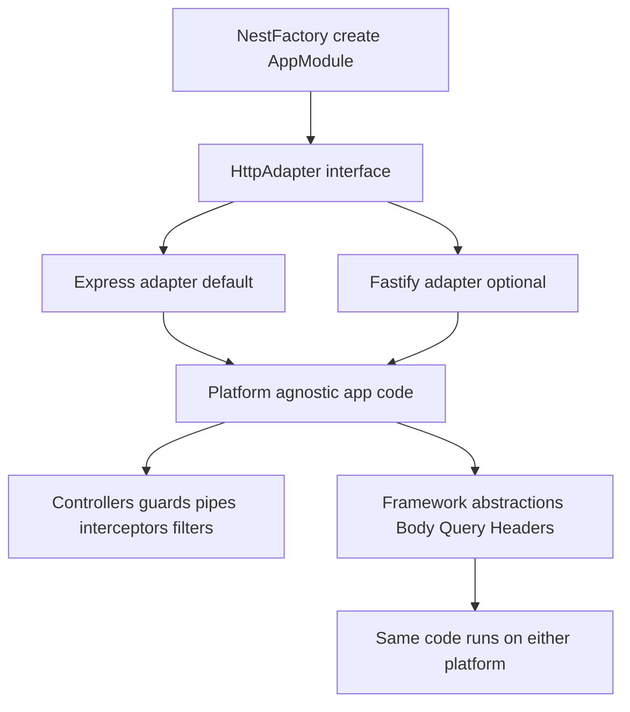

# Choosing Between Express and Fastify: The Adapter Trade-off

## English

NestJS does not ship its own HTTP server. Instead it defines a small interface called `HttpAdapter` and delegates real request handling to an underlying platform — by default Express, optionally Fastify. When you call `NestFactory.create(AppModule)`, NestJS instantiates an Express adapter and wires it up. If you instead call `NestFactory.create(AppModule, new FastifyAdapter())`, the same application code runs on Fastify. Controllers, guards, pipes, interceptors, exception filters — all of it is platform-agnostic, because NestJS normalizes the differences behind the adapter.

The practical difference is performance and plugin ecosystem. Fastify is generally faster on raw throughput, especially for JSON-heavy APIs, because it uses a schema-based serializer and a leaner routing layer. Express has a much larger middleware ecosystem and a more familiar mental model for many developers. If your app leans heavily on Express-specific middleware (say, a session library or a templating engine), sticking with Express is the path of least resistance. If your app is a JSON API with tight latency budgets, Fastify is worth the switch.

Switching is not free. Some Express middleware will not work on Fastify, and vice versa. Fastify has its own plugin system (`fastify-plugin`, `fastify-cookie`, etc.) and its own request/reply objects. NestJS gives you access to the raw objects via `@Req()` and `@Res()`, but if you use them directly you tie your code to the platform. The idiomatic NestJS approach is to use the framework's abstractions — `@Body()`, `@Query()`, `@Headers()`, and the `HttpAdapterHost` — so that the same code runs on either platform.

A common trap: calling `@Res()` without `{ passthrough: true }` puts NestJS into 'library-specific mode' for that handler. That means NestJS stops managing the response — no interceptors run their response transformation, no exception filter catches errors thrown after you have called `res.send()`. On Express this often works fine because the response object is familiar; on Fastify the reply object has a different API (`reply.send()` vs `res.send()`), so code written against Express can break. Prefer returning values from the handler and letting NestJS serialize them.

There is also a middle path: use `app.getHttpAdapter().getInstance()` when you genuinely need the raw platform instance (for example to register a Fastify plugin or an Express error handler). Just keep that code isolated in a small file — an adapter-specific bootstrap module — so the rest of the app stays portable. The whole point of the adapter abstraction is that you can swap platforms without rewriting your domain logic; the moment you sprinkle `req.raw` or `res.locals` everywhere, you have given up that benefit.

## 中文

NestJS 本身唔會帶自己嘅 HTTP server。佢定義咗一個細細嘅介面叫 `HttpAdapter`，將真正嘅請求處理交俾底層平台——預設係 Express，亦可以揀 Fastify。當你呼叫 `NestFactory.create(AppModule)`，NestJS 會建立一個 Express adapter 並接駁好。如果你改為呼叫 `NestFactory.create(AppModule, new FastifyAdapter())`，同一份應用程式碼就會喺 Fastify 上面行。Controller、guard、pipe、interceptor、exception filter——全部都係平台無關嘅，因為 NestJS 喺 adapter 後面將差異 normalize 咗。

實際分別在於效能同 plugin 生態。Fastify 喺原始吞吐量上面通常更快，尤其係 JSON 密集嘅 API，因為佢用基於 schema 嘅 serializer 同更精簡嘅路由層。Express 就有大好多嘅 middleware 生態，對好多開發者嚟講心智模型亦更熟悉。如果你個 app 好依賴 Express 專屬嘅 middleware（例如 session library 或者 templating engine），留喺 Express 係最少阻力嘅路。如果你個 app 係一個對延遲好敏感嘅 JSON API，Fastify 就值得轉。

轉換唔係免費嘅。有啲 Express middleware 喺 Fastify 上面行唔到，反之亦然。Fastify 有自己嘅 plugin 系統（`fastify-plugin`、`fastify-cookie` 等等）同自己嘅 request/reply 物件。NestJS 透過 `@Req()` 同 `@Res()` 俾你接觸原始物件，但如果你直接用佢哋，就會將你嘅程式碼綁死喺個平台。NestJS 嘅慣用做法係用框架嘅抽象——`@Body()`、`@Query()`、`@Headers()`，同 `HttpAdapterHost`——咁同一份程式碼喺兩個平台都行到。

一個常見陷阱：呼叫 `@Res()` 但冇加 `{ passthrough: true }`，會令該 handler 進入「平台特定模式」。即係話 NestJS 唔再管理個 response——interceptor 唔會做回應轉換，exception filter 亦唔會捕捉你呼叫 `res.send()` 之後 throw 嘅錯誤。喺 Express 上面呢個通常冇事，因為 response 物件好熟口面；但喺 Fastify 上面 reply 物件嘅 API 唔同（`reply.send()` 對 `res.send()`），所以照住 Express 寫嘅碼會爆。最好都係由 handler 回傳值，俾 NestJS 負責序列化。

仲有一條中間路線：當你真係需要原始平台實例（例如註冊一個 Fastify plugin 或者一個 Express error handler），可以用 `app.getHttpAdapter().getInstance()`。不過要將呢啲碼隔離喺一個細細嘅檔案——一個平台專屬嘅 bootstrap module——咁應用其餘部分就保持可攜。Adapter 抽象嘅重點就係你可以換平台而唔使重寫 domain 邏輯；一旦你四圍都灑滿 `req.raw` 或者 `res.locals`，你就放棄咗呢個好處。

## Key Takeaway

NestJS's HttpAdapter lets the same application code run on Express or Fastify, but using raw request objects directly re-couples you to one platform and forfeits that portability.

## Related Concepts
- FastifyAdapter
- HttpAdapterHost

## Diagram

