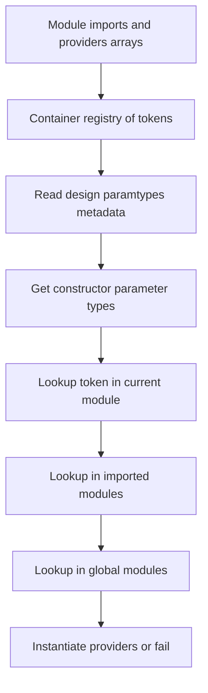

# How NestJS Finds and Instantiates Providers: The Reflector and Metadata Scanner

## English

Most people learn that you put `@Injectable()` on a class and NestJS magically wires it up. The interesting question is how. When you import a module, NestJS does not scan your whole disk looking for classes — it only looks at what you explicitly listed in the `providers` and `imports` arrays. That list is the entire universe of things the container knows about. This is why a service that exists in a file but is never registered produces a runtime error like `Nest can't resolve dependencies of the XxxService (?)` rather than silently working. The error is telling you: I looked in the module's registry, and this token was not there.

Once a class is registered, NestJS reads its constructor parameter list using reflection metadata. TypeScript compiles constructor parameter types into metadata (this is why `emitDecoratorMetadata` must be true in `tsconfig.json`), and NestJS uses `Reflect.getMetadata('design:paramtypes', Target)` to retrieve an array of the parameter types. For each entry in that array, it looks up a matching provider in the current module's scope, then in imported modules, and finally in globally registered modules. If it cannot find one, resolution fails at application bootstrap.

This is why interfaces do not work as injection tokens. An interface is erased at compile time — there is no runtime value for `Reflect.getMetadata` to return. If you type a constructor parameter as an interface, the metadata is simply `Object`, and NestJS has no idea which provider you meant. The workaround is to use an explicit token: either a string, a symbol, or a class used as a token via `@Inject('MY_TOKEN')` or a custom provider with a `provide`/`useClass` pair. That token is the actual key in the container's map, not the class name.

Metadata scanning also powers the routing and interceptor machinery. `MetadataScanner` walks the prototype of a controller class and collects all method names; for each method, `Reflector` asks whether certain metadata keys exist (for example, whether the method has an HTTP path assigned by `@Get()` or a role requirement set by a custom decorator). This is exactly how a custom `@Roles('admin')` decorator can be read by a guard later — the decorator writes a metadata key onto the method, and the guard reads it back at request time. Nothing is hardcoded; it is all metadata lookups.

A practical consequence: if you ever write a decorator that "does nothing," it is probably because nothing reads its metadata. Decorators in NestJS are passive — they attach data. The framework's scanners and reflectors are what turn that data into behavior. Understanding this split between writing metadata and reading it is the mental model that makes custom decorators, guards, and dynamic modules stop feeling like magic.

## 中文

大部分人學到的是：只要在類別上加上 `@Injectable()`，NestJS 就會自動幫你接好。真正有趣的問題是：它到底怎麼做到的？當你 import 一個模組時，NestJS 並不會掃描整個硬碟去找類別——它只看你在 `providers` 和 `imports` 陣列裡明確列出的東西。那份清單就是容器所知道的一切宇宙。這就是為什麼一個存在於檔案裡但從未註冊的 service，會產生像 `Nest can't resolve dependencies of the XxxService (?)` 這樣的執行期錯誤，而不是默默運作。這個錯誤是在告訴你：我在模組的註冊表裡找過了，這個 token 不在裡面。

一旦類別被註冊，NestJS 就會用反射 metadata 讀取它的建構子參數列表。TypeScript 會把建構子參數的型別編譯進 metadata（這就是為什麼 `tsconfig.json` 裡的 `emitDecoratorMetadata` 必須是 true），而 NestJS 會用 `Reflect.getMetadata('design:paramtypes', Target)` 取出一個參數型別的陣列。對於陣列裡的每一項，它會先在目前模組的範圍內找對應的 provider，然後找 imported 模組，最後找全域註冊的模組。如果找不到，解析就會在應用程式啟動時失敗。

這就是為什麼 interface 不能當作注入 token。interface 在編譯期就被抹除了——`Reflect.getMetadata` 沒有東西可以回傳。如果你把建構子參數標成型別為 interface，metadata 就只會是 `Object`，NestJS 根本不知道你指的是哪個 provider。變通方式是使用明確的 token：可以是一個字串、一個 symbol，或用類別本身當 token，透過 `@Inject('MY_TOKEN')` 或自訂 provider 的 `provide`/`useClass` 配對。那個 token 才是容器 map 裡真正的鍵，而不是類別名稱。

Metadata 掃描也支撐了路由與 interceptor 的機制。`MetadataScanner` 會走訪 controller 類別的原型，收集所有方法名稱；對於每個方法，`Reflector` 會詢問某些 metadata 鍵是否存在（例如這個方法有沒有被 `@Get()` 指定 HTTP 路徑，或是有沒有被自訂 decorator 設定角色需求）。這正是為什麼自訂的 `@Roles('admin')` decorator 之後能被 guard 讀到——decorator 把一個 metadata 鍵寫到方法上，guard 在請求時再讀回來。完全沒有寫死，全部都是 metadata 查詢。

一個實務上的後果：如果你曾經寫過一個「什麼都不做」的 decorator，那很可能是因為沒有東西去讀它的 metadata。NestJS 裡的 decorator 是被動的——它們只是附加資料。框架的 scanner 和 reflector 才是把資料變成行為的東西。理解「寫入 metadata」與「讀取 metadata」之間的這個分工，就是讓自訂 decorator、guard 和動態模組不再像魔術的關鍵心智模型。

## Key Takeaway

NestJS providers are resolved by reading constructor parameter metadata and matching it against the module registry, so tokens (not interfaces) are what the container actually keys on.

## Related Concepts
- Reflect metadata and design:paramtypes
- Custom provider tokens

## Diagram

