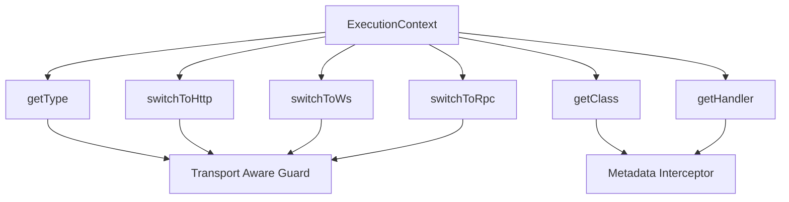

# The Execution Context: Writing Code That Works Across HTTP, WebSockets, and RPC

## English

A guard, interceptor, or pipe in NestJS receives an `ExecutionContext` as its first argument. Exception filters are the one exception: their `catch()` method receives an `ArgumentsHost`, not an `ExecutionContext`. Most tutorials show `context.switchToHttp().getRequest()` and leave it at that, but the `ExecutionContext` is really a small abstraction over three different kinds of transport. It exposes `getType()` (returning strings like `'http'`, `'ws'`, or `'rpc'`), `getClass()` (the controller class), `getHandler()` (the specific method), and a family of `switchToHttp()`, `switchToWs()`, and `switchToRpc()` adapters. Each adapter hands you the underlying request/response objects in a transport-appropriate shape. `ArgumentsHost` is the smaller surface: it exposes `getType()`, `getClass()`, and `getHandler()`, but not the `switchTo*()` adapters, so in a filter you branch on `host.getType()` rather than using the `ExecutionContext` switch adapters.

This matters because a single guard can protect both your REST endpoints and your WebSocket gateways without duplicating logic. In HTTP, the user identity typically comes from a header or a validated JWT on `request.user`. In a WebSocket gateway, the connection is established once and messages arrive as events, so the identity is usually attached to the socket's client data during the handshake. A well-written guard checks `context.getType()` first, then pulls the identity from the right place. If you skip that check, your guard will throw a confusing error the first time it is applied to a gateway.

Interceptors use the same abstraction but lean on `context.getHandler()` and `context.getClass()` to read metadata. That is how a `@CacheKey()` or `@Timeout()` decorator can be applied to one method and picked up by a global interceptor: the interceptor asks the context which handler is executing, then reads the metadata keyed to that handler. This is the mechanism that lets you write cross-cutting behavior once and attach it selectively without touching every endpoint.

Exception filters also benefit. An `HttpException` thrown inside a gateway handler will not automatically become a WebSocket error frame unless a filter maps it. A robust filter checks `host.getType()` and produces the right error envelope: an HTTP status and JSON body for HTTP, or a structured error event for WebSockets. The alternative — a filter that assumes HTTP — will throw a secondary error while trying to set a status code on an object that has none.

The practical habit to build is: whenever you write a guard, interceptor, or filter, ask yourself "does this need to work on more than one transport?" If yes, branch on `getType()` early and keep the transport-specific code in small helper functions. If no, say so explicitly and keep the code simple. This small discipline is what makes the difference between a codebase that grows gracefully into WebSockets or microservices and one that has to be rewritten when the second transport appears.

## 中文

NestJS 裡的 guard、interceptor 或 pipe，第一個參數都會收到一個 `ExecutionContext`。例外是 exception filter：它的 `catch()` 收到的是 `ArgumentsHost`，而不是 `ExecutionContext`。多數教學只示範 `context.switchToHttp().getRequest()` 就結束了，但 `ExecutionContext` 其實是對三種不同傳輸方式的小型抽象。它提供 `getType()`（回傳像 `'http'`、`'ws'` 或 `'rpc'` 的字串）、`getClass()`（controller 類別）、`getHandler()`（特定的方法），以及一組 `switchToHttp()`、`switchToWs()`、`switchToRpc()` 轉接器。每個轉接器會用符合該傳輸方式的形式，交給你底層的 request/response 物件。`ArgumentsHost` 則是較小的介面：它提供 `getType()`、`getClass()` 和 `getHandler()`，但沒有 `switchTo*()` 轉接器，所以在 filter 裡你要用 `host.getType()` 來分支，而不是使用 `ExecutionContext` 的 switch 轉接器。

這很重要，因為單一 guard 可以同時保護你的 REST 端點和 WebSocket gateway，而不需要重複邏輯。在 HTTP 裡，使用者身分通常來自 header 或 `request.user` 上驗證過的 JWT。在 WebSocket gateway 裡，連線只建立一次，訊息以事件形式抵達，所以身分通常會在 handshake 期間掛到 socket 的 client data 上。寫得好的 guard 會先檢查 `context.getType()`，再從正確的地方取出身分。如果你省略這個檢查，第一次把 guard 套用到 gateway 時就會拋出令人困惑的錯誤。

Interceptor 使用同樣的抽象，但更依賴 `context.getHandler()` 和 `context.getClass()` 來讀取 metadata。這就是為什麼像 `@CacheKey()` 或 `@Timeout()` 這樣的 decorator 可以套用在某個方法上，並被全域 interceptor 讀到：interceptor 會問 context 目前執行的是哪個 handler，然後讀取以該 handler 為鍵的 metadata。這個機制讓你只要寫一次橫切行為，就能選擇性地掛上去，而不必動到每個端點。

Exception filter 也同樣受益。在 gateway handler 裡拋出的 `HttpException`，除非有 filter 做對應，否則不會自動變成 WebSocket 錯誤框架。寫得穩健的 filter 會檢查 `host.getType()`，產生正確的錯誤包裝：HTTP 就回 HTTP 狀態碼和 JSON body，WebSocket 就發結構化的錯誤事件。相反地，假設只有 HTTP 的 filter，會在試圖對一個根本沒有狀態碼的物件設定狀態碼時，再拋出第二個錯誤。

該養成的實務習慣是：每次寫 guard、interceptor 或 filter 時，都問自己「這需要在多種傳輸方式上運作嗎？」如果是，就早點用 `getType()` 分支，並把傳輸方式相關的程式碼放進小的輔助函式。如果不用，就明確說出來，保持程式碼簡單。這個小紀律，就是決定一個程式碼庫能否優雅地長出 WebSocket 或微服務，還是等到第二種傳輸方式出現時就得重寫的關鍵。

## Key Takeaway

ExecutionContext lets one guard, interceptor, or pipe work across HTTP, WebSocket, and RPC by branching on getType() and pulling transport-specific data through the matching switchTo adapter; exception filters receive an ArgumentsHost and branch on host.getType() instead.

## Related Concepts
- WebSocket gateway authentication
- Transport-agnostic exception filters

## Diagram

