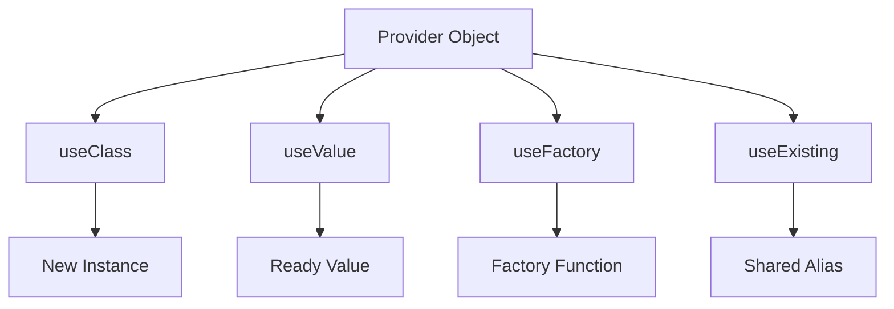

# Custom Providers in Depth: useClass, useValue, useFactory, and useExisting

## English

The simplest provider is `{ provide: SomeService, useClass: SomeService }`, which the shorthand `providers: [SomeService]` expands to. But the provider object has four mutually exclusive strategies, and each solves a different problem. Understanding them is what separates "I can build a NestJS app" from "I can shape a NestJS app around external constraints."

`useClass` lets you swap the implementation for a given token. The classic use is testing: register `{ provide: PaymentGateway, useClass: FakePaymentGateway }` in a test module and every consumer that injects `PaymentGateway` gets the fake. `useValue` is even simpler — you supply a ready-made object, which is perfect for configuration objects, mock functions, or a pre-built client like a database connection. The value is used as-is, so it is the most predictable strategy and the one most people reach for when wiring third-party libraries.

`useFactory` is where things get powerful. It is a function that returns the provider value, and it can be `async`. This is how you build a provider that depends on other providers or on environment variables read at runtime. You can declare `inject: [ConfigService, SomeOtherService]` on the provider object, and NestJS will resolve those dependencies and pass them as arguments to your factory. If the factory is async, NestJS will await it during bootstrap — that is the standard pattern for opening a database connection or fetching secrets from a vault before the application starts accepting traffic.

`useExisting` is the subtle one. It creates an alias: the new token resolves to whatever the existing provider's value is, sharing the same instance. The difference from `useClass` is important. `useClass` creates a new instance of the class for the new token; `useExisting` points at the already-created instance. Use `useExisting` when you want two tokens to refer to one singleton — for example, exposing a service under both a concrete class token and an abstract interface token, without ending up with two separate instances holding separate state.

One gotcha worth knowing: circular dependencies between providers will throw at bootstrap. NestJS offers `forwardRef(() => OtherService)` to break the cycle, but reaching for it often signals a design problem — two services that each need the other usually want a third service that both depend on. Also, async factories that hang (for example, a connection that never resolves) will block the entire application from starting, which is why production setups pair them with timeouts and health checks. Choosing the right provider strategy is a small decision with outsized consequences for how testable and configurable your application becomes.

## 中文

最簡單的 provider 是 `{ provide: SomeService, useClass: SomeService }`，而簡寫 `providers: [SomeService]` 就是展開成這樣。但 provider 物件有四種互斥的策略，每一種解決不同的問題。理解它們，是「我會寫 NestJS 應用程式」與「我能依外部限制塑造 NestJS 應用程式」之間的分水嶺。

`useClass` 讓你為某個 token 換掉實作。經典用法是測試：在測試模組裡註冊 `{ provide: PaymentGateway, useClass: FakePaymentGateway }`，每個注入 `PaymentGateway` 的使用者就都拿到假的實作。`useValue` 更簡單——你直接提供一個現成的物件，非常適合設定物件、mock 函式，或像資料庫連線這種預先建好的 client。這個值會原封不動地被使用，所以它是最可預測的策略，也是多數人接第三方函式庫時最先想到的。

`useFactory` 才是威力所在。它是一個回傳 provider 值的函式，而且可以是 `async`。這就是你建立「依賴其他 provider 或依賴執行期讀取的環境變數」的 provider 的方式。你可以在 provider 物件上宣告 `inject: [ConfigService, SomeOtherService]`，NestJS 就會解析這些依賴，並把它們當作參數傳給你的 factory。如果 factory 是 async，NestJS 會在啟動時 await 它——這就是在應用程式開始接收流量之前，開啟資料庫連線或從 vault 取得密鑰的標準做法。

`useExisting` 是最微妙的。它建立一個別名：新的 token 會解析到既有 provider 的值，共用同一個實例。它與 `useClass` 的差別很重要。`useClass` 會為新 token 建立該類別的新實例；`useExisting` 則指向已經建立好的實例。當你想讓兩個 token 指向同一個 singleton 時就用 `useExisting`——例如，把某個 service 同時以具體類別 token 和抽象 interface token 暴露出去，而不會最後變成兩個各自持有不同狀態的實例。

一個值得知道的陷阱：provider 之間的循環依賴會在啟動時拋錯。NestJS 提供 `forwardRef(() => OtherService)` 來打破循環，但動用它往往代表設計有問題——兩個互相需要的 service，通常其實想要一個兩者都依賴的第三個 service。另外，卡住的 async factory（例如永遠不會 resolve 的連線）會讓整個應用程式無法啟動，這就是為什麼生產環境的設定會搭配逾時和健康檢查。選對 provider 策略是個小決定，但對於應用程式能多好測試、多好設定，影響卻很大。

## Key Takeaway

The four provider strategies — useClass, useValue, useFactory, and useExisting — each solve a distinct wiring problem, and picking correctly shapes how testable and configurable your app becomes.

## Related Concepts
- Async factory providers
- forwardRef and circular dependencies

## Diagram

