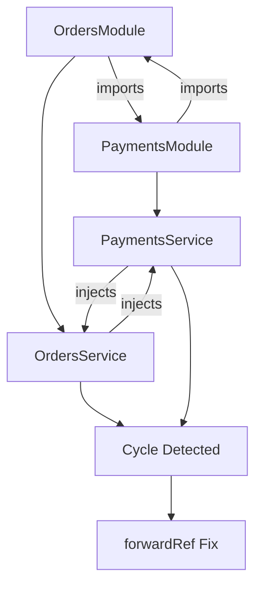

# Circular Dependencies: Why Two Modules Pointing at Each Other Break the Graph

## English

NestJS builds your application as a directed graph: every module declares what it imports, and every provider declares what it needs in its constructor. Most of the time this graph flows one way — a feature module imports a shared module, and nothing points back. But the moment Module A imports Module B and Module B also imports Module A, you have a cycle, and the framework has to decide which one to instantiate first. There is no correct answer, so at bootstrap NestJS throws an error telling you it cannot resolve the dependencies of one of the providers. This is not a bug in NestJS; it is a real design smell surfacing at runtime. The same thing happens at the provider level: Service X injects Service Y and Service Y injects Service X, and the dependency injection container cannot construct either one because each is waiting on the other.

The escape hatch is `forwardRef()`. Instead of writing `imports: [OtherModule]`, you write `imports: [forwardRef(() => OtherModule)]`, and in the provider constructor you write `@Inject(forwardRef(() => OtherService)) private other: OtherService`. The arrow function defers the reference until NestJS actually needs it, which breaks the chicken-and-egg problem at load time. NestJS then constructs one of them first with a placeholder and patches the reference afterwards. This works, but it is a bandage: the cycle is still there, you have just told the container to tolerate it. You will also find that the resulting code is harder to test in isolation, because you cannot instantiate one service without the other.

A concrete example: an `OrdersModule` needs to call a `PaymentsService` to charge a card, and `PaymentsService` needs to call back into `OrdersService` to mark an order as paid after a webhook. That is a genuine two-way conversation. The usual fix is not `forwardRef` but extracting the shared behaviour into a third module — say a `PaymentEventsModule` that both sides import one-way. Orders publishes an event, Payments subscribes to it, and the graph becomes a tree again. Event-driven decoupling is almost always better than a cycle, because cycles couple the lifecycle of two things that should not care about each other.

When you do reach for `forwardRef`, keep it local. Do not sprinkle it everywhere to silence errors — each one is a place where your architecture is telling you something. Look at the dependency and ask: does this really need to know about the other, or does it just need the result of an action? If it is the latter, an event emitter, a message queue, or a shared interface is the cleaner answer. Cycles also tend to grow: once you allow one, the next one is easier to justify, and eventually you have a knot that is impossible to bootstrap, test, or reason about.

Finally, watch out for cycles that hide inside barrel files. If `index.ts` in module A re-exports from module B, and `index.ts` in module B re-exports from module A, you can get a cycle that has nothing to do with `imports:` arrays — it is a plain JavaScript module resolution problem, and the symptom is often `undefined` at runtime instead of a clear NestJS error. Prefer importing from the concrete file rather than the barrel when you are inside the same feature, and keep barrel exports for the public surface of a module only.

## 中文

NestJS 會把你的應用程式建成一張有向圖：每個模組宣告它匯入什麼，每個 provider 宣告它的建構子需要什麼。大部分時候這張圖是單向流動的 —— 功能模組匯入共用模組，沒有東西指回去。但當模組 A 匯入模組 B，而模組 B 又匯入模組 A 的那一刻，你就有一個循環，而框架必須決定先實例化哪一個。這個問題沒有正確答案，所以啟動時 NestJS 會拋出錯誤，告訴你它無法解析其中一個 provider 的依賴。這不是 NestJS 的 bug，而是真實的設計氣味在執行期浮現。同樣的事也會發生在 provider 層：Service X 注入 Service Y，Service Y 又注入 Service X，依賴注入容器無法建構任何一個，因為兩者都在等對方。

逃生出口是 `forwardRef()`。你不要寫 `imports: [OtherModule]`，而是寫 `imports: [forwardRef(() => OtherModule)]`，並在建構子裡寫 `@Inject(forwardRef(() => OtherService)) private other: OtherService`。箭頭函式把引用延後到 NestJS 真正需要它的時候，這就打破了載入時的雞生蛋問題。NestJS 接著會先用佔位符建構其中一個，之後再補上引用。這可行，但它只是繃帶：循環仍然存在，你只是告訴容器去容忍它。你亦會發現，產生的程式碼更難獨立測試，因為你無法在不涉及另一個的情況下實例化其中一個 service。

一個具體例子：`OrdersModule` 需要呼叫 `PaymentsService` 去扣款，而 `PaymentsService` 在 webhook 之後又需要回呼 `OrdersService` 把訂單標記為已付款。這是真正的雙向對話。通常的修法不是 `forwardRef`，而是把共用行為抽到第三個模組 —— 例如一個 `PaymentEventsModule`，讓兩邊都單向匯入它。Orders 發佈事件，Payments 訂閱事件，圖就重新變成一棵樹。事件驅動的解耦幾乎總是比循環好，因為循環把兩件本應互不相干的東西的生命週期綁在一起。

當你真的要用 `forwardRef` 時，把它保持在局部。不要為了消滅錯誤就到處撒，每一個都是你的架構在告訴你一些事情。看看那個依賴並問：它真的需要認識對方，還是它只需要一個動作的結果？如果是後者，事件發射器、訊息佇列或共用介面會是更乾淨的答案。循環也會增長：一旦你允許一個，下一個就更容易被合理化，最終你會得到一個無法啟動、無法測試、無法推理的死結。

最後，要小心藏在 barrel 檔案裡的循環。如果模組 A 的 `index.ts` 從模組 B 再匯出，而模組 B 的 `index.ts` 又從模組 A 再匯出，你會得到一個與 `imports:` 陣列無關的循環 —— 那是純 JavaScript 模組解析問題，症狀通常是執行期出現 `undefined`，而不是清晰的 NestJS 錯誤。在同一功能內，盡量從具體檔案匯入而不是從 barrel 匯入，並把 barrel 匯出保留給模組的公開介面。

## Key Takeaway

Circular dependencies are a design signal, not just a compile error — prefer extracting shared behaviour or using events over papering over the cycle with forwardRef.

## Related Concepts
- forwardRef and deferred resolution
- Event-driven decoupling with @nestjs/event-emitter

## Diagram

